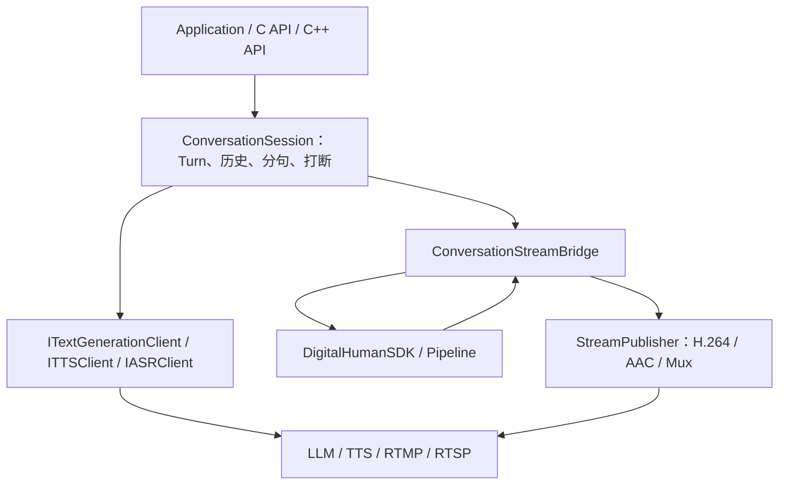
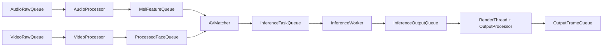
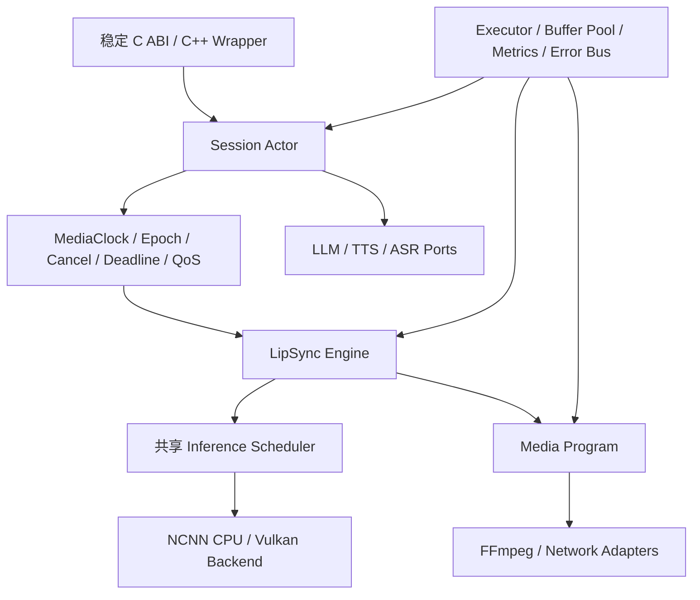

# 系统架构设计

## 1. 90 秒架构回答

项目分成会话编排、服务适配、数字人核心和媒体发布四层。ConversationSession 调用外部 LLM 和 TTS，把增量文本分句并转换为 PCM。核心 Pipeline 使用 5 个 worker 和 7 级有界队列并行处理音频特征、人脸、音视频匹配、ncnn 推理和渲染。ConversationStreamBridge 把同一份 TTS PCM 一路送入 SDK 驱动口型，一路送入 Publisher 作为音轨；渲染 BGR 则编码为 H.264，PCM 编码为 AAC，最后通过 FFmpeg 输出 RTMP、RTSP 或文件。模块间通过接口和数据包通信，但时间线、取消、错误监督与跨语言 ABI 仍是下一步重点。

## 2. 分层与依赖

理想依赖方向是：业务和适配器依赖核心接口，核心不依赖具体 HTTP、FFmpeg 或服务实现。

当前构建把 `dh_avatar`、`dh_dialog`、`dh_network`、`dh_http`、`dh_media`、`dh_audio_io`、`dh_audio_loader` 和 `dh_runtime` 等内部 STATIC target 合入一个 `digital_human_core` SHARED facade。定义见 [`src/CMakeLists.txt`](../../src/CMakeLists.txt)。

## 3. 核心数据流

七级队列包括两个原始输入队列、两个预处理结果队列、推理任务队列、推理输出队列和最终帧队列。普通核心 Push 以阻塞反压为主；Publisher 才明确使用“视频丢旧、音频限时等待”的实时策略。

## 4. 线程模型

| 范围 | 线程/Worker | 数量 |
|---|---|---:|
| ConversationSession | Generation、TTS、Audio Feeder、Video Feeder | 4 |
| Pipeline | Audio、Video、Matcher、Inference、Render | 5 |
| Bridge | SDK 输出读取 | 1 |
| Publisher | 编码、交织、写包 | 1 |

完整实时闭环约 11 条后台线程。文件处理模式额外创建临时音频和视频 producer，由调用线程读取输出。

线程启动顺序以“下游先准备”为原则，停止则先阻止新输入，再让上游结束并传播 EOS/取消，最后等待下游排空或停止。

## 5. 数据包与完成语义

核心包头包含 PTS、序号、状态和阶段耗时。特殊状态包括：

- EOS：上游不会再产生正常数据；
- FATAL：当前链路不能继续；
- SKIP：该数据因策略被跳过；
- 正常包：携带 payload 和时间信息。

空队列不等于 EOS。消费者暂时拿不到数据，可能只是上游仍在计算。结束必须由显式 terminal packet 或受保护状态确认，否则短音频特别容易“只有音频没有视频”。

## 6. 实时与离线模式

| 维度 | 离线文件 | 实时会话 |
|---|---|---|
| 目标 | 完整性、可重复 | 低延迟、持续性 |
| 输入 | 文件可提前读取 | 网络和 TTS 增量到达 |
| 过载 | 可适度阻塞 | 视频应丢旧或跳过过期任务 |
| 结束 | 文件 EOS | 每轮结束与会话 Stop 要区分 |
| 时钟 | 可按媒体内容推进 | 需保持会话级单调时间线 |

## 7. 生命周期状态

对外 SDK 使用 Init、Start、Pause、Resume、Stop 等状态。设计状态机的原因是避免多个 bool 组合成矛盾状态，并让非法调用可预测。

需要区分三类事件：

1. 自然结束：输入 EOS，允许下游排空并输出尾帧；
2. 用户取消：尽快停止旧任务，不保证完整输出；
3. 故障停止：传播错误并解除所有阻塞点。

所有子系统应共享同一个绝对 deadline，而不是每一层重新等待完整 timeout。

## 8. 当前设计亮点

- 服务适配接口隔离具体 LLM/TTS；
- 有界队列把反压变成显式策略；
- face-driven Matcher 避免按高频 Mel 产生过多推理任务；
- 静态头像缓存和 ROI 渲染减少重复计算；
- C++ facade 使用 Pimpl，C API 使用 opaque handle；
- Publisher 复用 FFmpeg 完成编码、交织和多协议输出。

## 9. 当前架构债务

- dialog 模块中的 SDKDigitalHumanSink 形成了对 facade 的反向依赖，whole-archive 掩盖了边界问题；
- 整个 `include/` 被安装，内部头和第三方类型进入了事实公共面；
- Pause 没有成为所有 worker 的共享 gate；
- MediaClock、turn epoch、取消和 Flush 还没有贯穿全链路；
- 每会话约 11 线程，多会话会造成线程和模型实例膨胀；
- worker ERROR 缺少统一 supervisor/error bus；
- C API 尚不能完成独立的输入到输出闭环。

## 10. 推荐演进架构

核心变化：会话状态用 actor/strand 串行化；模型和推理调度按设备共享；所有包携带 session、turn epoch、PTS 和 deadline；媒体时钟、取消和错误成为控制面，而不是分散在各模块中的 bool。

## 11. 高频追问

### 为什么使用流水线，而不是全部同步执行？

各阶段耗时和抖动不同，流水线能并行并隔离抖动，还能分别采集指标。代价是必须定义所有权、反压、EOS、取消和时间线。

### 为什么不是线程越多越好？

ncnn、OpenMP 和 OpenCV 内部也会使用线程。外部 worker 与内部线程池过度订阅会增加切换和 barrier 等待，多会话时尤其明显。

### 如果要支持 100 路会话怎样改？

不能简单复制 100 套 11 线程和模型实例。需要共享 I/O executor、按设备共享模型与推理调度、设置容量准入、按 deadline 丢弃过期任务，并隔离每会话状态和媒体时间线。

### 为什么 C API 更适合作为稳定 ABI？

C ABI 使用固定宽度 POD、opaque handle 和显式版本，不受 C++ 名字修饰、STL、异常和不同编译器对象布局的直接影响。

