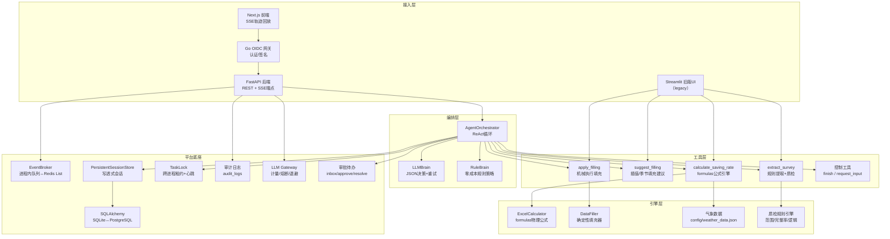
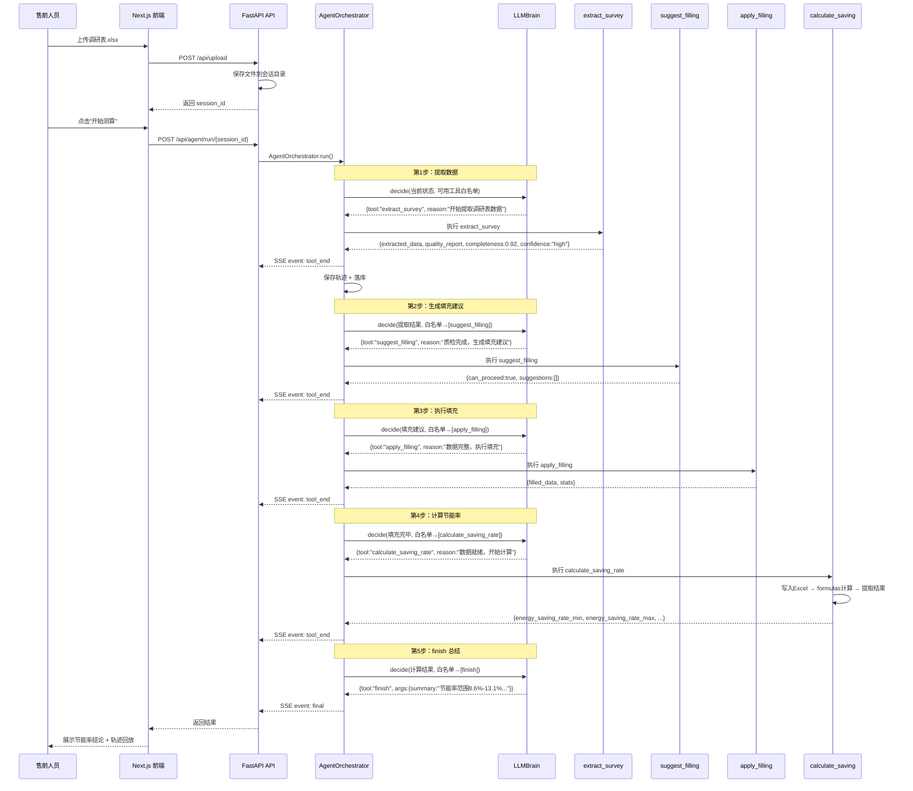
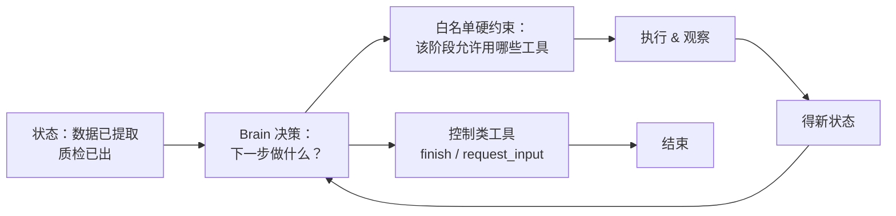
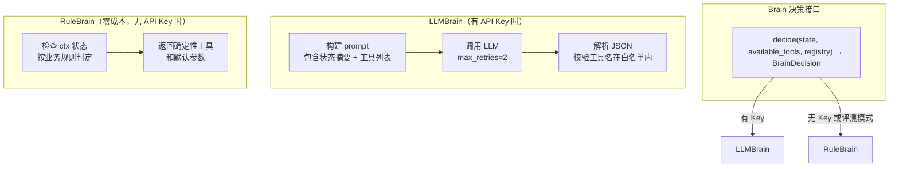
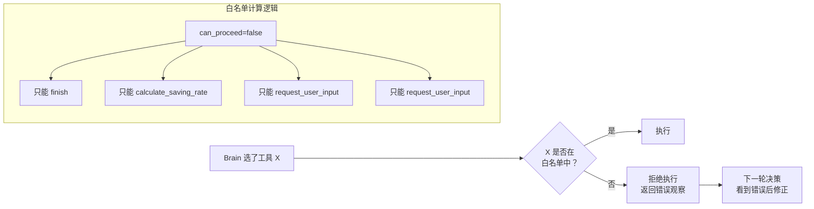
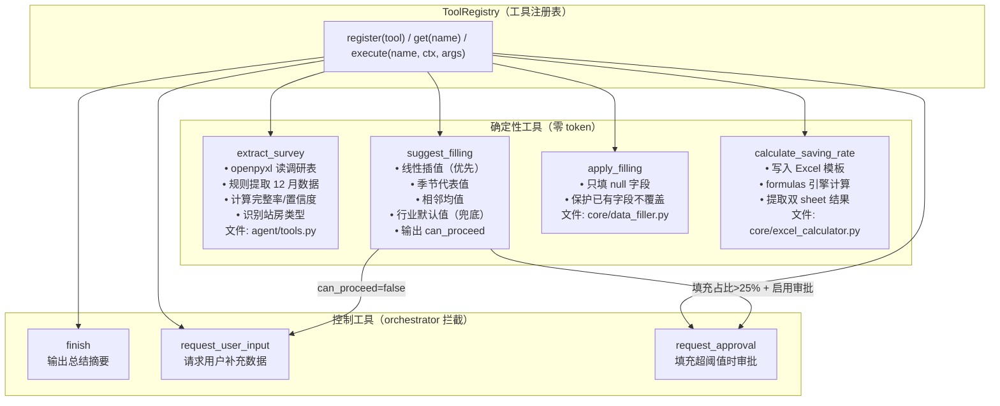
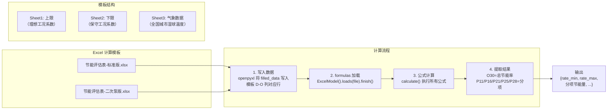
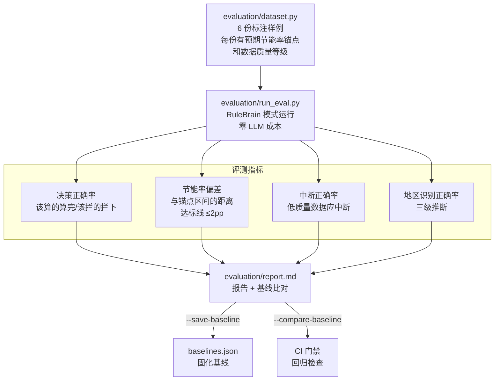
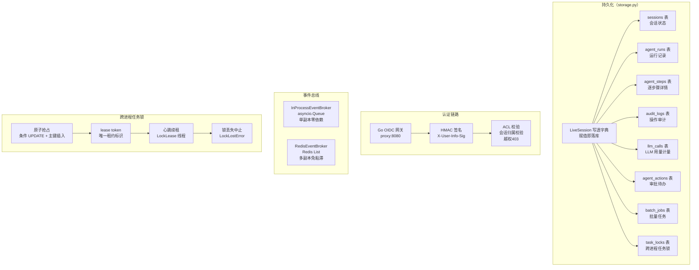

# 项目架构拆解与简历条目

> 基于源码与项目文档（README.md / ARCHITECTURE.md / AGENTS.md）整理，所有数据真实可溯源。
> 核心源码位置见文末"关键代码索引"。

***

## 1. 项目简介

**HVAC Energy Agent —— 暖通节能率智能测算 Agent**：面向中央空调节能改造售前场景的领域 Agent 平台。上传客户调研表后，Agent 在硬约束护栏内自主编排"提取 → 质检 → 填充 → 计算 → 结论"完整测算流程，输出可回归验证的节能率结论；数据质量不达标时自主中断并说明缺失项，拒绝硬算不可信结果。

### 1.1 业务场景

中央空调节能改造售前环节的三个痛点：

- **响应慢**：拿到调研表后人工测算以天计

- **数据脏**：调研表由客户手填，缺月、错值、季节性范围值（如"16\~20"）比比皆是

- **不标准**：节能率测算依赖个人经验，报价口径不统一

### 1.2 业务线

| 业务线           | 状态        | 说明                           |
| ------------- | --------- | ---------------------------- |
| 空调节能率测算（主线）   | ✅ Agent 化 | 自研 ReAct 编排 + 质量门禁 + 轨迹可观测   |
| 空压机节能测算       | ✅ 可用      | LLM 非结构化字段提取（Excel/Word/PPT） |
| 冷站全年 8760h 仿真 | ✅ 可用      | Agent 动态生成仿真代码并自检自愈          |
| 标准能管报价生成      | ✅ 可用      | LLM 语义冲突检测（调研表 × 价格目录）       |

<br />

- **确定性引擎才是内核**：数据提取、质检、填充、节能率计算全部是确定性函数，零 token

- **Agent 只是外壳**：负责"理解当前状态并规划"（下一步调哪个工具）+ 面向用户的中文叙事

- **Agent 可被替换，甚至不需要 LLM**：Brain 双实现（LLMBrain / RuleBrain），无 API Key 时自动降级为零成本规则策略，评测结果逐字节可复现

- **一句话原则**："算得准的交给公式，看得懂的交给模型；凡是进入报价的数字，必须来自确定性引擎"

定位：**"有边界的自主性"——自主编排 + 硬约束护栏 + 结果可回归验证**。

***

## 2. 后端结构分析

### 2.1 是否前后端分离 —— 是

| 端  | 技术                                               | 位置         |
| -- | ------------------------------------------------ | ---------- |
| 前端 | Next.js 16 + React 19（BFF 模式，`/api` rewrites 转发） | `apps/web` |
| 后端 | FastAPI（REST + SSE 事件流）                          | `apps/api` |
| 网关 | Go Gin OIDC 认证网关（生产拓扑唯一入口）                       | `proxy`    |

生产拓扑：浏览器 → proxy:8080 → web:3000 → api:8000

### 2.2 数据库 —— 有

- **SQLAlchemy**，开发默认 SQLite（`data/app.db`），生产 PostgreSQL，靠 `DATABASE_URL` 一键切换（代码零改动）

- 8 张业务表：`sessions` / `agent_runs` / `agent_steps` / `audit_logs` / `llm_calls` / `agent_actions` / `batch_jobs` / `task_locks`

- Alembic 迁移管理

### 2.3 消息队列 —— 有，但为自研轻量实现（非 Kafka/RabbitMQ）

`apps/api/events.py` 的 EventBroker 抽象：

- **默认**：进程内 `asyncio.Queue`（单副本零依赖）

- **配置** **`REDIS_URL`** **后**：Redis List 实现 FIFO 队列（LPUSH + BRPOP + EXPIRE 兜底），刻意不用 Pub/Sub（不缓冲、迟到订阅丢事件）

- 无 Celery/Kafka 任务队列，后台任务 = 线程 + 数据库任务锁

### 2.4 缓存 —— 无独立缓存层

- 唯一"缓存"是进程内 `_live` dict（写透式 LiveSession），见 `storage.py`

- **Redis 运行态缓存为 M2 演进项**（明确标注为已知缺口，非生产缓存）

### 2.5 分布式文件系统 —— 无（显式裁剪决策）

- 会话产物（调研表/结果 Excel）存本地卷 `tmp/session_*/`，由 `SessionManager` 管理

- 明确决策：暂不引入 MinIO/S3（内网几十 GB 规模本地卷足够），但已预留 S3SessionManager 替换路径

### 2.6 已有的分布式元素

1. **跨进程任务锁**：`TaskLock` 表 + lease token 原子抢占 + 心跳续租（`lock_lease.py`），锁丢失时协作式中止
2. **事件总线 Redis 模式**：多副本 SSE 无需网关粘滞路由

**整体定位**：单副本可靠优先，多副本能力预留。

***

## 3. 简历条目（数据全部可溯源）

**智能测算 Agent 平台 —— 中央空调节能率智能测算系统** | 从 0 到 1 独立设计与开发
（时间跨度：__至__）

**项目简介：** 面向中央空调节能改造售前的领域 Agent 平台：上传客户调研表后，Agent 自主编排"提取 → 质检 → 填充 → 计算 → 结论"完整测算流程，输出可回归验证的节能率结论；数据质量不达标时自主中断并说明缺失项，拒绝硬算不可信结果。

**核心工作：**

1. **自研 ReAct Agent 编排内核**（`agent/`，未依赖现成框架）：实现"决策→执行→观察→再决策"主循环；Brain 双实现（LLMBrain JSON 强约束决策 + 失败重试 / RuleBrain 零成本规则策略）；通过工具白名单、前置依赖、质量门禁（完整率<50% 或站房类型不支持→强制转人工）、连续失败熔断、步骤预算（默认 10 步）等硬约束护栏在代码层强制执行，模型无法绕过
2. **LLM 与传统代码的决策边界设计**：节能率计算精度要求 ≤2%，数据提取、质检、缺失填充、Excel 公式计算全部实现为确定性工具（零 token）；LLM 仅用于阶段决策与面向用户的中文叙事，单次完整测算仅 3\~5 次小额决策调用，工具执行零 token
3. **Agent 可观测性**：每步落盘完整轨迹（决策理由/工具观察/耗时/token 用量 → agent\_trace.json），FastAPI SSE 实时推流，Next.js 前端逐帧回放 agent 思考-行动-观察过程
4. **回归评测体系**（`evaluation/`）：6 份标注样例调研表为评测集（文件名自带预期节能率锚点），量化流程决策正确率、节能率偏差、低质量数据中断率、地区识别率；支持基线固化与回归比对；评测模式零 LLM 成本、逐字节可复现
5. **企业级平台底座**：SQLAlchemy 持久化（SQLite/PostgreSQL 双兼容零改动切换，8 张业务表）；网关注入身份头 + HMAC 签名的认证与 ACL；Agent 运行逐步骤落库的断点恢复；全链路审计；LLM 网关计量（日 token 预算/熔断/退避重试）；Human-in-the-loop 待办闭环（数据不达标→求助待办，审批后断点恢复）；批量测算；跨进程任务锁（租约 token + 心跳续租防多副本并发写）；SSE 事件总线（Redis List 实现，多副本免粘滞路由）

**量化成果（评测集：6 份标注样例）：**

- 流程决策正确率（该算的算完/该拦的拦下）：**100%（6/6）**

- 低质量数据中断正确率：**2/2**

- 地区识别正确率（三级推断）：**100%**

- 节能率与人工锚点偏差：**平均 1.97pp，最大 5.42pp**（达标线 ≤2pp，2/4 达标——诚实披露：此为已知精度限制，并非全部达标）

- 单次完整测算 LLM 成本：4 次选工具 + 1 次总结 = 5 次决策调用；评测/无 Key 模式 = 0（RuleBrain）

**技术栈：** Python 3.10+ / FastAPI + SSE / SQLAlchemy / PostgreSQL / SQLite / Redis / formulas 公式引擎 / pandas / openpyxl / Next.js 16 + React 19 / Go Gin（OIDC 网关）/ pytest / Alembic / Docker Compose / GitHub Actions CI

### 3.1 浓缩版

> **智能测算 Agent 平台**：自研 ReAct 编排内核（决策/工具/硬约束护栏三分离，Brain 双实现：LLM 决策 + 零成本规则降级），确定性工具执行零 token，单次测算 LLM 成本仅 3\~5 次决策调用；配 SSE 逐帧轨迹回放与 6 份标注样例的回归评测体系（决策正确率 100%）；下接 SQLite/PostgreSQL 双兼容持久化、断点恢复、审计、HITL 审批闭环、Redis 事件总线。技术栈：FastAPI·Formulas·Next.js·Go·Docker。

### 3.2 面试应答要点

| 可能的质疑                         | 回击方式                                                                                      |
| ----------------------------- | ----------------------------------------------------------------------------------------- |
| "LLM 占比太低，Agent 只是壳"          | 反向立论：**Decision boundary 是 agent 工程的核心设计问题**，故意把计算隔离出 LLM 是防幻觉的正确决策，定位是"ReAct 编排的可信计算流水线" |
| "用现成 SDK 还是自己写的？"             | 核心 ReAct 是自研（brain/orchestrator/tools），claude-agent-sdk 只在空压/仿真两条辅线用                      |
| "为什么又要 claude-agent-sdk 又要自研" | 承认这是演进中的已知缺口，说明"统一编排"已在路线图                                                                |
| "前台/评测都是脚本+UI，不算工程化"          | 强调 FastAPI + SSE + SQLAlchemy + Docker + CI 门禁，工程化核心在 apps/api 与部署层                       |

***

## 4. 项目模块拆分与架构图

### 4.0 五层架构总览

```
┌──────────────────────────────────────────────────────────────────┐
│                        接入层（Access Layer）                      │
│  Next.js 16 前端 · Go OIDC 网关 · FastAPI SSE 端点 · Streamlit   │
├──────────────────────────────────────────────────────────────────┤
│                        编排层（Orchestration Layer）               │
│  AgentOrchestrator: ReAct 循环 · 白名单硬约束 · 熔断 · 步数预算   │
│  Brain: LLMBrain（JSON决策）│ RuleBrain（零成本规则策略）          │
├──────────────────────────────────────────────────────────────────┤
│                        工具层（Tool Layer）                        │
│  ToolRegistry: extract_survey → suggest_filling → apply_filling  │
│  → calculate_saving → finish / request_user_input / request_…  │
│  每一个工具都是确定性函数，零 token，可通过 JSON Schema 描述       │
├──────────────────────────────────────────────────────────────────┤
│                        引擎层（Engine Layer）                      │
│  Excel 公式引擎（formulas库）· DataFiller 机械填充 · 规则提取/质检  │
│  气象数据 · 物理公式（COP、泵相似定律 frequency^2.5）               │
├──────────────────────────────────────────────────────────────────┤
│                    平台底座（Platform Layer）                      │
│  SQLAlchemy 持久化 · 认证ACL · 审计 · 任务锁 · 事件总线 · 文件管理  │
│  LLM 网关计量 · Human-in-the-loop 待办 · 批量测算 · 历史测算库     │
└──────────────────────────────────────────────────────────────────┘
```

**为什么分层**：每层只干自己的事，改一层不影响其他层（如把引擎从 formulas 换成 Excel COM，编排层零改动）。

### 4.1 核心模块关系图



### 4.2 一次典型请求的旅程（动态流程：上传齐全调研表顺利跑完）



**关键源码对应**：

- 主循环入口：`agent/orchestrator.py:105` `run()`

- 决策调用：`agent/orchestrator.py:130` `self.brain.decide()`

- 白名单计算：`agent/orchestrator.py:230` `_allowed_tools()`

- 工具执行：`agent/orchestrator.py:190` `self.registry.execute()`

- LLM 决策：`agent/brain.py:67` `LLMBrain.decide()`

### 4.3 模块 1：编排层 —— AgentOrchestrator + Brain

**ReAct 循环（不硬编码流程的原因：调研表质量参差不齐，Agent 需自行判断能否继续）**



**Brain 双实现（LLM 不是必须的）**



**白名单硬约束（模型无法绕过）**



核心代码：`agent/orchestrator.py:230` `_allowed_tools()`

> 小结：编排层 = ReAct 循环 + Brain 双实现 + 白名单硬约束。"自主性有边界，结果才可信。"

### 4.4 模块 2：工具层 —— ToolRegistry + 确定性工具



**为什么工具注册成统一 JSON Schema**：LLM 决策时看到的不是函数而是紧凑描述（`{"tool": "...", "description": "...", "parameters": {...}}`），只需在很小的"选工具名 + 填参数"空间决策，大幅降低输出错误 JSON 的概率。

> 小结：工具层 = 4 个确定性工具 + 3 个控制工具，统一注册，零 token 执行。LLM 只决定"选哪个"，不参与"怎么做"。

### 4.5 模块 3：引擎层 —— Excel 公式引擎 + 双 Sheet 计算



**为什么用 Excel 模板计算而非写死公式**：物理公式（COP、泵相似定律 `frequency^2.5`、冷却塔 1.5%/℃）由领域专家在 Excel 里维护，不需要懂代码——改公式 = 改模板，不改代码。

**双 Sheet 机制**：结构相同、系数不同，输出节能率范围（如 8.6% - 13.1%），给售前报价留合理区间。

核心代码：`core/excel_calculator.py` → `_calculate_with_formulas()`

> 小结：引擎层 = Excel 模板 + formulas 库，物理公式与代码完全解耦，由领域专家维护。

### 4.6 模块 4：评测体系 —— evaluation/



**为什么一定要评测**：Agent 改一个逻辑后，需要自动确认没把之前算对的 case 搞坏。评测体系让 CI 自动跑，0 token 成本。

**诚实原则**：报告列明未达标 case 与根因，不藏分（如"最大偏差 5.42pp 来自行业默认值填充与人工口径差异"）。

### 4.7 模块 5：平台底座 —— 持久化/认证/事件总线/任务锁



**关键设计决策**：

- **写透式会话**：`LiveSession` 重写 `__setitem__`，赋值即落库，业务代码写 `s["result"] = {...}` 即写库

- **数据库切换零改动**：`DATABASE_URL` 切换 SQLite ↔ PostgreSQL

- **事件总线双实现 + 刻意不用 Pub/Sub**（不缓冲，迟到订阅丢事件）

- **任务锁四要素**：原子抢占 / lease token 防误删 / 心跳续租防死锁 / 锁丢失协作式中止

> 小结：平台底座 = 写透持久化 + 认证 ACL + 事件总线 + 任务锁 + 审计。单副本零依赖可跑，多副本能力已预留。

### 4.8 核心概念逐个击破

**概念 1：决策边界（Decision Boundary）**

- **它是什么**：每个环节明确执行者——LLM 还是确定性代码

- **没有它会怎样**：v1 早期版本每个阶段都起完整 claude-agent-sdk 会话（包括纯规则脚本），为"执行一条 python 命令"付一整个 agent 会话的钱

- **本项目**：提取/计算走规则与公式引擎（零 token），选工具+写总结走 LLM；防幻觉、结果可复现

**概念 2：硬约束护栏（Hard Guardrails）**

- **它是什么**：代码层强制执行的规则，LLM 不可能绕过

- **没有它会怎样**：LLM 可能数据不达标硬算、跳过质检直接填充

- **本项目**：`_allowed_tools()` 按状态算白名单；完整率<50% 时白名单只剩 `request_user_input`

**概念 3：断点恢复（Hydrate from Session）**

- **它是什么**：每步落库，进程重启后从断点续跑，不重复计算已完成步骤

- **没有它会怎样**：长测算跑到一半重启，一切重来，浪费时间与 token

- **本项目**：各工具将产物写为标准文件名，`hydrate_from_session()` 恢复状态，`start_step` 定位续跑点，步号与 token 累计不重置

***

## 5. 能力边界清单（诚实披露）

| 边界          | 事实                                                                              |
| ----------- | ------------------------------------------------------------------------------- |
| **精度**      | 节能率与人工锚点平均偏差 1.97pp、最大 5.42pp，**未全部达到 ≤2pp 标准**（2/4 达标）；根因是行业默认值填充参数需业务校准（已知缺口） |
| **多副本**     | 会话写缓存为进程内 dict，多 worker 需网关粘滞路由；Redis 运行态缓存**未实现**（M2 演进项）                      |
| **缓存/文件系统** | 无独立缓存层；无分布式文件系统——会话产物存本地卷，S3 迁移路径已预留但未实施                                        |
| **业务线编排**   | 空压提取、冷站仿真仍为独立 claude-agent-sdk 会话，**未并入**统一 orchestrator（README 明确列为已知缺口）       |
| **存储规模**    | 多用户会话存储为 POC 级（进程内写缓存），生产多副本需换 Redis/分布式存储                                      |
| **不做的事**    | 未涉及模型训练/微调，纯 LLM 应用编排，不适用于纯算法岗                                                  |

***

## 6. 关键代码索引

| 组件                  | 位置                                           |
| ------------------- | -------------------------------------------- |
| ReAct 循环与白名单        | `agent/orchestrator.py`                      |
| LLM 决策 + JSON 强约束重试 | `agent/brain.py::LLMBrain`                   |
| 零成本规则策略             | `agent/brain.py::RuleBrain`                  |
| 工具注册表与确定性 handler   | `agent/tools.py`                             |
| 轨迹记录                | `agent/trace.py`                             |
| 写透式会话存储             | `apps/api/storage.py`                        |
| 事件总线（进程内/Redis）     | `apps/api/events.py`                         |
| 跨进程任务锁              | `apps/api/lock_lease.py`                     |
| SSE 端点              | `apps/api/routers.py`                        |
| token 用量统计          | `core/llm_client.py`                         |
| Excel 公式引擎          | `core/excel_calculator.py`                   |
| 评测入口                | `evaluation/run_eval.py`                     |
| 前端轨迹回放              | `apps/web/src/components/AgentTraceView.tsx` |

