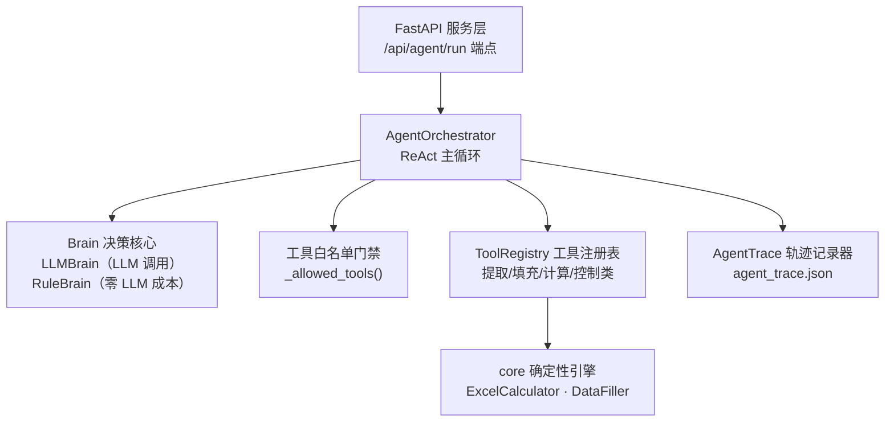
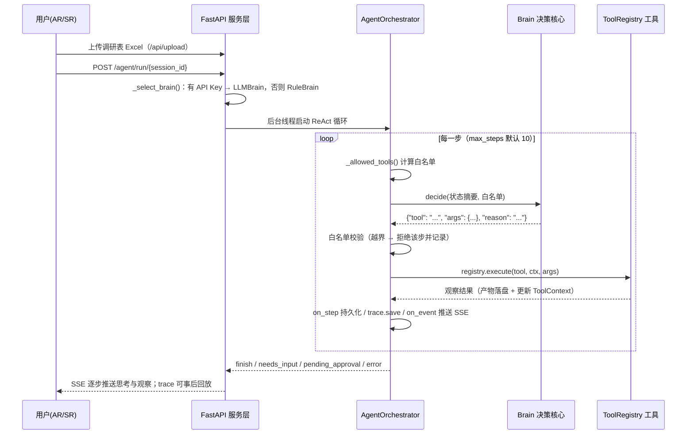

# 项目核心代码说明：暖通节能率智能测算 Agent

> **项目全称**：HVAC Energy Agent — 暖通节能率智能测算 Agent
> **定位**：面向中央空调/空压机节能改造售前场景的领域 Agent。输入一份客户调研表（Excel），系统在硬约束护栏内自主编排"数据提取 → 质量检查 → 缺失填充 → 物理公式测算 → 结论输出"的完整流程；数据质量不达标时中断流程并说明缺失项，而非输出不可信的计算结果。

---

**目录**

- [0. 阅读须知：工程根目录与路径约定](#0-阅读须知工程根目录与路径约定)
- [1. 设计原则：LLM 与传统代码的职责边界](#1-设计原则llm-与传统代码的职责边界)
- [2. 解决的问题与设计动因](#2-解决的问题与设计动因)
- [3. 系统架构总览](#3-系统架构总览)
- [4. 一次测算请求的执行流程](#4-一次测算请求的执行流程)
- [5. 核心模块源码解析](#5-核心模块源码解析)
- [6. 关键设计决策汇总](#6-关键设计决策汇总)
- [7. 后续深入方向](#7-后续深入方向)
- [附录 A：核心文件速查表](#附录-a核心文件速查表)

---

## 0. 阅读须知：工程根目录与路径约定

本仓库的**工程根目录**为三层嵌套路径：

```
E:\contion simulation\
├── conditioner_saving\conditioner_saving\conditioner_saving\   ← ★ 工程根目录（下文所有路径相对这里）
│   ├── agent/            # Agent 核心：编排器 / 决策核心 / 工具注册表 / 轨迹记录
│   ├── core/             # 确定性业务引擎：Excel 公式引擎、数据填充器、LLM 网关
│   ├── apps/api/         # FastAPI 后端（/agent/run 端点、SSE、持久化、认证）
│   ├── apps/web/         # Next.js 16 前端（SSE 订阅 agent 轨迹）
│   ├── .claude/skills/   # 提取/填充等纯 Python 脚本（被工具以子进程调用）
│   ├── evaluation/       # 回归评测（6 份标注样例，RuleBrain 模式零 LLM 成本可复现）
│   └── ...
├── architecture/                        # 可视化架构讲解页（HTML）
├── 标准能管5项目模拟测试包_20260807/    # 5 个模拟客户项目的测试数据
└── .test_deps/                          # 测试依赖（FastAPI / SQLAlchemy / pytest 等）
```

文中 `文件:行号` 均相对工程根目录，可直接跳转对照源码。

---

## 1. 设计原则：LLM 与传统代码的职责边界

整个系统的设计围绕一条核心边界展开（见 `agent/orchestrator.py:1-13` 模块文档与 README）：

| 职责类别 | 承担者 | 具体内容 |
|---|---|---|
| **软决策** | LLM（LLMBrain） | 在白名单内选择下一个工具；每步生成面向业务用户的叙事；最终结论摘要 |
| **确定性执行** | 纯 Python 函数（工具 handler） | 数据提取、质量检查、插值填充、Excel 公式计算——执行阶段零 token 消耗 |
| **硬约束** | 编排器代码（强制，模型不可绕过） | 工具白名单前置依赖、质量门禁（完整率 <50% 拦截、unsupported 站房拦截、不可填充字段拦截）、步骤预算（默认 10 步）、连续失败熔断（3 次） |

三个推论：

1. **LLM 成本只发生在决策点**。一次测算约 3~5 次小额 LLM 调用（每次 `max_tokens=800`，见 `agent/brain.py:74`），工具执行本身零 token。
2. **自主性有边界**。白名单在决策之前由代码计算并传入（`agent/orchestrator.py:123`），即使模型幻觉输出白名单外的工具名，主循环还有第二道拦截（`agent/orchestrator.py:147-159`）。
3. **结果可回归验证**。切换到 RuleBrain（确定性规则策略）后整条链路不含任何 LLM 调用，输出逐字节可复现，因此回归评测可在 CI 中零成本运行。

---

## 2. 解决的问题与设计动因

中央空调节能改造售前环节的三个业务痛点：

| 痛点 | 具体表现 |
|---|---|
| **响应慢** | AR（销售）拿到客户调研表后，SR（解决方案专家）人工测算一份方案以天计 |
| **数据脏** | 调研表由客户手填：缺月、错值、季节性范围值（如"16~20"）普遍存在 |
| **口径不统一** | 节能率测算依赖个人经验，报价口径不一致 |

两类既有方案的缺陷，构成本项目的设计动因：

1. **纯人工流程**——慢、口径依赖个人经验、无法批量。
2. **端到端 LLM 方案**——节能率精度要求 ≤2%，LLM 直接参与数值计算无法满足精度要求，且相同输入无法保证相同输出（不可回归测试）。此外 LLM 倾向于"努力完成任务"，面对残缺数据也会给出看似完整的结果，这在报价场景下是不可接受的风险。

因此本项目的架构选择是：**LLM 只承担工具选择与叙事生成两类低风险任务；所有数值计算由确定性函数完成；数据质量的最低门槛由代码强制执行**。README 中的表述："LLM 只花在决策与叙事上，计算交给确定性物理公式引擎，偏差可回归验证。"

---

## 3. 系统架构总览



| 模块 | 职责 | 源码入口 |
|---|---|---|
| FastAPI 服务层 | 接收上传与运行请求、按环境选择 Brain、后台线程执行、SSE 推送事件、持久化与断点恢复 | `apps/api/routers.py:1393`、`apps/api/agent_service.py` |
| AgentOrchestrator | ReAct 主循环：决策 → 白名单校验 → 执行 → 观察 → 再决策，直到 finish / 求助 / 预算耗尽 | `agent/orchestrator.py:44` |
| Brain 决策核心 | 统一接口 `decide(state, available_tools, registry)` 的两种实现 | `agent/brain.py:32` |
| 白名单门禁 | 根据当前状态计算"当前允许调用的工具集合"及门禁说明 | `agent/orchestrator.py:230` |
| ToolRegistry | 将确定性函数包装为带 JSON Schema 的工具；控制类工具由编排器拦截 | `agent/tools.py:65` |
| core 确定性引擎 | ExcelCalculator（`formulas` 库求解模板公式，双 sheet 上下限）、DataFiller（机械填充） | `core/excel_calculator.py`、`core/data_filler.py` |
| AgentTrace | 逐步记录工具、参数、理由、观察、耗时、token 用量，落盘 `agent_trace.json` | `agent/trace.py:18` |

辅助设施（M1~M3 平台底座）：LLM 网关（计量/日预算/熔断，`core/llm_gateway.py`）、任务锁租约（`apps/api/lock_lease.py`）、审计与待办（`apps/api/models.py`、`apps/api/routers.py` 的 `/api/inbox`）。

---

## 4. 一次测算请求的执行流程



**正常路径共 6 步**（RuleBrain 视角的标准序列，`agent/brain.py:155-218`）：

```
extract_survey      提取调研表数据 + 质量检查（子进程运行 .claude/skills 脚本）
  → suggest_filling   规则引擎生成缺失数据填充建议（线性插值/季节代表值/行业默认值）
    → apply_filling     DataFiller 机械执行填充，生成 filled_data.json
      → calculate_saving_rate  ExcelCalculator 双 sheet 公式求解节能率上下限
        → finish            输出面向用户的结论摘要
```

**异常路径**：任一门禁不满足时，白名单收缩为 `["request_user_input"]`，流程中断并返回缺失项清单；填充占比超阈值时白名单收缩为 `["request_approval"]`，流程暂停等待人工审批，批准后从断点续跑。

---

## 5. 核心模块源码解析

### 5.1 AgentOrchestrator：ReAct 主循环

**职责**：实现"决策（Brain）→ 执行（ToolRegistry）→ 观察 → 再决策"循环，直至 finish / request_user_input / 触发预算限制。见 `agent/orchestrator.py:105-226`（有删节）：

```python
def run(self) -> Dict[str, Any]:
    if self.brain is None:
        self.brain = RuleBrain()                     # 未指定决策核心时降级为零成本策略

    for step_no in range(self.start_step, self.start_step + self.max_steps):
        if self.abort_check is not None:
            self.abort_check()                       # 任务锁租约易主 → 抛 LockLostError 协作式中止

        allowed, gate_note = self._allowed_tools()   # 硬约束：计算当前白名单
        state_view = self._state_view()              # 生成给决策模型的紧凑状态摘要
        decision = self.brain.decide(state_view, allowed, self.registry)   # 软决策

        # 硬约束兜底：决策越出白名单一律拒绝（防模型幻觉/越权）
        if decision.tool not in allowed:
            observation = {"error": f"工具 {decision.tool!r} 不在当前可用白名单 {allowed} 中"}
            self.trace.end_step(False, observation)
            self._notify_step(); self.trace.save(self.session_dir)
            continue                                 # 拒绝该步但循环继续，错误信息经状态视图回传

        # 控制类工具：终止循环
        tool = self.registry.get(decision.tool)
        if tool is not None and tool.control:
            if decision.tool == "finish":
                status, summary = "completed", decision.args.get("summary", "测算完成")
                extra["result"] = self.ctx.get("result")
            elif decision.tool == "request_approval":
                status, summary = "pending_approval", ...   # Human-in-the-loop 审批暂停
            else:  # request_user_input
                status, summary = "needs_input", ...        # 请求用户补充数据
            break

        # 确定性工具：执行并观察（执行零 token）
        try:
            observation = self.registry.execute(decision.tool, self.ctx, decision.args)
            self.trace.end_step(True, observation)
            consecutive_errors = 0
        except Exception as e:
            observation = {"error": f"{type(e).__name__}: {e}"}
            self.trace.end_step(False, observation)
            consecutive_errors += 1

        self._notify_step()                          # 步骤持久化回调（供断点恢复）
        self.trace.save(self.session_dir)            # 轨迹每步落盘

        if consecutive_errors >= 3:                  # 连续失败熔断
            status, summary = "error", f"工具连续失败 {consecutive_errors} 次，中止运行"
            break
```

**设计要点**：

1. **双重约束**：白名单在 `decide()` 之前计算并作为参数传入，模型只能在白名单内选择；主循环内再做一次越权校验（`orchestrator.py:147`）。两层防御的原因：前者降低幻觉概率，后者保证即使模型违规也不产生实际副作用。
2. **被拒绝的步骤同样落库**（`orchestrator.py:155-158`）：token 用量以数据库为权威计量口径，跳过记录会漏计该次决策的消耗。
3. **断点恢复机制**：每个确定性工具把产物写入会话目录的标准文件名（`_STATE_FILES`，`orchestrator.py:31-37`），状态循环完全由 `ToolContext` 驱动，因此恢复 = 重新读入产物文件（`hydrate_from_session`，`orchestrator.py:84-101`），不重复计算已完成步骤。
4. **事件回调故障隔离**：`_emit` / `_notify_step` 均吞掉回调异常（`orchestrator.py:341-357`），SSE 消费方故障不影响测算主流程。
5. **协作式中止**：`abort_check` 在每步边界调用，任务锁被其他实例接管时抛 `LockLostError`，防止新旧实例并发写同一会话（`orchestrator.py:76-78` 注释，P1 修复项）。

### 5.2 白名单门禁：质量门禁的强制执行点

**职责**：纯函数 `_allowed_tools()`（`agent/orchestrator.py:230-271`），输入为当前状态（ToolContext 中的产物），输出为 `(可用工具列表, 门禁说明)`。状态推进顺序如下：

```python
def _allowed_tools(self):
    if self.ctx.get("result") is not None:
        return ["finish"], None                        # 状态①：已有结果 → 只允许收尾
    if self.ctx.get("filled_data") is not None:
        return ["calculate_saving_rate"], None         # 状态②：已填充 → 只允许计算

    suggestions = self.ctx.get("suggestions")
    if suggestions is not None:
        if not suggestions.get("can_proceed", False):
            # 门禁①：存在不可填充字段 → 中断求助
            return ["request_user_input"], "存在不可填充字段，无法继续计算: …"
        if self.require_fill_approval and not self.approval_granted:
            ...
            if ratio > APPROVAL_FILL_RATIO:            # 门禁②：填充占比 >25%（APPROVAL_FILL_RATIO=0.25）
                return ["request_approval"], "填充建议占比 … 超过审批阈值…"
        return ["apply_filling", "request_user_input"], None

    extracted = self.ctx.get("extracted_data")
    if extracted is not None:
        quality = self.ctx.get("quality_report", {})
        if quality.get("confidence_level") == "low":
            # 门禁③：数据完整率 <50% → 禁止进入计算流程
            return ["request_user_input"], "数据完整率 … 低于 50%，不允许进入计算流程…"
        if extracted.get("station_type") == "unsupported":
            # 门禁④：站房类型不支持自动测算（如含热水泵、水蓄冷、中低温机组）
            return ["request_user_input"], "站房类型不支持自动测算: …"
        return ["suggest_filling"], None

    return ["extract_survey"], None                    # 状态⑤：初始状态 → 从提取开始
```

**设计要点**：

1. **门禁语义**：门禁限制的是"当前能选什么"，不直接决定"选什么"。例如数据完整率在 50% 以上但填充建议占比过高时，白名单同时包含 `apply_filling` 与 `request_user_input`，风险判断留给决策核心（`agent/brain.py:153` 定义 `RISKY_FILL_RATIO = 0.5`）。即**红线由代码强制，灰区由模型判断**；RuleBrain 在灰区按固定阈值转人工，保证评测可复现。
2. **填充占比的计算口径**（`agent/tools.py:263-285` 的 `fill_ratio`）：分子为"需估算的模板字段点数"，分母为 `available_fields 数量 × 12 个月`——模板天生不存在、只能靠行业默认值填充的点不计入分母，避免高估数据质量风险。
3. **Human-in-the-loop 两级介入**：`request_user_input`（数据不达标，需重新上传）与 `request_approval`（填充占比超阈值，审批后从断点恢复）分别对应 `apps/api/routers.py` 的 `/api/inbox` 待办闭环。

### 5.3 Brain 决策核心：双实现与统一接口

**职责**：给定状态摘要与可用工具白名单，返回一次 `BrainDecision(tool, args, reason, llm_meta)`。接口定义（`agent/brain.py:32-37`）：

```python
class Brain(Protocol):
    def decide(self, state: Dict[str, Any], available_tools: List[str],
               registry: ToolRegistry) -> BrainDecision: ...
```

**实现一：LLMBrain**（`agent/brain.py:56-139`）。核心是"JSON 强约束输出 + 解析失败自动重试"的闭环：

```python
def decide(self, state, available_tools, registry) -> BrainDecision:
    prompt = self._build_prompt(state, available_tools, registry)   # JSON 载荷：白名单+工具描述+状态
    for attempt in range(self.max_retries + 1):                     # max_retries 默认 2
        text, usage = self.client.create_message_with_usage(
            prompt, system=SYSTEM_PROMPT, max_tokens=800, temperature=self.temperature)  # temperature=0.0
        parsed, err = self._parse_decision(text, available_tools)
        if parsed is not None:
            return BrainDecision(tool=parsed["tool"], args=parsed.get("args", {}),
                                 reason=parsed.get("reason", ""),
                                 llm_meta={"attempt": attempt + 1, "input_tokens": ..., ...})
        # 将上一轮的错误原因附回 prompt，引导模型自纠
        prompt = (f"{self._build_prompt(state, available_tools, registry)}\n\n"
                  f"你上一次的输出不符合要求（{err}），请严格按格式重新输出 JSON。")
    raise RuntimeError(f"LLM 决策在 {self.max_retries + 1} 次尝试后仍无法解析: {last_error}")
```

要点：

- `SYSTEM_PROMPT`（`brain.py:42-53`）约束输出为单一 JSON 对象 `{"tool", "args", "reason"}`，工具名必须取自 `available_tools`，`reason` 面向业务用户。
- `_parse_decision`（`brain.py:111-139`）三层容错：剥离 markdown 代码围栏 → 截取首尾大括号之间内容 → 校验 `tool` 为字符串且在白名单内、`args` 为对象。
- LLM 客户端未注入时默认 `DirectLLMClient`（`core/llm_client.py`）；生产环境经 `core/llm_gateway.py` 统一计量与熔断（`apps/api/agent_service.py:34-48` 的 `_select_brain`）。

**实现二：RuleBrain**（`agent/brain.py:144-227`）。零 LLM 成本的确定性策略，按白名单内容复刻业务标准路径（提取 → 建议填充 → 风险判断 → 执行填充 → 计算 → 结论），并在灰区按 `RISKY_FILL_RATIO = 0.5` 转人工。**用途**：回归评测（结果逐字节可复现）、离线运行、未配置 API Key 的场景。

**双实现的设计收益**：接口统一使评测、CI 基线比对（`evaluation/run_eval.py --compare-baseline`）可零 LLM 成本运行；若只有 LLMBrain，评测将依赖真实 LLM 调用——慢、有成本、输出不确定，回归测试失去意义。

### 5.4 ToolRegistry 与确定性工具集

**职责**：将确定性函数包装为带 JSON Schema 的工具；LLM 只决定"调哪个"，不参与执行。核心数据结构（`agent/tools.py:47-90`）：

```python
@dataclass
class Tool:
    name: str
    description: str
    input_schema: Dict[str, Any]   # JSON Schema，供决策模型理解入参
    handler: Optional[Callable[[ToolContext, Dict[str, Any]], Dict[str, Any]]] = None
    control: bool = False          # 控制类工具（finish/request_user_input/request_approval），
                                   # 由 orchestrator 拦截处理，不走 handler

class ToolRegistry:
    def execute(self, name: str, ctx: ToolContext, args: Dict[str, Any]) -> Dict[str, Any]:
        tool = self._tools.get(name)
        if tool is None:
            raise AgentToolError(f"未知工具: {name}")
        if tool.handler is None:
            raise AgentToolError(f"工具 {name} 没有 handler（控制类工具应由 orchestrator 处理）")
        return tool.handler(ctx, args)
```

**handler 的统一模式**（以 `extract_survey` 为例，`agent/tools.py:123-168`）：子进程运行 `.claude/skills` 下的纯 Python 脚本 → 读取输出 JSON → 写入 ToolContext 状态（驱动白名单推进）→ 返回精简观察结果：

```python
def extract_survey(ctx, args):
    _run_script(Path("extract-and-check-data") / "scripts" / "extract_and_check_data.py",
                [str(survey_path), str(out_path), original_filename])
    extracted = content.get("extracted_data", content)
    quality = content.get("quality_report", {})
    ctx.set("extracted_data", extracted)           # 产物进入共享状态
    ctx.set("quality_report", quality)
    return {"project_region": ..., "completeness": ..., "critical_issues": [...]}  # 精简观察
```

**两条业务线共用同一编排器**（`agent/tools.py:433-544` 的 `build_registry_for_module`）：空调线 4 个工具全部为确定性脚本；空压线仅提取环节为 LLM 型工具（经 `core/skill_caller.py` 走 claude-agent-sdk），其余仍为确定性工具；`request_user_input` / `request_approval` / `finish` 三个控制类工具两线共用。

**下游两个确定性引擎**：

- **DataFiller**（`core/data_filler.py:27-142`）：纯机械执行，无决策逻辑。两条安全规则：① 只填充值为 `null` 的字段，不覆盖已有数据（`data_filler.py:90`）；② `project_region`、`station_type` 等受保护字段直接跳过（`data_filler.py:63-68`），防止填充建议篡改地区与站型判断依据。完整率分母按提取阶段标记的 `available_fields` 计算（P1 口径统一修复），元数据携带 `defaults_version` 与逐月填充明细，使"行业默认值口径变化"可追溯至最终结果。
- **ExcelCalculator**（`core/excel_calculator.py:40-95`）：将填充后数据回填到按 `station_type` 选择的 Excel 模板，调用 `formulas` 库（纯 Python Excel 公式引擎，`excel_calculator.py:674`）求解模板内嵌的 COP/泵定律公式，分别计算上限/下限两个 sheet（`excel_calculator.py:339-342`），合并输出节能率区间及冷机/水泵/冷却塔分项节能量。

### 5.5 失败关闭（fail-closed）：结果校验与禁止静默降级

**职责**：任何故障宁可显式报错退出，不允许伪装成正常计算结果。两处体现：

调用点注释即设计原则（`core/excel_calculator.py:81-83`）：

```python
# 公式计算失败必须显式报错，严禁静默降级到 mock/默认值——
# 前端展示的是给销售报价用的节能率，假数据比报错危害更大
result = self._calculate_with_formulas(data, temp_excel)
```

计算后强制校验 `_validate_result`（`core/excel_calculator.py:394-444`），任一不满足即抛 `RuntimeError`：

1. 所有指标字段必须是有限数值（拒绝 NaN/Inf）；
2. 节能率下限 ≤ 上限（否则判定上限/下限 sheet 结果交叉，模板或单元格映射失配）；
3. 节能率必须落在 `[-50%, 100%]` 合理区间；
4. 冷机+水泵+冷却塔分项合计与总节能量偏差超过 2% 报错；
5. 总节能量不得超过原始总能耗（物理上不可能，判定公式或输入数据故障）。

该设计的动因：若公式引擎输出 NaN 被静默降级为 0，前端展示的不是"系统故障"而是"该项目无节能效果"——故障被包装成了一个错误的商业结论。docstring 表述为"杜绝把故障伪装成'无节能效果'"（`excel_calculator.py:395`）。

### 5.6 AgentTrace：轨迹记录与可观测性

**职责**：记录单次运行的结构化轨迹，支撑事后逐帧复盘与前端回放（`agent/trace.py`）：

- 每步记录：`step` 序号、`tool`、`args`、决策 `reason`、LLM 元数据（`decision.attempt/tokens/model`）、`ok`、`observation`、`duration_ms`（`trace.py:32-57`）；
- LLM 用量累计：`brain_calls / input_tokens / output_tokens`（`trace.py:61-64`）；
- **每步结束即落盘**（`trace.py:83-89`，由主循环每步调用 `trace.save()`）：进程崩溃也能保留已执行部分；
- 运行模式区分 `mode="agent"`（LLM 决策）与 `"deterministic"`（RuleBrain），由构造时是否注入 brain 决定（`orchestrator.py:79`）。

轨迹经两条通路输出：`on_event` 回调桥接为 FastAPI SSE（`GET /api/agent/{id}/stream`，`apps/api/routers.py:1447`），完整文件落盘为 `agent_trace.json` 并可通过 `/api/agent/{id}/trace` 获取。

---

## 6. 关键设计决策汇总

| # | 决策 | 动因 | 源码依据 |
|---|---|---|---|
| 1 | LLM 与计算分离：LLM 只做工具选择与叙事 | 节能率精度要求 ≤2%，LLM 数值计算不可靠且不可复现 | `agent/orchestrator.py:6-10` |
| 2 | 硬约束用白名单机制在代码层强制 | 防止模型在残缺数据上"强行完成"产出误导性报价；模型无法绕过 | `agent/orchestrator.py:123,147` |
| 3 | Brain 双实现（LLMBrain / RuleBrain） | 评测与 CI 需要零成本、逐字节可复现的运行模式 | `agent/brain.py:144-227` |
| 4 | 工具执行全部为确定性函数（子进程脚本） | 执行零 token；单次测算仅 3~5 次小额决策调用 | `agent/tools.py:95-115` |
| 5 | 断点恢复 = 产物文件回读 | 状态循环完全由 ToolContext 驱动，无需额外恢复协议 | `agent/orchestrator.py:84-101` |
| 6 | 结果五项校验，失败关闭 | 报价场景下"故障伪装成正常结果"比报错危害更大 | `core/excel_calculator.py:394-444` |
| 7 | 填充器只填 null + 受保护字段跳过 | 防止估算值覆盖真实数据、篡改地区/站型判断 | `core/data_filler.py:63-93` |
| 8 | 轨迹每步落盘 + 每步持久化回调 | 进程崩溃保留进度；支撑前端逐帧回放与审计 | `agent/trace.py:83-89` |
| 9 | 门禁分两级：红线代码定、灰区模型判 | 门禁只收缩可选集合；灰区风险判断保留给决策核心（评测时按固定阈值） | `agent/orchestrator.py:254-255`、`agent/brain.py:153` |
| 10 | 多业务线复用同一编排器与门禁语义 | 空压线接入仅替换工具注册表，编排/门禁/轨迹语义不变 | `agent/tools.py:433-544` |

---

## 7. 后续深入方向

1. **门禁状态机与测试对照**：将 `_allowed_tools` 的五种状态与 `tests/unit/test_agent_orchestrator.py` 对照阅读，确认"该算的算完、该拦的拦下"的测试覆盖方式；
2. **公式求解细节**：`core/excel_calculator.py:602` 起 `_calculate_single_sheet` 如何用 `formulas.ExcelModel().loads(...).finish()` 求解模板公式（`excel_calculator.py:674`），以及 `config/cell_mapping.py` 的单元格映射与版本绑定（`MAPPING_VERSION`）；
3. **平台底座**：LLM 网关的计量/日预算/熔断与双模型路由（`core/llm_gateway.py`）、断点恢复与审批闭环的服务层实现（`apps/api/agent_service.py`）、任务锁租约（`apps/api/lock_lease.py`）。

**项目内延伸文档**（工程根目录下）：

| 文档 | 内容 |
|---|---|
| `ARCHITECTURE.md` | 架构与决策边界设计说明（P3 改造） |
| `从Skill到Agent升级改造设计.md` | 从 Skill 架构到 Agent 架构的改造设计 |
| `evaluation/report.md` | 最新回归评测报告（指标明细与缺口根因） |
| `审查报告.md` / `审查报告2.md` | 代码审查与 P1 修复记录 |

---

## 附录 A：核心文件速查表

| 文件 | 行数 | 角色 | 关键入口 |
|---|---|---|---|
| `agent/orchestrator.py` | 357 | ★ ReAct 主循环 + 白名单门禁 | `run()` `:105`、`_allowed_tools()` `:230` |
| `agent/brain.py` | 227 | ★ 决策核心双实现 | `LLMBrain.decide()` `:67`、`RuleBrain` `:144` |
| `agent/tools.py` | 549 | ★ 工具注册表 + 8 个工具 handler | `build_registry_for_module()` `:433` |
| `agent/trace.py` | 89 | 轨迹记录器（可观测性） | `AgentTrace` `:18`、`save()` `:83` |
| `core/excel_calculator.py` | 763 | ★ Excel 物理公式引擎 | `calculate()` `:40`、`_validate_result()` `:394` |
| `core/data_filler.py` | 142 | 数据填充执行器（机械执行） | `fill_data()` `:27` |
| `core/llm_gateway.py` | 161 | LLM 网关（计量/预算/熔断） | — |
| `apps/api/agent_service.py` | 482 | Agent 服务层（桥接 FastAPI） | `_select_brain()` `:34` |
| `apps/api/routers.py` | 1890 | 全部 HTTP 端点 | `/agent/run` `:1393`、SSE `:1447` |
| `apps/api/main.py` | 80 | FastAPI 应用工厂 | `create_app()` `:24` |

标 ★ 的五个文件是理解本项目的必读源码：`orchestrator.py`、`brain.py`、`tools.py`、`excel_calculator.py`，以及承担服务层桥接的 `agent_service.py`。
