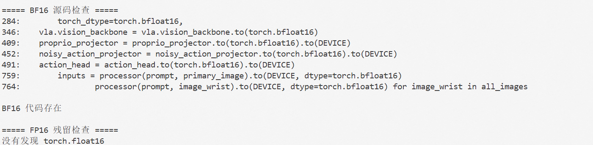

# OpenVLA\-OFT 环境部署


https://github\.com/moojink/openvla\-oft


目标：跑通 OpenVLA\-OFT 官方推理 demo，确认 A100\-40G 上 FP16 推理正常，**记录基线延迟和显存**。


本次直接使用魔搭提供的运行环境，不创建或激活 Conda 环境。截图中的环境为 **Ubuntu 22.04 + CUDA 12.8.1 + Python 3.12 + PyTorch 2.10.0**。

> 兼容性说明：OpenVLA-OFT 官方论文实验使用 Python 3.10.14、PyTorch 2.2.0 和自定义 Transformers 4.40.1。魔搭环境的 Python 3.12/PyTorch 2.10 不是官方复现实验版本，因此本方案优先用于推理；训练前应先完成导入、单 batch 前向和 Flash-Attention 兼容性检查。


模型下载：https://huggingface\.co/moojink/openvla\-7b\-oft\-finetuned\-libero\-spatial


**产出**：环境搭建文档（踩坑记录本身就是经验）。

## 0. 魔搭现有环境部署原则（不使用 Conda）

以下命令在魔搭实例已经进入的默认终端中执行。不要运行 `conda create`、`conda activate`，也不要重复安装 `torch`、`torchvision` 或 `torchaudio`，避免覆盖魔搭预装的 CUDA/PyTorch 组合。

```bash
# 1. 确认正在使用魔搭自带 Python/PyTorch
which python
python --version
python -c "import torch; print('PyTorch:', torch.__version__); print('Torch CUDA:', torch.version.cuda); print('CUDA available:', torch.cuda.is_available()); print('GPU:', torch.cuda.get_device_name(0) if torch.cuda.is_available() else 'N/A')"

# 2. 进入已有代码目录并安装项目代码（禁止依赖解析，避免覆盖魔搭的 Torch）
cd /PATH/TO/openvla-oft
python -m pip install -e . --no-deps

# 3. 仅安装推理侧的非 Torch 依赖；已存在的包会被 pip 复用
python -m pip install \
  accelerate draccus==0.8.0 einops huggingface_hub json-numpy jsonlines \
  matplotlib peft==0.11.1 protobuf rich sentencepiece timm tokenizers wandb \
  diffusers imageio uvicorn fastapi requests pillow

# 4. 安装 OFT 所需的并行解码 Transformers fork，不解析其依赖
python -m pip install --no-deps \
  "transformers @ git+https://github.com/moojink/transformers-openvla-oft.git"

# 5. 安装 LIBERO 仿真环境
git clone https://github.com/Lifelong-Robot-Learning/LIBERO.git
python -m pip install -e LIBERO
python -m pip install -r experiments/robot/libero/libero_requirements.txt
```

这里必须使用 `python -m pip`，并且项目本身必须带 `--no-deps`。因为仓库的 `pyproject.toml` 明确声明了 `torch==2.2.0`、`torchvision==0.17.0` 和 `torchaudio==2.2.0`；直接运行 `pip install -e .` 可能会把魔搭自带的 PyTorch 2.10 环境替换掉。

### 0.1 不要直接照搬官方 Flash-Attention 安装命令

官方 `SETUP.md` 针对 Python 3.10/PyTorch 2.2，给出了 `flash-attn==2.5.5`。在魔搭 Python 3.12/PyTorch 2.10 环境中，这个固定版本可能无法编译或与当前 Torch ABI 不匹配。先检查项目是否能够导入并运行；只有确实需要训练、且当前环境已有兼容的 Flash-Attention wheel 时，再按该 wheel 的要求安装。

```bash
python - <<'PY'
import torch
print('torch:', torch.__version__)
print('cuda:', torch.version.cuda)
print('bf16:', torch.cuda.is_bf16_supported() if torch.cuda.is_available() else False)

try:
    import flash_attn
    print('flash-attn:', getattr(flash_attn, '__version__', 'installed'))
except Exception as exc:
    print('flash-attn: unavailable ->', repr(exc))
PY
```

推理优先使用官方代码路径，不需要为了推理强行安装 Flash-Attention。若后续遇到 `flash_attn` 导入错误、CUDA kernel 错误或 ABI 错误，应先卸载不兼容的 wheel，再根据魔搭环境对应的 Torch 版本选择兼容 wheel；不要把官方 `flash-attn==2.5.5` 当作必需依赖强行安装。

### 0.2 魔搭环境下的推荐验证顺序

```text
Python/PyTorch/CUDA 检查
        ↓
OpenVLA-OFT 导入检查
        ↓
LIBERO 环境创建检查
        ↓
单次 observation 动作块推理
        ↓
单任务少量 rollout
        ↓
完整 LIBERO 评估
        ↓
最后再考虑微调训练
```

导入检查：

```bash
python - <<'PY'
import torch
from experiments.robot.libero.run_libero_eval import GenerateConfig
from experiments.robot.openvla_utils import get_action_head, get_processor, get_proprio_projector, get_vla

print('OpenVLA-OFT imports: OK')
print('torch:', torch.__version__)
PY
```

如果魔搭环境的 `transformers` 版本与 OFT 的并行解码实现不兼容，优先采用仓库中已经验证过的自定义 Transformers 代码，或在当前环境中只替换该 Python 包；不要重新安装整套 PyTorch。

### 0.3 训练侧额外依赖

只做 LIBERO 推理时，不需要 Flash-Attention；但官方原版 `openvla_utils.py` 和 `libero_utils.py` 的顶层导入仍可能触发 TensorFlow，且 `openvla_utils.py` 还会间接导入 dlimp。因此，如果使用未修改的官方代码，需要先确认魔搭环境已有可用的 TensorFlow/dlimp；如果沿用本文已有的“免 dlimp 导入”修复，则只需补齐实际报错的缺失包。需要训练时，再单独检查并安装与 **Python 3.12/PyTorch 2.10** 兼容的 TensorFlow、TensorFlow Datasets、TensorFlow Graphics 和 dlimp 版本。官方固定的 `tensorflow==2.15.0`、`dlimp` 及其依赖是按 Python 3.10 环境准备的，不能默认认为在魔搭环境中可直接使用。

## 一. OpenVLA 与 OpenVLA-OFT 模型架构

### 1.1 基础模型：OpenVLA

OpenVLA 是一个约 7B 参数的视觉—语言—动作模型。其基础网络来自 Prismatic-7B：输入图像分别经过 SigLIP 与 DINOv2 视觉编码器，两路 patch 特征在通道维拼接，再由 MLP 投影到 Llama 2 7B 的词嵌入空间；语言指令经过 Llama 2 tokenizer 和嵌入层后，与视觉 token 沿序列维拼接。原始 OpenVLA 使用因果注意力和自回归解码，把每个动作维度量化为 256 个区间，并像预测文本 token 一样逐个预测 7 个离散动作 token。[1]

原始模型在单臂任务中的单步 7 维动作通常表示：3 维末端位置增量、3 维末端姿态增量和 1 维夹爪动作。动作的具体物理意义、单位和反归一化边界由数据集配置决定，不能脱离 `unnorm_key` 把模型输出直接解释为固定单位的位移或角度。[1]


### 1.2 OFT 的关键改造

OpenVLA-OFT 并不是重新预训练一个新的 VLM，而是在 OpenVLA 表征之上改变下游微调和动作解码方式，核心包括：[2]

1. **并行解码**：用仅由位置编码区分的空动作嵌入作为查询，将动作区间的因果注意力改为双向注意力，一次前向计算同时生成所有动作。
2. **动作分块（action chunking）**：一次预测未来 $K$ 个时刻的动作。LIBERO 检查点取 $K=8$，因此输出形状为 $8\times7$；ALOHA 取 $K=25$，输出形状为 $25\times14$。[2][3]
3. **连续动作头**：以 4 层 ReLU MLP 替换离散 token 输出层，直接回归归一化后的连续动作，并使用 L1 损失训练。原始 OpenVLA 的离散自回归动作 token 仍是理解预训练模型的基础，但不是本文所用 OFT 检查点的最终解码方式。[2]
4. **扩展观测输入**：支持多个相机视角和机器人本体状态。每张图像经共享视觉主干产生 256 个 patch embedding；低维本体状态经 2 层 GELU MLP 投影到语言嵌入空间，然后与视觉、语言和动作查询 token 一起送入 Llama 2 解码器。[2]

本文使用的 `openvla-7b-oft-finetuned-libero-spatial` 检查点配置为两幅图像（第三人称相机和腕部相机）、8 维本体状态及语言指令，输出 8 个连续的 7 维动作。[3]

### 1.3 关于“初始位置”和本体状态

- **为什么原始 OpenVLA 图中没有机器人初始位置？** 原始模型只显式接收单张第三人称图像和语言指令，机器人当前构型只能从图像中被隐式推断；模型预测的是相对动作，因此不需要把任务开始时的绝对位姿作为固定条件反复输入。这种设计简单且便于跨平台预训练，但在遮挡、关节多解或精细控制时会丢失状态信息。[1]
- **OFT 是否输入机器人自身状态？** 是。OFT 将每个控制时刻的当前本体状态（而非仅 episode 的初始位置）显式投影到语言嵌入空间。LIBERO 中 `PROPRIO_DIM=8`，动作维度为 7；ALOHA 中二者均为 14。相应常量由官方代码定义。[3]

## 二. 模块构成与数据流

| 模块 | 实现 | 输入与输出 | 作用 |
| --- | --- | --- | --- |
| 输入处理器 | Hugging Face processor、Llama 2 tokenizer | 图像、语言指令 → 像素张量与语言 token | 统一图像预处理、提示词模板和分词 |
| 双视觉编码器 | SigLIP + DINOv2（约 600M 参数） | 每幅 $224\times224$ 图像 → 256 个融合 patch 特征 | SigLIP 偏语义，DINOv2 补充空间与细粒度视觉信息 |
| 视觉投影器 | 3 层 GELU MLP | 融合视觉特征 → Llama 2 嵌入维度 | 让图像 patch 能作为“视觉 token”进入语言模型 |
| 本体状态投影器 | 2 层 GELU MLP | LIBERO 8 维状态 → 1 个状态 embedding | 显式提供当前机器人状态；原始 OpenVLA 不包含该模块 |
| 多模态主干 | Llama 2 7B decoder | 视觉 token + 状态 token + 语言 token + 空动作查询 | 融合观测、任务语义和动作位置；OFT 在动作查询间采用双向注意力 |
| 连续动作头 | 4 层 ReLU MLP | 最后一层动作隐藏状态 → 连续动作块 | 以 L1 回归输出 $K\times D$ 动作，避免逐 token 自回归和 256-bin 量化误差 |
| 反归一化与执行 | 数据集统计量、控制接口 | 归一化动作 → 机器人控制量 | 按 `unnorm_key` 恢复量纲，并按 open-loop 配置执行动作块 |

完整数据流如下：

```text
第三人称图像 ─┐
腕部图像 ─────┴→ SigLIP + DINOv2 → 视觉投影器 ─┐
当前本体状态 ───→ 本体状态投影器 ──────────────┤
语言指令 ───────→ tokenizer / token embedding ─┼→ Llama 2 7B
空动作查询（K×D 个位置）────────────────────────┘        │
                                                        ↓
                                            4 层连续动作 MLP
                                                        ↓
                              归一化动作块 [K, D] → 反归一化 → 执行
```

需要强调：Llama 2 在这里负责多模态条件融合并产生动作位置的隐藏状态；最终连续动作由独立 MLP action head 解码。因此，将 OFT 简写为“Llama 直接生成动作 token”是不准确的。[2]

## 三. 训练方法与实验结果

### 3.1 训练过程

OpenVLA 首先在 Open X-Embodiment 的约 97 万条真实机器人示范上，将 Prismatic-7B 端到端微调为离散动作预测模型。原始训练使用逐维 256-bin 动作离散化、交叉熵下一 token 预测，输入分辨率为 $224\times224$；论文报告最终训练进行了 27 个 epoch，固定学习率为 $2\times10^{-5}$。[1]

OpenVLA-OFT 的下游训练保留 OpenVLA 的预训练表征，采用 LoRA 进行参数高效微调，同时训练连续动作头和本体状态投影器。LIBERO 的公开配置为：[2]

- 四个任务套件分别包含 10 个任务、共 500 条专家示范；过滤失败示范后分别训练和评测。
- LoRA rank 为 32，可训练参数共 279M（111M LoRA、151M action head、17M proprio projector）。
- 总 batch size 为 64，初始学习率为 $5\times10^{-4}$；Spatial、Object、Long 训练 150K 步并在 100K 步后降至 $5\times10^{-5}$，Goal 训练 50K 步。
- 动作和本体状态按训练集的 1%/99% 分位数归一化到 $[-1,1]$；目标为归一化动作的平均 L1 loss 小于 0.01。
- 输入为一幅第三人称图像、一幅腕部图像、机器人状态和语言指令；图像大小为 $224\times224$，动作块长度 $K=8$，推理时完整执行 8 步再重新规划。

这里的“高效”主要是指 LoRA 降低可训练参数量、并行解码降低推理次数，并不等于官方完整训练只需单张 40GB GPU。论文主实验使用 8 张 A100/H100 80GB；官方仓库说明不同配置需要 1–8 张、约 27–80GB 显存的 GPU。本文后续 A100-40G 测试只验证推理，不代表复现了论文训练成本。[2][3]

### 3.2 LIBERO 任务成功率

论文在每个任务套件上评测 500 次（10 个任务 × 每任务 50 个 episode）。为保证对比口径一致，下表优先列出“单第三人称图像 + 语言指令、过滤失败示范”的受控消融；最后两行是增加腕部图像和本体状态后的最强模型及其同输入设置下的 $\pi_0$ 结果。[2]

| 方法 | Spatial | Object | Goal | Long | 平均成功率 |
| --- | ---: | ---: | ---: | ---: | ---: |
| OpenVLA 原始微调 | 84.7% | 88.4% | 79.2% | 53.7% | 76.5% |
| + 并行解码与动作分块（离散动作） | 91.3% | 92.7% | 90.5% | 86.5% | 90.2% |
| + 连续动作与 diffusion | 96.9% | 98.1% | 95.5% | 91.1% | 95.4% |
| OpenVLA-OFT：+ 连续动作与 L1 | 96.2% | 98.3% | 96.2% | 90.7% | 95.3% |
| $\pi_0$（双图像/本体状态输入） | 96.8% | 98.8% | 95.8% | 85.2% | 94.2% |
| OpenVLA-OFT（双图像/本体状态输入） | 97.6% | 98.4% | 97.9% | 94.5% | **97.1%** |

结果表明：

1. 并行解码与 8 步动作分块把平均成功率从 76.5% 提高到 90.2%，绝对提升 13.7 个百分点；Long 套件提升 32.8 个百分点，是最大增益项。论文将其归因于动作分块对时序依赖的建模以及对误差累积的抑制，但这是实验解释，不是单独验证过的因果结论。[2]
2. 在同一单图输入设置下，连续动作进一步带来约 5 个百分点增益；L1（95.3%）与 50 步 diffusion（95.4%）成功率几乎相同，因此更简单的 L1 目标具有更好的速度—性能折中。[2]
3. 加入腕部图像与本体状态后，OpenVLA-OFT 达到 97.1%，比同设置的 $\pi_0$ 高 2.9 个百分点，也比原始 OpenVLA 高 20.6 个百分点。不过后二者的输入和训练配方不同，因此 20.6 个百分点不能全部归因于某一个模块。[2]

### 3.3 官方推理效率与本地 NVIDIA A10 基线

官方论文在 A100 上对 100 次查询取平均。LIBERO 单图、7 维动作设置中，原始 OpenVLA 的吞吐量为 4.2 action/s、延迟 239.6ms；采用并行解码、8 步动作分块和连续 L1 头后达到 109.7 action/s、每个动作块 72.9ms，即吞吐量约提升 26 倍。增加腕部图像和本体状态后仍达到 71.4 action/s、112ms/块。[2]

本文第六节记录的三组本地 BF16 结果使用双图像、本体状态和 $8\times7$ 动作块：

| 指标 | 三次运行汇总 |
| --- | ---: |
| 模型加载时间 | $5045.854\pm34.454$ ms |
| 动作块平均延迟 | $216.647\pm0.723$ ms |
| p50 / p95 / p99 | 208.925 / 250.499 / 388.421 ms |
| 峰值 allocated / reserved 显存 | 14.963 / 15.004 GiB |
| 由 $8/0.216647$ 计算的动作吞吐量 | 约 36.9 action/s |

本地平均延迟约为论文同类“额外输入”结果 112ms 的 1.93 倍，吞吐量约为论文 71.4 action/s 的 51.7%。截图中 `GPU` 字段显示本次测试实际运行在 **NVIDIA A10**，因此这些数据不能作为 A100-40G 的实测结果。它说明当前 A10 环境已稳定跑通 BF16 推理且显存低于 16GiB，但软件版本、内核、计时范围、输入预处理和 GPU 运行状态仍有优化空间。由于本地测试只重复同一个 observation，它只能作为工程性能基线，不能证明任务成功率或泛化能力；性能结论与 LIBERO rollout 成功率必须分开报告。

### 3.4 实验边界

- LIBERO-Spatial、Object、Goal、Long 分别考察空间布局、物体、目标和长时程任务泛化；它们不应被直接改写为“视觉、运动、物理、语义”四类。这后四类加语言定位是原 OpenVLA/BridgeData V2 的真实机器人评测划分。[1]
- OFT 论文在 BridgeData V2 的上述五类任务子集上报告平均得分 69.2%，原始 OpenVLA 为 65.8%；这支持 OFT 可扩展到 50,365 条真实机器人示范，但增益为 3.4 个百分点，弱于 LIBERO 上的提升。[2]
- 论文还在 ALOHA 上验证了三相机、14 维本体状态和 $25\times14$ 动作块；OpenVLA-OFT+ 为语言相关任务加入 FiLM。其吞吐量由原始 OpenVLA 的 1.8 action/s 提高到 77.9 action/s（约 43 倍），但论文对任务执行采用分阶段完成度评分，不能与 LIBERO 的二值成功率直接比较。[2]

### 3.5 引用

[1] Kim et al., [OpenVLA: An Open-Source Vision-Language-Action Model](https://arxiv.org/abs/2406.09246), 2024.

[2] Kim, Finn, and Liang, [Fine-Tuning Vision-Language-Action Models: Optimizing Speed and Success](https://arxiv.org/abs/2502.19645), 2025.

[3] [OpenVLA-OFT 官方仓库](https://github.com/moojink/openvla-oft)及其 [`prismatic/vla/constants.py`](https://github.com/moojink/openvla-oft/blob/main/prismatic/vla/constants.py).

## 四\. 基线测试

1\.本地测试

OpenVLA\-OFT 官方推理路径 \+ 本地 FP16 修改


2\.官方测试

1\.设置环境变量

```Bash
set +e
set +u

export BASE="/root/openvla_oft_workspace"
export OFT="$BASE/openvla-oft"
export OFT_MODEL="$BASE/models/openvla-7b-oft-finetuned-libero-spatial"

export OPENVLA_UTILS="$OFT/experiments/robot/openvla_utils.py"

export FP16_SCRIPT="$BASE/benchmark_openvla_oft_fp16.py"
export BF16_SCRIPT="$BASE/benchmark_openvla_oft_bf16.py"

export SAMPLE="$OFT/experiments/robot/libero/sample_libero_spatial_observation.pkl"
export LOG_DIR="$BASE/logs"

mkdir -p "$LOG_DIR"

export PYTHONPATH="$OFT:${PYTHONPATH:-}"
export HF_HUB_OFFLINE=1
export TRANSFORMERS_OFFLINE=1
export TOKENIZERS_PARALLELISM=false
export PYTHONFAULTHANDLER=1
export CUDA_VISIBLE_DEVICES=0
export PYTORCH_CUDA_ALLOC_CONF=expandable_segments:True

cd "$OFT"

printf 'BASE=<%s>\n' "$BASE"
printf 'OFT=<%s>\n' "$OFT"
printf 'OPENVLA_UTILS=<%s>\n' "$OPENVLA_UTILS"
printf 'FP16_SCRIPT=<%s>\n' "$FP16_SCRIPT"
printf 'BF16_SCRIPT=<%s>\n' "$BF16_SCRIPT"
printf 'SAMPLE=<%s>\n' "$SAMPLE"
```

```Bash
set +e
set +u

export BASE="/root/openvla_oft_workspace"
export OFT="$BASE/openvla-oft"
export OFT_MODEL="$BASE/models/openvla-7b-oft-finetuned-libero-spatial"

export OPENVLA_UTILS="$OFT/experiments/robot/openvla_utils.py"
export FP16_SCRIPT="$BASE/benchmark_openvla_oft_fp16.py"
export BF16_SCRIPT="$BASE/benchmark_openvla_oft_bf16.py"

export SAMPLE="$OFT/experiments/robot/libero/sample_libero_spatial_observation.pkl"
export LOG_DIR="$BASE/logs"

mkdir -p "$LOG_DIR"

export PYTHONPATH="$OFT:${PYTHONPATH:-}"
export HF_HUB_OFFLINE=1
export TRANSFORMERS_OFFLINE=1
export TOKENIZERS_PARALLELISM=false
export PYTHONFAULTHANDLER=1
export CUDA_VISIBLE_DEVICES=0
export PYTORCH_CUDA_ALLOC_CONF=expandable_segments:True

echo "FP16_SCRIPT=$FP16_SCRIPT"
echo "BF16_SCRIPT=$BF16_SCRIPT"
echo "OPENVLA_UTILS=$OPENVLA_UTILS"

echo
echo "===== 检查 FP16 基准脚本 ====="

if [ ! -f "$FP16_SCRIPT" ]; then
    echo "[错误] 找不到 FP16 基准脚本：$FP16_SCRIPT"
    echo
    echo "实际搜索结果："
    find /root /mnt/workspace \
        -type f \
        -name "benchmark_openvla_oft_fp16.py" \
        -print \
        2>/dev/null
else
    echo "[OK] 找到 FP16 基准脚本"
    ls -lh "$FP16_SCRIPT"

    echo
    echo "===== 从 FP16 脚本创建 BF16 脚本 ====="

    cp -f "$FP16_SCRIPT" "$BF16_SCRIPT"

    python - "$BF16_SCRIPT" <<'PY'
import sys
from pathlib import Path

path = Path(sys.argv[1])

if not path.is_file():
    raise FileNotFoundError(f"BF16 脚本副本不存在：{path}")

text = path.read_text(encoding="utf-8")

print("原脚本中 torch.float16 数量：", text.count("torch.float16"))
print(
    "原脚本中 torch.bfloat16 数量：",
    text.count("torch.bfloat16"),
)

# 将 dtype 检查和相关文字切换为 BF16。
replacements = [
    ("torch.float16", "torch.bfloat16"),
    (
        "find_non_fp16_parameters",
        "find_non_bf16_parameters",
    ),
    ("OpenVLA-OFT FP16", "OpenVLA-OFT BF16"),
    ("openvla_oft_fp16", "openvla_oft_bf16"),
    ("FP16", "BF16"),
    ("fp16", "bf16"),
]

for old, new in replacements:
    text = text.replace(old, new)

path.write_text(text, encoding="utf-8")

print("BF16 脚本已写入：", path)
print(
    "修改后 torch.bfloat16 数量：",
    text.count("torch.bfloat16"),
)
print(
    "修改后 torch.float16 数量：",
    text.count("torch.float16"),
)

if "torch.bfloat16" not in text:
    raise RuntimeError(
        "BF16 脚本中没有找到 torch.bfloat16"
    )

if "torch.float16" in text:
    raise RuntimeError(
        "BF16 脚本中仍然存在 torch.float16"
    )
PY

    chmod +x "$BF16_SCRIPT"

    echo
    echo "===== BF16 脚本文件检查 ====="
    ls -lh "$BF16_SCRIPT"
    wc -l "$BF16_SCRIPT"

    echo
    echo "===== BF16 脚本 dtype 检查 ====="
    grep -n \
        -E "DTYPE|torch\.bfloat16|torch\.float16|BF16|FP16|find_non_" \
        "$BF16_SCRIPT" \
        | head -100

    echo
    echo "===== BF16 脚本语法检查 ====="

    python -m py_compile "$BF16_SCRIPT"
    COMPILE_STATUS=$?

    echo "py_compile 退出码：$COMPILE_STATUS"

    if [ "$COMPILE_STATUS" -eq 0 ]; then
        echo "BF16 基准脚本语法检查通过"
    else
        echo "BF16 基准脚本语法检查失败"
    fi
fi
```

2\.检查BF16的支持


```Python
python - <<'PY'
import sys
import torch

print("Python:", sys.version)
print("PyTorch:", torch.__version__)
print("PyTorch CUDA:", torch.version.cuda)
print("CUDA available:", torch.cuda.is_available())

if torch.cuda.is_available():
    print("GPU:", torch.cuda.get_device_name(0))
    print(
        "GPU memory:",
        round(
            torch.cuda.get_device_properties(0).total_memory
            / 1024**3,
            2,
        ),
        "GiB",
    )
    print(
        "BF16 supported:",
        torch.cuda.is_bf16_supported(),
    )
PY
```

插曲：保留验证成功FP16版本

```Bash
export OPENVLA_UTILS="$OFT/experiments/robot/openvla_utils.py"
export FP16_BACKUP="$OFT/experiments/robot/openvla_utils.py.fp16.backup"
export BF16_BACKUP="$OFT/experiments/robot/openvla_utils.py.bf16.backup"

if [ -f "$OPENVLA_UTILS" ]; then
    cp -f "$OPENVLA_UTILS" "$FP16_BACKUP"
    echo "当前 FP16 版本已保存到：$FP16_BACKUP"
else
    echo "没有找到：$OPENVLA_UTILS"
fi

if [ -f "$FP16_BACKUP" ]; then
    grep -n \
        -E "torch\.float16|torch\.bfloat16" \
        "$FP16_BACKUP" \
        | head -30
fi
```


3\.恢复初始BF16版本

```Bash
if [ -f "$BF16_BACKUP" ] && \
   grep -q "torch\.bfloat16" "$BF16_BACKUP"; then

    cp -f "$BF16_BACKUP" "$OPENVLA_UTILS"

    echo "已从 BF16 备份恢复官方默认 BF16 源码："
    echo "$OPENVLA_UTILS"

else
    echo "没有找到可用的 BF16 备份。"
    echo "尝试将当前 FP16 推理 dtype 恢复为 BF16。"

    if [ -f "$OPENVLA_UTILS" ]; then
        python - <<PY
from pathlib import Path

path = Path("$OPENVLA_UTILS")
text = path.read_text(encoding="utf-8")

count = text.count("torch.float16")

if count == 0:
    print("没有发现 torch.float16，未执行替换。")
else:
    text = text.replace(
        "torch.float16",
        "torch.bfloat16",
    )
    path.write_text(text, encoding="utf-8")
    print(
        f"已将 {count} 处 torch.float16 "
        "恢复为 torch.bfloat16"
    )
PY
    fi
fi
```


4\.检查当前openvla\_utils\.py

```Bash
echo
echo "===== 当前 openvla_utils.py dtype ====="

grep -n \
    -E "torch\.float16|torch\.bfloat16" \
    "$OPENVLA_UTILS" \
    || true
```


5\.重新应用 dlimp 免依赖导入修复

这里很重要。当前环境之前出现过： 


```Plain Text
python - <<PY
from pathlib import Path
import re

path = Path("$OPENVLA_UTILS")
text = path.read_text(encoding="utf-8")

# 删除会触发 dlimp 的数据集工具导入。
text = re.sub(
    r"^from prismatic\.vla\.datasets\.rlds\.utils\.data_utils "
    r"import NormalizationType\s*\n",
    "",
    text,
    flags=re.MULTILINE,
)

# 确保 NormalizationType 从 constants 直接导入。
pattern = re.compile(
    r"(from prismatic\.vla\.constants import \(\n)"
    r"(.*?)"
    r"(\n\))",
    flags=re.DOTALL,
)

match = pattern.search(text)

if match is None:
    print("没有找到 prismatic.vla.constants 的括号导入块。")
    print("请查看文件头部导入部分：")
    print("\n".join(text.splitlines()[:60]))
else:
    body = match.group(2)

    if "NormalizationType" not in body:
        body = body.rstrip() + "\n    NormalizationType,"

        text = (
            text[:match.start(2)]
            + body
            + text[match.end(2):]
        )

    path.write_text(text, encoding="utf-8")
    print("已完成 dlimp 免依赖导入修复：", path)
PY
```

```Bash
echo
echo "===== 检查 NormalizationType 导入 ====="

grep -n \
    -A8 \
    -B3 \
    "prismatic.vla.constants\|NormalizationType\|data_utils" \
    "$OPENVLA_UTILS" \
    || true
```


6\.确认prismatic\.vla 仍然是延迟导入

```Plain Text
echo "===== prismatic/vla/__init__.py ====="

sed -n '1,100p' \
    "$OFT/prismatic/vla/__init__.py"
```

```Python
python - <<PY
from pathlib import Path

path = Path("$OFT/prismatic/vla/__init__.py")
text = path.read_text(encoding="utf-8")

if "from .materialize import get_vla_dataset_and_collator" in text:
    path.write_text(
        '''"""
VLA utilities.

Dataset materialization is imported lazily so inference does not require
the RLDS/dlimp training-data stack.
"""


def get_vla_dataset_and_collator(*args, **kwargs):
    """
    Import dataset materialization only when training/data loading
    is explicitly requested.
    """
    from .materialize import (
        get_vla_dataset_and_collator as _get_vla_dataset_and_collator,
    )

    return _get_vla_dataset_and_collator(*args, **kwargs)
''',
        encoding="utf-8",
    )
    print("已恢复 prismatic.vla 的延迟导入")
else:
    print("prismatic.vla 已经是延迟导入或没有 eager materialize 导入")
PY
```

7\.确认实际使用

```Python
cd "$OFT"

python - <<'PY'
from pathlib import Path
import sys

import experiments.robot.openvla_utils as openvla_utils
import prismatic.vla.constants as constants

utils_path = Path(
    openvla_utils.__file__
).resolve()

constants_path = Path(
    constants.__file__
).resolve()

print("openvla_utils:", utils_path)
print("constants:", constants_path)
print()
print("NUM_ACTIONS_CHUNK:", constants.NUM_ACTIONS_CHUNK)
print("ACTION_DIM:", constants.ACTION_DIM)
print("PROPRIO_DIM:", constants.PROPRIO_DIM)
print()
print("dlimp loaded:", "dlimp" in sys.modules)

assert str(utils_path).startswith(
    "/root/openvla_oft_workspace/openvla-oft"
)

print()
print("OFT 导入检查通过")
PY
```


8\.检查当前的dtype

```Bash
echo "===== BF16 源码检查 ====="

if grep -n "torch\.bfloat16" "$OPENVLA_UTILS"; then
    echo
    echo "BF16 代码存在"
else
    echo
    echo "没有找到 torch.bfloat16，BF16 恢复失败"
fi

echo
echo "===== FP16 残留检查 ====="

if grep -n "torch\.float16" "$OPENVLA_UTILS"; then
    echo
    echo "发现 torch.float16 残留，需要继续检查"
else
    echo "没有发现 torch.float16"
fi
```


9\.安全切换到BF16

保存当前FP16

```Bash
if [ -f "$OPENVLA_UTILS" ] && \
   grep -q "torch\.float16" "$OPENVLA_UTILS"; then

    if [ ! -f "$FP16_BACKUP" ]; then
        cp "$OPENVLA_UTILS" "$FP16_BACKUP"
        echo "当前 FP16 版本已保存：$FP16_BACKUP"
    else
        echo "FP16 备份已经存在，保留原备份：$FP16_BACKUP"
    fi
fi
```

FP16\-\>BF16切换

```Python
python - "$OPENVLA_UTILS" <<'PY'
import sys
from pathlib import Path

path = Path(sys.argv[1])

if not path.is_file():
    raise FileNotFoundError(f"文件不存在：{path}")

text = path.read_text(encoding="utf-8")

float16_count = text.count("torch.float16")
bfloat16_count = text.count("torch.bfloat16")

print("替换前 torch.float16 数量:", float16_count)
print("替换前 torch.bfloat16 数量:", bfloat16_count)

if float16_count > 0:
    text = text.replace(
        "torch.float16",
        "torch.bfloat16",
    )
    path.write_text(text, encoding="utf-8")
    print(
        f"已将 {float16_count} 处 "
        "torch.float16 替换为 torch.bfloat16"
    )
else:
    print("没有找到 torch.float16，不执行替换")
PY
```


确认BF16恢复成功

```Bash
echo
echo "===== BF16 源码检查 ====="

if grep -n "torch\.bfloat16" "$OPENVLA_UTILS"; then
    echo
    echo "BF16 代码存在"
else
    echo
    echo "没有找到 torch.bfloat16"
fi

echo
echo "===== FP16 残留检查 ====="

if grep -n "torch\.float16" "$OPENVLA_UTILS"; then
    echo
    echo "发现 torch.float16 残留，需要继续检查"
else
    echo "没有发现 torch.float16"
fi
```



10\.确认实际导入源码路径

```Python
cd "$OFT"

python - <<'PY'
from pathlib import Path
import sys

import experiments.robot.openvla_utils as openvla_utils
import prismatic.vla.constants as constants

utils_path = Path(
    openvla_utils.__file__
).resolve()

constants_path = Path(
    constants.__file__
).resolve()

print("openvla_utils:")
print(utils_path)

print()
print("constants:")
print(constants_path)

print()
print("NUM_ACTIONS_CHUNK:", constants.NUM_ACTIONS_CHUNK)
print("ACTION_DIM:", constants.ACTION_DIM)
print("PROPRIO_DIM:", constants.PROPRIO_DIM)
print("dlimp loaded:", "dlimp" in sys.modules)

assert str(utils_path) == (
    "/root/openvla_oft_workspace/openvla-oft/"
    "experiments/robot/openvla_utils.py"
)

print()
print("OFT 导入检查通过")
PY
```

11\.BF16基准脚本

```Bash
echo "===== FP16 脚本检查 ====="

if [ -f "$FP16_SCRIPT" ]; then
    echo "[OK] FP16 基准脚本存在"
    ls -lh "$FP16_SCRIPT"
else
    echo "[错误] 找不到 FP16 基准脚本：$FP16_SCRIPT"
fi
```


12\.运行BF16 smoke test

确认脚本和observation存在

```Bash
if [ -f "$BF16_SCRIPT" ]; then
    echo "[OK] BF16 脚本：$BF16_SCRIPT"
else
    echo "[错误] BF16 脚本仍不存在：$BF16_SCRIPT"
fi

if [ -f "$SAMPLE" ]; then
    echo "[OK] observation：$SAMPLE"
else
    export SAMPLE="$BASE/sample_test_observation.pkl"
    echo "尝试使用：$SAMPLE"
fi

ls -lh "$BF16_SCRIPT" "$SAMPLE"
```

运行冒烟测试

```Bash
cd "$OFT"

set +e

python -u "$BF16_SCRIPT" \
    --model "$OFT_MODEL" \
    --observation "$SAMPLE" \
    --warmup 1 \
    --iterations 1 \
    --output "$BASE/openvla_oft_bf16_smoke_test.json" \
    2>&1 | tee "$LOG_DIR/openvla_oft_bf16_smoke_test.log"

BF16_SMOKE_STATUS=${PIPESTATUS[0]}

echo
echo "=============================================="
echo "BF16 smoke test Python 退出码：$BF16_SMOKE_STATUS"
echo "=============================================="

if [ "$BF16_SMOKE_STATUS" -eq 0 ]; then
    echo "BF16 smoke test 成功"
else
    echo "BF16 smoke test 失败，但当前终端不会关闭"
    echo
    echo "===== 最后 200 行日志 ====="
    tail -200 "$LOG_DIR/openvla_oft_bf16_smoke_test.log"
fi
```


13\.运行正式BF16基线

```Bash
cd "$OFT"

set +e

python -u "$BF16_SCRIPT" \
    --model "$OFT_MODEL" \
    --observation "$SAMPLE" \
    --warmup 5 \
    --iterations 30 \
    --output "$BASE/openvla_oft_bf16_baseline.json" \
    2>&1 | tee "$LOG_DIR/openvla_oft_bf16_baseline.log"

BF16_STATUS=${PIPESTATUS[0]}

echo
echo "=============================================="
echo "BF16 基准 Python 退出码：$BF16_STATUS"
echo "=============================================="

if [ "$BF16_STATUS" -eq 0 ]; then
    echo "OpenVLA-OFT 默认 BF16 基准运行成功"
    echo "结果文件：$BASE/openvla_oft_bf16_baseline.json"
    echo "日志文件：$LOG_DIR/openvla_oft_bf16_baseline.log"
else
    echo "BF16 基准运行失败，但当前终端不会关闭"
    echo
    tail -200 "$LOG_DIR/openvla_oft_bf16_baseline.log"
fi
```


## 五\. 版本稳定

1\.设置稳定的绝对路径

```Bash
set +e
set +u

export BASE="/root/openvla_oft_workspace"
export OFT="$BASE/openvla-oft"
export OFT_MODEL="$BASE/models/openvla-7b-oft-finetuned-libero-spatial"

export BF16_SCRIPT="$BASE/benchmark_openvla_oft_bf16.py"
export BF16_RESULT="$BASE/openvla_oft_bf16_baseline.json"
export BF16_LOG="$BASE/logs/openvla_oft_bf16_baseline.log"

export SAMPLE="$OFT/experiments/robot/libero/sample_libero_spatial_observation.pkl"

export PYTHONPATH="$OFT:${PYTHONPATH:-}"

mkdir -p "$BASE/logs"

printf 'BASE=<%s>\n' "$BASE"
printf 'OFT=<%s>\n' "$OFT"
printf 'OFT_MODEL=<%s>\n' "$OFT_MODEL"
printf 'BF16_SCRIPT=<%s>\n' "$BF16_SCRIPT"
printf 'BF16_RESULT=<%s>\n' "$BF16_RESULT"
printf 'BF16_LOG=<%s>\n' "$BF16_LOG"
printf 'SAMPLE=<%s>\n' "$SAMPLE"
```

2\.确认结果和日志文件存在

```Bash
echo "===== BF16 结果和日志 ====="

if [ -f "$BF16_RESULT" ]; then
    echo "[OK] 结果文件：$BF16_RESULT"
    ls -lh "$BF16_RESULT"
else
    echo "[缺失] 结果文件：$BF16_RESULT"
fi

if [ -f "$BF16_LOG" ]; then
    echo "[OK] 日志文件：$BF16_LOG"
    ls -lh "$BF16_LOG"
else
    echo "[缺失] 日志文件：$BF16_LOG"
fi

if [ -f "$BF16_SCRIPT" ]; then
    echo "[OK] BF16 基准脚本：$BF16_SCRIPT"
else
    echo "[缺失] BF16 基准脚本：$BF16_SCRIPT"
fi
```


3\.验证json中的关键字段


```Python
python - <<PY
import json
from pathlib import Path

path = Path("$BF16_RESULT")

if not path.is_file():
    print("结果文件不存在：", path)
else:
    with open(path, "r", encoding="utf-8") as file:
        result = json.load(file)

    print("========== BF16 基线验证 ==========")
    print("GPU:", result.get("gpu"))
    print("dtype:", result.get("dtype"))
    print("action_shape:", result.get("action_shape"))
    print("num_actions_chunk:", result.get("num_actions_chunk"))
    print("action_dim:", result.get("action_dim"))
    print("proprio_dim:", result.get("proprio_dim"))
    print("use_l1_regression:", result.get("use_l1_regression"))
    print("use_proprio:", result.get("use_proprio"))
    print("unnorm_key:", result.get("unnorm_key"))
    print()

    print("VLA dtypes:", result.get("vla_dtype_counts"))
    print("Action head dtypes:", result.get("action_head_dtype_counts"))
    print(
        "Proprio projector dtypes:",
        result.get("proprio_projector_dtype_counts"),
    )
    print()

    latency = result.get("latency_ms", {})
    print("mean latency:", latency.get("mean_ms"), "ms")
    print("p50 latency:", latency.get("p50_ms"), "ms")
    print("p95 latency:", latency.get("p95_ms"), "ms")
    print("p99 latency:", latency.get("p99_ms"), "ms")
    print()

    if result.get("dtype") != "torch.bfloat16":
        print("[警告] JSON dtype 不是 torch.bfloat16")

    if tuple(result.get("action_shape", [])) != (8, 7):
        print("[警告] action_shape 不是 [8, 7]")

    print("====================================")
PY
```

3\.快照当前环境

```Bash
export RUN_ID="bf16_baseline_$(date +%Y%m%d_%H%M%S)"
export RUN_DIR="$BASE/baselines/$RUN_ID"

mkdir -p "$RUN_DIR"

echo "归档目录：$RUN_DIR"
```


保存结果与日志

```Bash
if [ -f "$BF16_RESULT" ]; then
    cp -f "$BF16_RESULT" "$RUN_DIR/"
fi

if [ -f "$BF16_LOG" ]; then
    cp -f "$BF16_LOG" "$RUN_DIR/"
fi

if [ -f "$BF16_SCRIPT" ]; then
    cp -f "$BF16_SCRIPT" "$RUN_DIR/"
fi

if [ -f "$SAMPLE" ]; then
    cp -f "$SAMPLE" "$RUN_DIR/"
fi

echo "结果、日志、脚本和 observation 已归档"
ls -lh "$RUN_DIR"
```


快照源码差异以及包版本

```Bash
git -C "$OFT" status --short \
    > "$RUN_DIR/git_status.txt" \
    2>/dev/null

git -C "$OFT" diff -- \
    prismatic/vla/__init__.py \
    experiments/robot/openvla_utils.py \
    > "$RUN_DIR/oft_inference_patch.diff" \
    2>/dev/null

echo "Git 状态和源码差异已保存"
```

```Bash
nvidia-smi \
    > "$RUN_DIR/nvidia-smi.txt" \
    2>&1

python - <<'PY' \
    > "$RUN_DIR/python_torch_info.txt"
import platform
import sys
import torch

print("Python:", sys.version)
print("Platform:", platform.platform())
print("PyTorch:", torch.__version__)
print("Torch CUDA:", torch.version.cuda)
print("CUDA available:", torch.cuda.is_available())

if torch.cuda.is_available():
    print("GPU:", torch.cuda.get_device_name(0))
    print("BF16 supported:", torch.cuda.is_bf16_supported())
    print(
        "GPU memory GiB:",
        torch.cuda.get_device_properties(0).total_memory / 1024**3,
    )
PY

python -m pip freeze \
    > "$RUN_DIR/pip_freeze.txt" \
    2>&1

sha256sum \
    "$BF16_RESULT" \
    "$BF16_SCRIPT" \
    "$OFT/experiments/robot/openvla_utils.py" \
    > "$RUN_DIR/sha256sums.txt" \
    2>/dev/null

echo "环境快照已保存到：$RUN_DIR"
```


## 六\. 多组测试

1. 执行 3 组 BF16 测试

```Bash
export REPEAT_DIR="$RUN_DIR/repeats"
mkdir -p "$REPEAT_DIR"

set +e

for i in 1 2 3; do
    OUT="$REPEAT_DIR/bf16_repeat_${i}.json"
    LOG="$REPEAT_DIR/bf16_repeat_${i}.log"

    echo
    echo "=============================================="
    echo "开始 BF16 重复测试 $i/3"
    echo "结果：$OUT"
    echo "日志：$LOG"
    echo "=============================================="

    python -u "$BF16_SCRIPT" \
        --model "$OFT_MODEL" \
        --observation "$SAMPLE" \
        --warmup 10 \
        --iterations 100 \
        --output "$OUT" \
        2>&1 | tee "$LOG"

    STATUS=${PIPESTATUS[0]}

    echo
    echo "BF16 重复测试 $i 退出码：$STATUS"

    if [ "$STATUS" -ne 0 ]; then
        echo "第 $i 组失败，继续保留其他结果"
    fi
done

set +e
```

汇总三组结果

```Python
python - "$REPEAT_DIR" <<'PY'
import json
import statistics
import sys
from pathlib import Path

repeat_dir = Path(sys.argv[1])
files = sorted(repeat_dir.glob("bf16_repeat_*.json"))

print("找到结果文件数量：", len(files))

rows = []

for path in files:
    try:
        with open(path, "r", encoding="utf-8") as file:
            result = json.load(file)

        latency = result["latency_ms"]

        rows.append(
            {
                "file": path.name,
                "load_time_ms": result["load_time_ms"],
                "mean_ms": latency["mean_ms"],
                "p50_ms": latency["p50_ms"],
                "p95_ms": latency["p95_ms"],
                "p99_ms": latency["p99_ms"],
                "max_ms": latency["max_ms"],
                "peak_allocated_gib": result[
                    "inference_peak_allocated_gib"
                ],
                "peak_reserved_gib": result[
                    "inference_peak_reserved_gib"
                ],
            }
        )
    except Exception as exc:
        print("读取失败:", path, exc)

if not rows:
    print("没有可汇总的结果")
else:
    print()
    print("========== 每组结果 ==========")

    for row in rows:
        print()
        print(row["file"])
        print("  load:", row["load_time_ms"], "ms")
        print("  mean:", row["mean_ms"], "ms")
        print("  p50:", row["p50_ms"], "ms")
        print("  p95:", row["p95_ms"], "ms")
        print("  p99:", row["p99_ms"], "ms")
        print("  max:", row["max_ms"], "ms")
        print(
            "  peak allocated:",
            row["peak_allocated_gib"],
            "GiB",
        )
        print(
            "  peak reserved:",
            row["peak_reserved_gib"],
            "GiB",
        )

    print()
    print("========== 跨运行汇总 ==========")

    for key in [
        "load_time_ms",
        "mean_ms",
        "p50_ms",
        "p95_ms",
        "p99_ms",
        "max_ms",
        "peak_allocated_gib",
        "peak_reserved_gib",
    ]:
        values = [row[key] for row in rows]

        print(
            f"{key}: "
            f"mean={statistics.mean(values):.3f}, "
            f"std={statistics.stdev(values) if len(values) > 1 else 0.0:.3f}, "
            f"min={min(values):.3f}, "
            f"max={max(values):.3f}"
        )
PY
```

```YAML
========== 每组结果 ==========

bf16_repeat_1.json
  load: 5084.100194275379 ms
  mean: 216.08886420726776 ms
  p50: 207.91629794985056 ms
  p95: 262.9322797060013 ms
  p99: 383.2278418354691 ms
  max: 402.18323841691017 ms
  peak allocated: 14.962680339813232 GiB
  peak reserved: 15.00390625 GiB

bf16_repeat_2.json
  load: 5017.246330156922 ms
  mean: 217.4643350020051 ms
  p50: 209.1840272769332 ms
  p95: 239.71186177805063 ms
  p99: 395.7207897305496 ms
  max: 542.7746940404177 ms
  peak allocated: 14.962680339813232 GiB
  peak reserved: 15.00390625 GiB

bf16_repeat_3.json
  load: 5036.214463412762 ms
  mean: 216.38887465000153 ms
  p50: 209.67551227658987 ms
  p95: 248.85317953303453 ms
  p99: 386.31529798731214 ms
  max: 402.4532921612263 ms
  peak allocated: 14.962680339813232 GiB
  peak reserved: 15.00390625 GiB

========== 跨运行汇总 ==========
load_time_ms: mean=5045.854, std=34.454, min=5017.246, max=5084.100
mean_ms: mean=216.647, std=0.723, min=216.089, max=217.464
p50_ms: mean=208.925, std=0.908, min=207.916, max=209.676
p95_ms: mean=250.499, std=11.697, min=239.712, max=262.932
p99_ms: mean=388.421, std=6.507, min=383.228, max=395.721
max_ms: mean=449.137, std=81.093, min=402.183, max=542.775
peak_allocated_gib: mean=14.963, std=0.000, min=14.963, max=14.963
peak_reserved_gib: mean=15.004, std=0.000, min=15.004, max=15.004
```

性能指标说明

load\_time\_ms：模型启动和组件加载时间，不属于每次控制循环延迟。

mean\_ms：生成一个长度为 8 的动作块的平均端到端时间。

p50\_ms：典型延迟。p95\_ms：比较重要的尾延迟指标。

p99\_ms：部署时需要关注的异常慢延迟。

mean\_ms\_per\_action\_step：动作块平均分摊到每个动作的数值，不等于真实控制频率。inference\_peak\_allocated\_gib：PyTorch 实际分配的峰值显存。

inference\_peak\_reserved\_gib：PyTorch 缓存分配器保留的峰值显存。

## 七\. 比较两种detype

```Python
export FP16_RESULT="$BASE/openvla_oft_fp16_baseline.json"

python - "$FP16_RESULT" "$BF16_RESULT" <<'PY'
import json
import sys
from pathlib import Path

import numpy as np

fp16_path = Path(sys.argv[1])
bf16_path = Path(sys.argv[2])

paths = {
    "FP16": fp16_path,
    "BF16": bf16_path,
}

results = {}

for name, path in paths.items():
    if not path.is_file():
        print(f"{name} 文件不存在：{path}")
        continue

    with open(path, "r", encoding="utf-8") as file:
        results[name] = json.load(file)

if "FP16" in results:
    fp16 = results["FP16"]
    fp16_latency = fp16["latency_ms"]

    print("========== FP16 ==========")
    print("dtype:", fp16["dtype"])
    print("GPU:", fp16["gpu"])
    print("action shape:", fp16["action_shape"])
    print("mean:", fp16_latency["mean_ms"], "ms")
    print("p50:", fp16_latency["p50_ms"], "ms")
    print("p95:", fp16_latency["p95_ms"], "ms")
    print("p99:", fp16_latency["p99_ms"], "ms")
    print(
        "peak allocated:",
        fp16["inference_peak_allocated_gib"],
        "GiB",
    )

if "BF16" in results:
    bf16 = results["BF16"]
    bf16_latency = bf16["latency_ms"]

    print()
    print("========== BF16 ==========")
    print("dtype:", bf16["dtype"])
    print("GPU:", bf16["gpu"])
    print("action shape:", bf16["action_shape"])
    print("mean:", bf16_latency["mean_ms"], "ms")
    print("p50:", bf16_latency["p50_ms"], "ms")
    print("p95:", bf16_latency["p95_ms"], "ms")
    print("p99:", bf16_latency["p99_ms"], "ms")
    print(
        "peak allocated:",
        bf16["inference_peak_allocated_gib"],
        "GiB",
    )

if "FP16" in results and "BF16" in results:
    fp16 = results["FP16"]
    bf16 = results["BF16"]

    fp16_mean = fp16["latency_ms"]["mean_ms"]
    bf16_mean = bf16["latency_ms"]["mean_ms"]

    print()
    print("========== BF16 相对 FP16 ==========")
    print(
        "mean latency ratio BF16/FP16:",
        bf16_mean / fp16_mean,
    )
    print(
        "mean latency difference:",
        bf16_mean - fp16_mean,
        "ms",
    )
    print(
        "allocated memory difference:",
        bf16["inference_peak_allocated_gib"]
        - fp16["inference_peak_allocated_gib"],
        "GiB",
    )

    if (
        "last_action_chunk" in fp16
        and "last_action_chunk" in bf16
    ):
        fp16_action = np.asarray(
            fp16["last_action_chunk"],
            dtype=np.float64,
        )

        bf16_action = np.asarray(
            bf16["last_action_chunk"],
            dtype=np.float64,
        )

        if fp16_action.shape == bf16_action.shape:
            diff = bf16_action - fp16_action

            print()
            print("动作块数值差异：")
            print("shape:", bf16_action.shape)
            print("max abs diff:", np.max(np.abs(diff)))
            print("mean abs diff:", np.mean(np.abs(diff)))
            print(
                "RMSE:",
                np.sqrt(np.mean(np.square(diff))),
            )
        else:
            print(
                "FP16 和 BF16 action shape 不一致：",
                fp16_action.shape,
                bf16_action.shape,
            )
PY
```


## 八\. 终版快照

```Bash
export SNAPSHOT_DIR="$BASE/bf16_baseline_snapshot_$(date +%Y%m%d_%H%M%S)"
mkdir -p "$SNAPSHOT_DIR"

cp -f \
    "$OPENVLA_UTILS" \
    "$SNAPSHOT_DIR/openvla_utils.py"

cp -f \
    "$OFT/prismatic/vla/__init__.py" \
    "$SNAPSHOT_DIR/prismatic_vla__init__.py"

cp -f \
    "$BF16_SCRIPT" \
    "$SNAPSHOT_DIR/benchmark_openvla_oft_bf16.py"

if [ -f "$BF16_RESULT" ]; then
    cp -f "$BF16_RESULT" "$SNAPSHOT_DIR/"
fi

if [ -f "$BF16_LOG" ]; then
    cp -f "$BF16_LOG" "$SNAPSHOT_DIR/"
fi

python - <<'PY' > "$SNAPSHOT_DIR/torch_cuda_info.txt"
import sys
import torch

print("Python:", sys.version)
print("PyTorch:", torch.__version__)
print("Torch CUDA:", torch.version.cuda)
print("CUDA available:", torch.cuda.is_available())

if torch.cuda.is_available():
    print("GPU:", torch.cuda.get_device_name(0))
    print("BF16 supported:", torch.cuda.is_bf16_supported())
PY

python -m pip freeze \
    > "$SNAPSHOT_DIR/pip_freeze.txt" \
    2>&1

nvidia-smi \
    > "$SNAPSHOT_DIR/nvidia-smi.txt" \
    2>&1

sha256sum \
    "$SNAPSHOT_DIR"/* \
    > "$SNAPSHOT_DIR/SHA256SUMS.txt" \
    2>/dev/null

echo "BF16 快照目录：$SNAPSHOT_DIR"
ls -lh "$SNAPSHOT_DIR"
```


新开终端的流程

新终端打开

```Plain Text
source /root/openvla_oft_bf16_env.sh
```

检查

```Bash
printf 'BF16_SCRIPT=<%s>\n' "$BF16_SCRIPT"
printf 'BF16_RESULT=<%s>\n' "$BF16_RESULT"
```

跑基准测试

```Plain Text
bash /root/run_openvla_oft_bf16_benchmark.sh
```

\#\#可以将环境变量加入脚本

```Bash
grep -qxF \
    'source /root/openvla_oft_bf16_env.sh' \
    "$HOME/.bashrc" \
    || echo 'source /root/openvla_oft_bf16_env.sh' >> "$HOME/.bashrc"
```

\#\#立即加载

```Plain Text
source "$HOME/.bashrc"
```

## 九\. 基线总结

### 9.1 测试口径

FP16 与 BF16 对比使用同一 OpenVLA-OFT LIBERO-Spatial 检查点、同一 observation 和相同的 $8\times7$ 动作块，均在 **NVIDIA A10** 上完成 30 次正式推理。FP16 与 BF16 的模型主干、连续动作头和本体状态投影器分别切换到 `torch.float16` 和 `torch.bfloat16`。以下数值来自本文保存的基线 JSON 和对比截图，不是论文报告值。

### 9.2 FP16 与 BF16 汇总

| 指标 | FP16 | BF16 | BF16 相对 FP16 |
| --- | ---: | ---: | ---: |
| 数据类型 | `torch.float16` | `torch.bfloat16` | — |
| 动作块形状 | $[8,7]$ | $[8,7]$ | 相同 |
| 平均延迟 | 219.520 ms | **215.590 ms** | -3.930 ms（-1.79%） |
| p50 延迟 | 212.241 ms | **207.706 ms** | -4.535 ms（-2.14%） |
| p95 延迟 | **246.690 ms** | 268.551 ms | +21.860 ms（+8.86%） |
| p99 延迟 | 324.027 ms | **320.598 ms** | -3.428 ms（-1.06%） |
| 最大延迟 | 354.808 ms | **323.347 ms** | -31.461 ms（-8.86%） |
| 标准差 | **26.620 ms** | 27.634 ms | +1.014 ms |
| 平均每动作步耗时（动作块时间÷8） | 27.440 ms | **26.949 ms** | -0.491 ms |
| 加载后 allocated 显存 | 14.391 GiB | 14.391 GiB | 约 0 GiB |
| 加载峰值 allocated 显存 | 14.641 GiB | 14.641 GiB | 约 0 GiB |
| 推理峰值 allocated 显存 | 14.963 GiB | 14.963 GiB | **0 GiB** |
| 推理峰值 reserved 显存 | 15.004 GiB | 15.004 GiB | **0 GiB** |

显存指标的含义：`allocated` 是 PyTorch 当前实际分配给张量的显存，`reserved` 还包含缓存分配器保留但未必正在使用的空间。因此部署容量评估应至少按较高的 `inference peak reserved = 15.004 GiB` 计算，并额外保留 CUDA context、第三方库及输入变化所需的安全余量。

### 9.3 结果分析

1. **显存占用没有可测差异。** FP16 和 BF16 都是 16-bit 浮点格式，每个参数通常占 2 字节。在模型结构、batch size 和输入形状相同的情况下，两者的模型权重和主要激活张量大小相同。本次实测的推理峰值均为 14.963 GiB allocated、15.004 GiB reserved，因此不能声称 BF16 能节省显存。
2. **平均性能基本相当。** BF16 平均延迟比 FP16 少 3.930ms，幅度仅 1.79%；p50 改善 2.14%，但 p95 反而增加 8.86%。结合两种格式约 26–28ms 的单次延迟标准差，这个差距较小，不能据此断言 BF16 在 A10 上具有稳定速度优势。
3. **尾延迟仍需更大样本验证。** 每种格式只有 30 次正式迭代，p95 实际只由最慢的少数样本决定，p99 更接近最大值，统计稳定性不足。建议至少各运行 3 组、每组 100–1000 次，并交替测试 FP16/BF16，以减少 GPU 温度、缓存和后台负载造成的顺序偏差。
4. **BF16 重复性较好。** 后续三组 BF16 测试（每组 100 次）得到跨运行平均延迟 $216.647\pm0.723$ ms，推理峰值 allocated 始终为 14.963 GiB、reserved 始终为 15.004 GiB。该结果与 30 次 BF16 基线的 215.590 ms 接近，说明 BF16 基线在当前环境中具有较好的跨运行稳定性。
5. **数值输出不完全相同。** 对同一输入，FP16 与 BF16 最后一个动作块的最大绝对差为 0.00863、平均绝对差为 0.00106、RMSE 为 0.00188。这符合两种格式有效位数不同所带来的舍入差异，但单次动作差异不能证明控制效果等价；若要比较精度，应在 LIBERO 完整 rollout 上报告任务成功率。

### 9.4 结论与选择建议

- **默认采用 BF16。** 当前硬件已验证支持 BF16，官方 OpenVLA-OFT 推理路径也默认使用 BF16；本地 BF16 运行稳定，平均延迟略低，且不存在额外显存成本。
- **保留 FP16 作为兼容基线。** FP16 的平均性能与 BF16 接近，p95 在本次小样本测试中更低；当目标 GPU 不支持 BF16，或某些算子、依赖对 BF16 支持不完整时，可以回退到已验证的 FP16 版本。
- **容量规划按约 15 GiB 峰值、至少 16 GiB 可用显存考虑。** 15.004 GiB 只是固定输入的 PyTorch reserved 峰值，不包含所有系统开销。生产环境宜预留更多余量，避免输入变化或并发造成 OOM。
- **当前结论只覆盖推理工程指标。** 本测试证明两种 dtype 都能输出 $8\times7$ 动作块，并给出延迟、显存及数值差异；它没有测量 LIBERO 成功率，不能据此判断 FP16 与 BF16 的策略质量孰优。

综合来看，在当前 **NVIDIA A10** 环境中，FP16 与 BF16 的显存占用相同、推理速度接近；BF16 具有官方默认配置和更大指数范围的工程优势，因此建议作为主版本保留，FP16 作为可复现的兼容备份。A100-40G 上的最终延迟与显存结论仍需重新实测。
