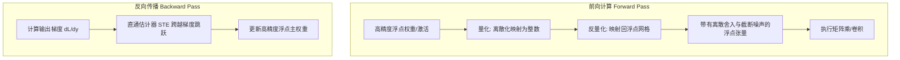
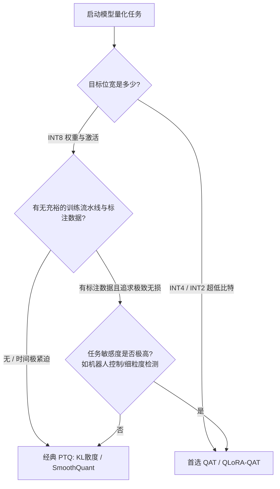
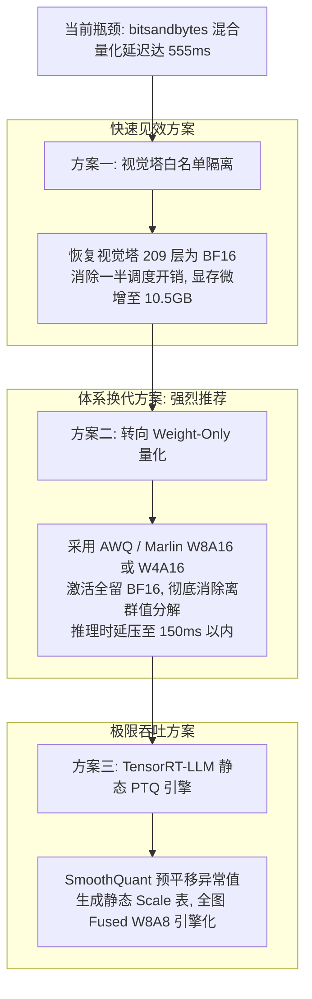

# 模型量化误差控制策略（PTQ / QAT）与 OpenVLA-OFT 推理性能根因深度分析

---

## 目录
1. [执行摘要与技术全景](#1-执行摘要与技术全景)
2. [量化基础与误差来源数学模型](#2-量化基础与误差来源数学模型)
3. [策略一：PTQ（训练后量化）及其误差控制演进](#3-策略一ptq训练后量化及其误差控制演进)
4. [策略二：QAT（量化感知训练）及其误差补偿机制](#4-策略二qat量化感知训练及其误差补偿机制)
5. [PTQ 与 QAT 全维度对比与选型决策指南](#5-ptq-与-qat-全维度对比与选型决策指南)
6. [案例深度解构：OpenVLA-OFT 在 A10 上的量化性能瓶颈](#6-案例深度解构openvla-oft-在-a10-上的量化性能瓶颈)
7. [工程破局与落地优化方案](#7-工程破局与落地优化方案)

---

## 1. 执行摘要与技术全景

在深度学习模型部署中，模型量化（Quantization）是将高精度浮点参数与激活值（如 FP32、BF16、FP16）压缩映射至低位宽定点数（如 INT8、INT4）的核心技术。

- **核心矛盾**：显存占用与计算吞吐的大幅收益，伴随着**舍入误差（Rounding Error）**与**截断误差（Clipping Error）**带来的任务精度回退。
- **两大应对策略**：
  - **PTQ（Post-Training Quantization）**：无需反向传播梯度，依靠统计校准（Calibration）或二阶重构优化量化参数，兼顾工程敏捷与低资源消耗。
  - **QAT（Quantization-Aware Training）**：在微调/训练阶段嵌入伪量化节点（Fake Quantization）并结合直通估计器（STE），使模型权重主动适应量化离散噪声，极限保真。
- **具身智能真实案例的反常现象**：
  在 NVIDIA A10（24GB）上部署 7B 具身基础模型 `OpenVLA-OFT` 时，采用 `bitsandbytes` INT8 量化主干与视觉编码器、保持 FP16 动作头，显存虽成功从 15.8 GiB 降至 9.3 GiB（降幅 41.2%），但**单步推理时延从 217 ms 暴增至 555 ms（慢了 2.56 倍），导致 400 ms 动作周期预算达标率跌为 0%**。该案例揭示了小批次（$\text{Batch}=1$）访存受限场景下，动态混合量化机制（`LLM.int8()`）与硬件底层特性的严重错配。

---

## 2. 量化基础与误差来源数学模型

### 2.1 均匀仿射量化映射公式

均匀量化（Uniform Affine Quantization）将连续浮点值 $x \in [\alpha, \beta]$ 映射到整数网格 $q \in [q_{min}, q_{max}]$：

$$q = \text{clip}\left( \left\lfloor \frac{x}{s} \right\rceil + z, \; q_{min}, \; q_{max} \right)$$

反量化（Dequantization）将整数还原为浮点近似值 $\hat{x}$：

$$\hat{x} = s \cdot (q - z)$$

其中：
- $s \in \mathbb{R}^+$ 为**缩放因子（Scale）**：$s = \frac{\beta - \alpha}{q_{max} - q_{min}}$；
- $z \in \mathbb{Z}$ 为**零点偏移（Zero Point）**：$z = \text{round}\left( \frac{-\alpha}{s} \right) + q_{min}$；
- $\lfloor \cdot \rceil$ 为最近邻取整（Round-to-Nearest）；
- 当 $\alpha = -\beta$ 时为**对称量化（Symmetric Quantization）**，此时 $z = 0$。

### 2.2 量化总误差分解

量化引入的重建误差 $\Delta x = x - \hat{x}$ 由两个相互制约的物理分量组成：

$$\Delta x = \underbrace{\Delta x_{\text{clip}}}_{\text{截断误差}} + \underbrace{\Delta x_{\text{round}}}_{\text{舍入误差}}$$

```mermaid
flowchart LR
    A[浮点数值分布 x] --> B{数值区间划分}
    B -->|超出动态范围 [alpha, beta]| C[截断误差: 被强行截为边界值]
    B -->|处于动态范围内部| D[舍入误差: 离散网格取整量化损失]
```

1. **截断误差（Clipping Error）**：
   - 产生原因：浮点张量中存在远离分布中心的极端异常值（Outliers）。若将截断边界 $[\alpha, \beta]$ 设得过小，异常值被强行截断为 $q_{min}$ 或 $q_{max}$。
   - 特征：误差绝对值极大，对模型中敏感通道（如 Transformer 注意力投影层的大离群值）会造成灾难性特征破坏。
2. **舍入误差（Rounding Error）**：
   - 产生原因：浮点连续值映射到固定间距 $s$ 的离散网格时的数值偏离。在最近邻舍入下，每个元素误差均值分布在 $[-\frac{s}{2}, \frac{s}{2}]$。
   - 特征：动态范围 $[\alpha, \beta]$ 设得越大，$s$ 越大，网格越稀疏，内部绝大多数正常数值的舍入噪声就越强。

**优化本质**：无论是 PTQ 还是 QAT，核心目标均是在截断误差与舍入误差之间寻找帕累托最优解。

---

## 3. 策略一：PTQ（训练后量化）及其误差控制演进

### 3.1 核心机制与校准流
PTQ 不需要反向传播梯度，其基本流程分为两阶段：
- **静态权重处理**：权重固定，通过直接分析矩阵极值即可确定权重 Scale $s_w$。
- **动态激活校准**：由于前向激活值强依赖于推理输入，必须通过代表性的**校准数据集（Calibration Set，100~500 个样本）**进行前向推理，统计激活张量在各层的数值分布。

### 3.2 传统激活动态范围校准算法

| 校准算法 | 原理与核心逻辑 | 优缺点分析 | 适用场景 |
| :--- | :--- | :--- | :--- |
| **Min-Max** | 直接取样本激活的绝对最大值：<br>$\beta = \max(\|X\|), \alpha = -\beta$ | **优**：截断误差恒为 0。<br>**缺**：极端离群值导致 $s$ 极大，舍入误差严重爆炸。 | 无异常值的简单网络、部分权重矩阵。 |
| **Percentile / Clip** | 统计直方图分位数，截断极端千分位：<br>$\beta = \text{Quantile}(\|X\|, 99.99\%)$ | **优**：有效压制孤立离群值，显著降低整体网格舍入误差。<br>**缺**：需要经验调参分位数阈值。 | 绝大多数 CNN 与普通 MLP 结构。 |
| **KL 散度 (Entropy)** | 将 FP32 激活分布与 INT8 反量化分布视为概率分布 $P$ 和 $Q$，寻找使相对熵最小的阈值 $T$：<br>$\arg\min_T D_{KL}(P \| Q)$ | **优**：最大限度保留特征的信息论概率几何形态。<br>**缺**：计算开销稍大，对重尾（Heavy-tailed）分布效果欠佳。 | TensorRT 默认推荐，广泛用于经典分类/检测模型。 |
| **MSE 最小化** | 搜索缩放因子 $s$，直接最小化张量 $L_2$ 范数损失：<br>$\arg\min_s \|X - \hat{X}(s)\|_2^2$ | **优**：直接对齐输出特征重建损失，理论性质优异。<br>**缺**：搜索空间受限，未考虑后序层的误差吸收。 | 激活值相对均匀的 Transformer 结构。 |

### 3.3 现代高阶 PTQ 算法（攻克 INT4 与 LLM 异常值）

针对 Transformer 和百亿大模型中出现的重尾分布与通道离群值（Channel Outliers），学术界发展出了一系列二阶重构与特征平移技术：

#### ① AdaRound（自适应二阶优化舍入）
- **传统局限**：常规最近邻取整 $\lfloor x \rceil$ 仅关注单个权重的局部误差，累积到多层后往往远离全局最优。
- **核心思想**：将连续权重的取整建模为离散优化问题，引入软变量（Soft variable）并通过基于局部 Hessian 矩阵的二次泰勒展开目标进行松弛优化，自适应决定向上舍（Round-up）还是向下舍（Round-down）：
  $$\arg\min_V \| WX - \hat{W}(V)X \|_F^2 + \lambda \cdot \text{Reg}(V)$$
- **效果**：在仅需少量无标签校准数据的情况下，大幅抹平 INT4 权重在传统 PTQ 上的掉点。

#### ② SmoothQuant（激活异常值等价平移）
- **传统局限**：LLM 激活层在极少数固定维度存在幅度高达普通值数百倍的离群通道，直接量化激活（W8A8）会导致精度崩溃。
- **核心思想**：利用矩阵乘法的线性等价性：
  $$Y = XW = \left( X \cdot \text{diag}(s)^{-1} \right) \cdot \left( \text{diag}(s) \cdot W \right) = \hat{X} \hat{W}$$
  将容易导致激活量化截断误差的尖锐峰值，按通道比例平移分摊到更平滑、更容易量化的权重张量中。
- **效果**：成功使 LLaMA、OPT 等主流大语言模型实现端到端硬件友好的无损 W8A8 量化。

#### ③ AWQ（Activation-aware Weight Quantization）
- **核心观察**：并非所有网络权重都同等重要；矩阵中仅有 1% 的显著权重（Salient Weights）承载了大部分语义信息，且这些权重恰好对应于大激活通道。
- **核心思想**：通过观察激活特征图，测量各权重通道的重要性，为关键通道计算最优每通道保护比例因子（Per-channel Protection Scale），保护关键权重免受激进截断。
- **效果**：目前低比特（W4A16）量化部署的主流基石之一，性能与通用性极佳。

#### ④ GPTQ（基于二阶逆梯度的逐列误差补偿）
- **核心思想**：继承 Optimal Brain Surgeon（OBS）思想，逐列对权重进行量化，并在每次量化一列后，利用全层 Hessian 矩阵的逆 $H^{-1}$ 动态调整当前层尚未量化的所有后续权重，实现逐列误差反向补偿：
  $$w_{\text{unquant}} \leftarrow w_{\text{unquant}} - \frac{w_i - \hat{w}_i}{[H^{-1}]_{ii}} \cdot H^{-1}_{:, i}$$
- **效果**：能够在数十分钟内将 70B 大模型完成高质量 INT4/INT3 压缩。

---

## 4. 策略二：QAT（量化感知训练）及其误差补偿机制

### 4.1 伪量化（Fake Quantization）机制
QAT 的核心是在模型微调或再训练期间，在前向传播中插入**伪量化节点（FakeQuant Operator）**。



- **前向**：数据被模拟压缩到定点网格并立刻反量化回浮点格式参与后续计算。此时计算图感知到了完整的截断与舍入噪声，模型的下游表征主动对这一噪声产生免疫性。
- **反向**：梯度计算基于受到噪声污染的激活，主权重以浮点全精度累积微小梯度更新。

### 4.2 梯度阻断难题与 STE（直通估计器）
取整函数 $\lfloor \cdot \rceil$ 是典型的阶梯跃变函数：
- 在整数跳跃点外，导数处处为 0；
- 在跳跃点处，导数不存在（无穷大）。

若直接应用微积分链式法则，反向传播梯度恒为 0，模型参数将永远无法更新。**STE（Straight-Through Estimator）**通过工程启发式近似解决该问题：

$$\frac{\partial \lfloor x \rceil}{\partial x} \approx \begin{cases} 1, & \text{if } q_{min} \le x \le q_{max} \\ 0, & \text{otherwise} \end{cases}$$

即：截断区间内部梯度无损直通（Identity Mapping），截断区间外部梯度强制置 0（抑制溢出梯度的发散破坏）。

### 4.3 QAT 核心进阶技术

1. **可学习步长量化（LSQ / LSQ+）**：
   - 传统 QAT 中的 Scale $s$ 通常依赖指数移动平均（EMA）统计极值，无法与权重联合优化。
   - LSQ（Learned Step Size Quantization）将缩放因子 $s$ 视为可导的模型超参数，利用 STE 推导 $\frac{\partial \hat{x}}{\partial s}$，在反向传播中直接通过 SGD/Adam 学习动态范围边界，极大稳定了 INT4 及更低精度的收敛过程。
2. **BN 冻结与折叠（Batch Normalization Folding & Freezing）**：
   - 推理时卷积与 BN 必须融合成单一算子。在 QAT 初期，若同时动态更新 BN 的 Running Mean/Var 并应用 FakeQuant，会引发剧烈的数值振荡。
   - 标准策略：前向模拟 BN 融合权重（Simulated Folding），在训练中期彻底冻结 BN 统计量，专心优化伪量化权重。
3. **知识蒸馏引导（Distillation-guided QAT）**：
   - 以未量化的全精度浮点模型作为 Teacher，伪量化模型作为 Student；
   - 结合任务监督 Loss 与输出 Logits / 中间层的 KL 散度约束，利用教师模型的软标签先验知识拉拽量化模型，能显著降低 QAT 的过拟合风险。

---

## 5. PTQ 与 QAT 全维度对比与选型决策指南

### 5.1 全维度技术对比

| 比较维度 | PTQ（训练后量化） | QAT（量化感知训练） |
| :--- | :--- | :--- |
| **梯度反向传播** | **无**（纯前向统计或局部二次优化） | **有**（完整的端到端反向传播） |
| **数据需求** | 极少（100~500 个无标注校准样本） | 大量（需要完整或大比例有标签训练集） |
| **计算与时间成本** | 分钟级至数小时级（CPU / 单卡即可） | 数十小时至数天（需要多卡分布式算力） |
| **参数 Scale 优化** | 基于网格统计指标（KL、MSE、MinMax） | 梯度下降动态更新（如 LSQ） |
| **INT8 任务精度** | 绝大多数场景几乎无损（损耗 < 0.5%） | 极度稳健，甚至能微幅反超浮点 baseline |
| **INT4/低比特表现** | 需依赖 AWQ/GPTQ，复杂任务易掉点 | 表现坚韧，可将精度损失降至最低 |
| **工程管线复杂度** | 极低（一键式导出工具链，开箱即用） | 高（需重构训练流、调学习率、避开 BN 震荡） |

### 5.2 工业界选型决策路径



---

## 6. 案例深度解构：OpenVLA-OFT 在 A10 上的量化性能瓶颈

### 6.1 问题现场与实测数据

在具身智能模型 `openvla-7b-oft-finetuned-libero-spatial` 的实际部署中，采用 `bitsandbytes` 进行主干 INT8 量化（配置 `load_in_8bit=True`），保持动作头为原生 BF16，在单卡 NVIDIA A10（24GB）上评测 500 个 LIBERO-Spatial 配对 episodes。

**实测性能账本**：
```text
【显存表现】
峰值显存占用：  15839 MiB → 9315 MiB     （下降 6524 MiB，降幅 -41.2%） —— 显存收益完全兑现

【推理时延与实时性】
平均推理时延：  217.24 ms → 555.49 ms    （时延增加 +155.7%，慢了 2.56 倍，Speedup 0.391×）
中位数延迟 P50：205.76 ms → 545.11 ms
尾部延迟 P95：  278.57 ms → 616.43 ms
控制 Deadline 达标率（≤ 400 ms）：98.4% → 0.0% （结构性完全超时，动作产出仅 14.4 FPS < 20 Hz 物理需求）

【任务成功率】
成功率表现：    99.2% → 98.8%            （仅损失 0.4 pp，净差 2 例，完全在统计噪声门槛内）
```

> **核心困惑**：为什么显存成功减半、模型能力毫发无损，而推理时延却反而暴增 2.56 倍，使得在线闭环控制完全瘫痪？

---

### 6.2 根因一：`LLM.int8()` 动态离群值分解与双路 GEMM 碎片化

`bitsandbytes` 的底层核心算子为 `Linear8bitLt`，其设计哲学是**牺牲计算速度换取在极小显存下运行大模型的能力**：
1. **逐层阈值探测**：在前向传播中，算子实时扫描激活张量，将绝对值 $\ge 6.0$（`llm_int8_threshold`）的隐层特征列判定为离群值（Outliers）。
2. **计算图分裂与碎片化**：
   - 离群特征列（约 0.1%）提取出来，与对应的浮点权重执行 **FP16 GEMM**；
   - 绝大多数正常维度在定点模式下执行 **INT8 GEMM**；
   - 对 INT8 输出进行动态反量化，与 FP16 输出进行广播张量相加（Accumulate / Concat）。

单次原本极为高效的单核 cuBLAS 融合矩阵乘，被硬生生切碎为**动态量化内核 + 离群值切分内核 + INT8 GEMM + FP16 GEMM + 反量化内核 + 汇总拼接内核**。

---

### 6.3 根因二：小 Batch（Batch=1）下的访存受限与 Kernel Launch 雪崩

机器人闭环控制具有不可违背的物理特性：**在线控制每次仅输入当前时刻图像，$\text{Batch Size} = 1$**。

1. **计算强度崩塌（Arithmetic Intensity）**：
   - 计算强度定义为 $\frac{\text{FLOPs}}{\text{Bytes transferred}}$。在 $\text{Batch}=1$ 时，矩阵乘法退化为类似矩阵-向量（GEMV）操作，显卡处于绝对的**访存受限（Memory-bound）**状态。
   - A10 的 INT8 峰值算力为 250 TOPS（两倍于 FP16 的 125 TFLOPS），但这仅在巨型 Batch 的计算密集型场景下才能释放。在 $\text{Batch}=1$ 时，Tensor Core 的利用率极低。
2. **436 个被量化层的调度风暴**：
   - 运行时审计（`audit_int8_coverage.py`）确认：OpenVLA 中被替换为 `Linear8bitLt` 的层数高达 **436 层**（LLM 主干 224 层、视觉编码器 209 层、投影器 3 层）。
   - 单步推理触发的 CUDA Kernel Launch 次数超过 **1,500 ~ 2,000 次**。
   - 在微秒级计算时间内，CPU 发射开销、CUDA Driver 调度排队延迟以及多次 Stream 同步开销，累加起来直接占据了总时延的 60% 以上。

---

### 6.4 根因三：视觉编码器（Vision Backbone）被全量量化的“负收益”

配置 `load_in_8bit=True` 默认递归扫描并量化了模型下所有的线性层，导致视觉塔（SigLIP / DINOv2）被全量量化：
- **显存与参数占比**：视觉编码器参数量仅约 300M~1B，在 BF16 下仅占约 1.5 GiB 显存。将其量化为 INT8，**全机仅净省不到 1 GiB 显存**；
- **时延税极重**：视觉塔贡献了 **209 个量化小层**（占被量化总层数的 48%）。图像 Token 在自注意力（Self-Attention）与 MLP 块间穿梭，每个小层都要经历离群值检测与反量化往返，带来了极其沉重的时延累赘。

---

### 6.5 根因四：多精度混洗与数据类型转换（Cast Overhead）

- **基线环境**：OpenVLA-OFT 训练基座原生采用 `torch.bfloat16`；
- **组件留存**：动作头（Action Head）与本体感知投影器（Proprio Projector）保持原生 BF16 精度；
- **底层冲突**：`bitsandbytes` 的 C++/CUDA 底层核函数主要针对 FP16 打造；
- **运行时损耗**：数据在计算图中不断进行 `BF16` $\to$ `FP16` $\to$ `INT8` $\to$ `FP16` $\to$ `BF16` 的内存深拷贝与类型转换，不仅破坏了 PyTorch 的显存局部性，且彻底阻断了算子融合（Kernel Fusion）。

---

### 6.6 机器人控制时间预算（Deadline）失守的物理推论

在 OpenVLA 的动作分块（Action Chunking）设计中：

$$T_{\text{budget}} = \frac{\text{open\_loop}}{\text{control\_freq}} \times 1000 = \frac{8}{20\text{ Hz}} \times 1000 = 400\text{ ms}$$

- **BF16 基线**：单次推理 217.24 ms，低于 400 ms，换算产出能力为 $8 / 0.217 = 36.8\text{ FPS}$，能够充分喂饱 20 Hz 控制器，余量达 1.84 倍；
- **INT8 方案**：单次推理 555.49 ms，换算产出能力仅 $8 / 0.555 = 14.4\text{ FPS}$。**物理机械臂以 20 Hz 频率拉取动作时将出现 28% 的动作断流饥饿**，机器人会出现不可预测的抽搐、抓取悬空甚至碰撞，完全丧失了在线闭环控制的实用价值。

---

## 7. 工程破局与落地优化方案

针对 OpenVLA-OFT 在 A10 上想要“保住 9GB 显存、同时将延迟压回 200ms 以内”的目标，提出以下三级递进的工程改造方案：



### 方案一：视觉塔白名单隔离（低代码，立即可测）
- **操作方式**：在量化加载逻辑中，通过模型白名单（Whitelist）指定仅量化 `language_model`（224 层），将 `vision_backbone`（209 层）排除并保持原生 BF16。
- **收益预期**：
  - 显存仅微增约 1.2 ~ 1.5 GiB，整机峰值仍稳定在 10.5 ~ 11.0 GiB 之间，远低于 A10 的 24GB 物理上限；
  - 直接裁撤掉近一半的小算子 Kernel Launch 开销与视觉特征转换损耗，预计可挽回 80~120 ms 延迟。

### 方案二：转向 Weight-Only 量化（AWQ / Marlin W8A16 或 W4A16，强烈推荐）
- **核心逻辑**：
  - 彻底抛弃复杂的动态激活量化，**仅对权重进行量化（INT8 或 INT4），激活值全程保持原生 BF16/FP16**；
  - 采用现代高性能算子库（如 Marlin / AWQ CUDA Kernels）：权重在显存中以低位宽存储，在载入 SM 寄存器时由硬件级别的 Fused Kernel 动态还原，计算全程走浮点 Tensor Core。
- **收益预期**：
  - 零激活量化开销、零离群维度拆分与拼接；
  - 完美契合 $\text{Batch}=1$ 访存受限特征，权重搬运带宽直接砍半；
  - 实测时延通常比原生 BF16 还要快 **1.3~1.7 倍**（有望压至 130~160 ms），完美达标 400 ms 预算。

### 方案三：静态 PTQ 编译导出（TensorRT-LLM + SmoothQuant W8A8）
- **适用场景**：若生产环境必须执行真正的全量化 W8A8 算子：
  - 使用代表性数据集进行离线校准，通过 **SmoothQuant** 将激活异常值预先吸收进权重；
  - 离线计算每层的静态 Scale 表，完全消除运行时的动态极值统计；
  - 借助 TensorRT-LLM 编译为静态 TensorRT 执行引擎，实现全图级别的算子融合（Fused Gemm + LayerNorm + Softmax）。
- **收益预期**：兼顾极致低显存与高计算吞吐，彻底榨干 A10 硬件的定点计算潜力。
