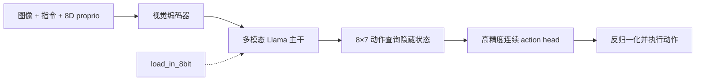
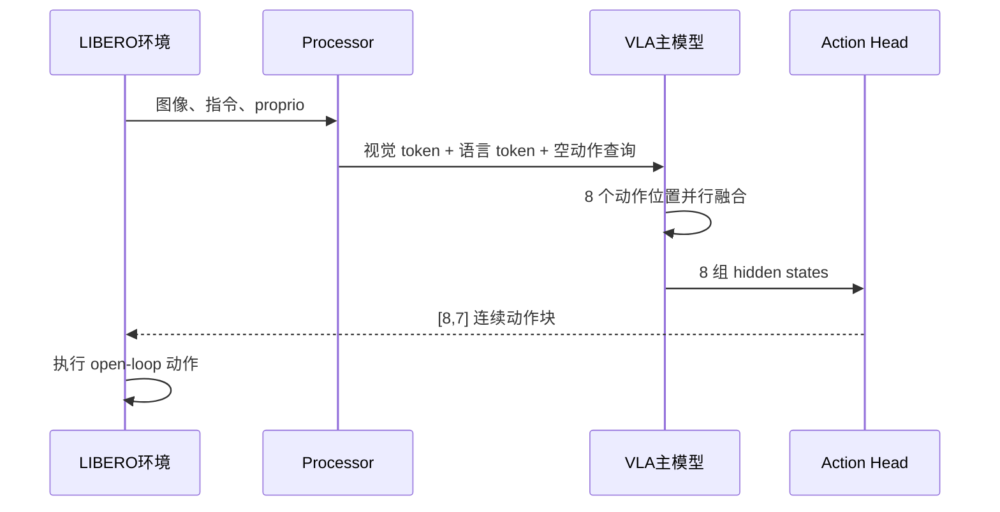

# OpenVLA-OFT 并行解码与 INT8 实验：验收标准与文档总结

> 更新日期：2026-09-12  
> 适用范围：LIBERO-Spatial、OpenVLA-OFT、`openvla-7b-oft-finetuned-libero-spatial`  运行时对照  
> 当前状态：运行包和统计脚本已准备；新实例上的 INT8 实测结果尚未形成。

## 1. 结论先行

本实验要回答三个问题：

1. OFT 的一次并行动作查询能否稳定输出 8 个 7D 动作；
2. 主模型加载为 INT8 后，延迟、FPS 和显存是否改善；
3. 在动作头保留高精度时，LIBERO 成功率损失是否可接受。

工作区已经具备 `load_in_8bit` 和 `load_in_4bit` 配置入口，但当前运行代码使用 `torch.bfloat16`。因此现成脚本的准确实验名称是：

```text
BF16 baseline
vs
INT8 VLA 主模型 + BF16 action head/proprio projector
```

它不是严格的 FP16→INT8 对照。已有 FP16 文件只能作为历史性能参考，不能替代本次同状态 INT8 对照。

当前已有历史 FP16 推理基线：

| 指标 | 已有值 |
|---|---:|
| GPU | NVIDIA A10 |
| 动作块 | 8 × 7 |
| 平均延迟 | 219.520 ms |
| Policy query FPS | 4.56 |
| 8-action FPS | 36.44 |
| 峰值 allocated 显存 | 14.963 GiB |

来源：[openvla_oft_fp16_baseline.json](../04-评测结果/baseline/openvla_oft_fp16_baseline.json)。这组数据没有 INT8 配对结果，不能计算成功率损失。

## 2. 文档边界

### 本次请求包含

- 新 GPU 实例建立独立 Python 虚拟环境；
- OFT 并行解码原理和运行验证；
- INT8 主模型推理；
- 延迟、P50/P95、Policy FPS、8-action FPS、显存和成功率对比；
- 动作头高精度保留策略的验收。

### 参考文档但不属于本次验收

`08-后续实验验证/README.md` 中的 00～07 实验，包括抓取恢复、321 重定位、20/50Hz 消融、top drawer 扫描和 DAgger 训练。这些实验有各自的状态机、数据和验收条件，不能混入 INT8 结论。

## 3. 模型和数据流

把 VLA 想成一条机器人生产线：视觉模块负责“看”，语言模块负责“结合任务理解”，动作头负责“把理解翻译成机械臂命令”。INT8 只改其中主干的数值表示，不能默认认为所有模块都被量化。



一次典型查询：



OFT 的“并行”不是同时运行 8 个模型，而是一次 forward 同时计算 8 个动作位置。于是：

```text
policy_query_fps = 1000 / 平均 forward 延迟(ms)
predicted_action_fps = 8 × policy_query_fps
executed_action_capacity_fps = open_loop × policy_query_fps
```

## 4. INT8 原理和敏感度

对线性层权重，可直观写成：

```text
W ≈ scale × QINT8
```

权重被压缩为 8-bit 整数和缩放因子，矩阵计算时由 bitsandbytes 执行量化路径；异常值通常需要保留更高精度路径。因此 `load_in_8bit=True` 是“加载时量化”，不是把整个 VLA 文件永久改写成 INT8。

不同模块对误差的容忍度不同：

| 模块 | 误差影响 | 本实验策略 |
|---|---|---|
| 视觉编码器 | 视觉特征略有偏移，可能改变几何判断 | 由运行时实际审计覆盖范围 |
| LLM 主干 | 语言—视觉融合 hidden state 改变 | INT8 候选量化对象 |
| proprio projector | 当前状态嵌入偏移 | 保留 BF16 |
| action head | 直接输出位移、姿态和夹爪动作，误差可能累积 | 保留 BF16 |

动作头不能直接按普通分类层处理：在狭窄抽屉、碗边缘和夹爪闭合阈值附近，小的连续数值偏差可能改变接触时序，最终表现为抓取失败。因此首轮只量化主模型，动作头保持高精度。

## 5. 实验矩阵

两组必须严格配对：

| 项目 | 高精度组 | INT8 组 |
|---|---|---|
| `load_in_8bit` | `False` | `True` |
| `load_in_4bit` | `False` | `False` |
| 当前代码主 dtype | BF16 | INT8 主干 + BF16 非量化模块 |
| checkpoint | 相同 | 相同 |
| task/state 集合 | 相同 | 相同 |
| seed | 相同 | 相同 |
| `chunk_size` | 8 | 8 |
| `num_open_loop_steps` | 8 | 8 |
| `control_freq` | 20 Hz | 20 Hz |

如果必须做字面上的 FP16→INT8，必须额外让模型输入、视觉/主干非量化部分、proprio projector 和 action head 全部使用 FP16，并重新执行 FP16 baseline；不能只把结果标签从 BF16 改成 FP16。

## 6. 分级验收标准

### G0：独立环境

必须满足：

- Python 3.10；
- 使用 `/mnt/workspace/venv_oft` 等独立 `venv`，`sys.prefix != sys.base_prefix`；
- Torch 能看到 CUDA，GPU 显存建议至少 16 GiB；
- `torch`、`numpy`、`gym`、`robosuite`、`mujoco`、`transformers`、`bitsandbytes` 可导入；
- OFT 的 Transformers fork 可导入；
- 不强制安装 Flash-Attention，默认使用 PyTorch SDPA；
- `NUM_ACTIONS_CHUNK=8`、`ACTION_DIM=7`、`PROPRIO_DIM=8`。

G0 不通过时不启动长评测。

### G1：量化路径和功能

必须满足：

- `load_in_8bit=True`；
- `load_in_4bit=False`；
- 两个量化开关不能同时开启；
- 运行时至少发现一个 bitsandbytes 量化线性层或等价量化参数；
- 明确记录实际被量化的模块范围，不能未经审计写成“只量化 LLM”；
- action head/proprio projector dtype 与实验声明一致；
- 每次输出形状为 `[8,7]`；
- 没有 NaN、Inf、dtype mismatch 或 CUDA OOM；
- 每个目标 episode 都产生完整摘要。

### G2：性能和实时性

延迟丢弃前 3 个 warmup chunk 后统计 mean、P50、P95，并计算：

```text
policy_query_fps = 1000 / mean_latency_ms
predicted_action_fps = 8 × policy_query_fps
```

当前配置 `open_loop=8, control_freq=20` 的动作块时间预算为：

```text
8 / 20 × 1000 = 400 ms
```

建议把 `chunk_deadline_met` 达标率设为至少 95%。INT8 若平均延迟不高于高精度组，可称为“性能无回退”；若还要称为“性能收益”，应同时报告明确的 speedup，而不能只凭理论推断。

### G3：显存

- 两组都必须无 OOM；
- 记录 `nvidia-smi` 采样最小/峰值显存；
- INT8 峰值显存不高于高精度组，才算通过资源验收；
- 若显存反而升高，需检查 CUDA context、缓存分配器、其他进程和量化覆盖范围。

### G4：成功率

快速集默认是 5 个已知难例：

```text
4:29, 4:32, 5:35, 6:20, 7:27
```

这组只作冒烟检查，不作最终成功率结论。

正式结论使用同 seed、同 state 顺序的完整 LIBERO-Spatial 500 episodes：

```text
success_loss_pp = (high_precision_success_rate - int8_success_rate) × 100
```

建议工程门槛：

| 成功率损失 | 判定 |
|---:|---|
| ≤ 1.0 个百分点 | 通过，可进入重复性复核 |
| 1.0～2.0 个百分点 | 结果可用但需复核，不能直接部署 |
| > 2.0 个百分点 | 失败，回退量化范围或保留更多高精度模块 |

同时报告 paired regressions，即高精度成功而 INT8 失败的相同 task/state 数量。成功率不下降不代表动作完全相同，只代表任务级结果没有观察到损失。

### G5：可复现性

必须保存 GPU 型号、驱动、Torch/CUDA、Python 包版本、checkpoint、脚本版本、seed、目标列表、运行时间和 GPU 进程列表。两组应在同一实例、同一环境、同一 checkpoint 下连续完成；显存被其他进程污染时，结果只能标记为无效或待复核。

## 7. 执行顺序和产物

1. 激活独立 `venv`，完成 G0；
2. 用 5 个目标状态跑 `bash tools/09_int8_benchmark.sh all`，完成 G1/G2/G3 冒烟；
3. 确认无量化加载错误后，设置 `TARGETS=""` 跑完整 500 episodes；
4. 检查 `summary/metrics.csv` 和 `summary/report.md`；
5. 最后根据 G4/G5 判定能否接受 INT8。

结果目录必须至少包含：

```text
bf16/run_config.txt
bf16/console.log
bf16/gpu_memory.csv
bf16/actions/**/chunks.jsonl
bf16/actions/**/episode_summary.json
int8-mixed/run_config.txt
int8-mixed/console.log
int8-mixed/gpu_memory.csv
int8-mixed/actions/**/chunks.jsonl
int8-mixed/actions/**/episode_summary.json
summary/metrics.csv
summary/report.md
```

缺少任一关键文件时不估算、不补填，直接标记该组无效并重跑。

## 8. 当前项目证据和未完成项

### 已有证据

- OFT 源码已具备 `load_in_8bit` / `load_in_4bit` 配置入口；
- OFT 已具备一次输出 `8×7` 动作块的并行解码路径；
- 已有 A10 FP16 推理性能基线；
- 已有 LIBERO-Spatial 基座成功率历史结果，但它不是本次 FP16/BF16 与 INT8 的同状态配对结果；
- INT8 运行包、显存采样脚本和汇总脚本已经准备。

### 尚未完成

- 新实例独立 `venv` 的实际安装验证；
- INT8 bitsandbytes 量化模块运行时审计；
- INT8 5 状态冒烟；
- BF16/INT8 或严格 FP16/INT8 的完整配对评测；
- 延迟、FPS、显存和成功率损失的正式数值。

因此当前只能说“实验管线已准备”，不能说“INT8 已通过验收”。

## 9. 失败处理

| 现象 | 处理 |
|---|---|
| bitsandbytes CUDA/ABI 错误 | 先记录 Torch/CUDA/bitsandbytes 版本，不切换成 4-bit 冒充 INT8 |
| dtype mismatch | 检查主干输出、输入、action head/proprio projector dtype |
| 显存没有下降 | 审计实际量化覆盖范围和其他 GPU 进程 |
| 成功率下降 | 先保持 action head 高精度，再逐层跳过视觉编码器或部分主干量化 |
| 5 状态结果波动 | 不下成功率结论，改跑完整 500 episodes |
| 缺少统计量或反归一化异常 | 停止实验，恢复 checkpoint 的 `libero_spatial_no_noops` 统计量 |

## 10. 相关文件

- [INT8 运行说明](./INT8量化推理说明.md)
- [后续验证脚本 README](./README.md)
- [INT8 benchmark 脚本](./int8_complete_runtime_v3/tools/09_int8_benchmark.sh)
- [结果汇总脚本](./int8_complete_runtime_v3/tools/summarize_int8_benchmark.py)
- [源码配置入口](./int8_complete_runtime_v3/experiments/robot/libero/run_libero_eval.py)
- [模型加载和动作头 dtype](./int8_complete_runtime_v3/experiments/robot/openvla_utils.py)
- [项目时间线](../00-项目文档时间线.md)
