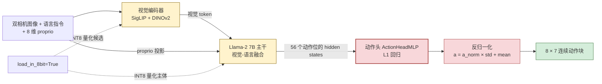
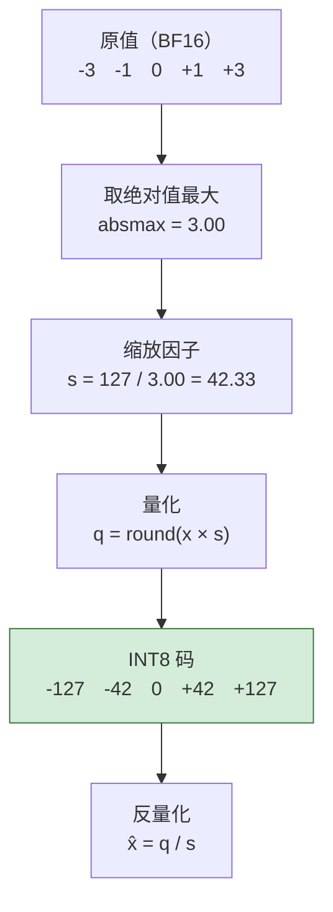
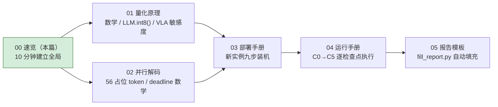

# 00 · 先读我：量化在 VLA 中的全景速览

> **10 分钟读完。** 目标：读完你能回答四个问题 —— **量化了谁、怎么量化的、省了什么、代价是什么**。
>
> 这一篇只讲"是什么、值不值"。往下深挖：
> 数学与 LLM.int8() 原理 → [01-INT8与FP16量化教程和入门手册](./01-INT8与FP16量化教程和入门手册.md)；
> 并行解码 → [02-VLA并行解码深入原理与算法](./02-VLA并行解码深入原理与算法.md)；
> 怎么跑、怎么判 → [04-实验运行手册](./04-实验运行手册.md)、[05-INT8实验结果报告模板](./05-INT8实验结果报告模板.md)。

---

## 一页结论

| 问题 | 答案 |
|---|---|
| **量化了谁** | **VLA 主干全部线性层** —— 视觉编码器（209 层）+ Llama-2 7B（224 层）+ projector（3 层），共 **436 个 `Linear8bitLt`（99.8%）**。动作头与 proprio projector **绝不量化**（代码里写死 BF16，实测确认） |
| **怎么量化** | bitsandbytes **LLM.int8()**：对称 absmax；权重按输出通道、激活按 token；离群维度回退 FP16 |
| **省了什么** | 峰值显存 **15.47 → 9.10 GiB，省 6.37 GiB（−41.2%）** —— 这是唯一确定兑现的收益 |
| **代价是什么** | **推理慢了 2.56 倍**（217 → 555 ms），deadline 达标率 **98.4% → 0.0%**，**实时性直接不达标** |
| **任务能力如何** | 500 配对 episodes：**99.2% → 98.8%（−0.4 pp）**，在 ≤1.0 pp 门槛内，**无观测损失** |

> **一句话**：在这套 VLA 上，INT8 买到的是**显存**，不是**速度**。
>
> §4 给实测数据与三条判读；完整报告见 `05` 生成的 `<RUN_TAG>/INT8实验报告.md`。

---

## 1. 量化只碰流水线的中间那一段

一次 VLA 推理是"看 → 理解 → 动手"三段：



| 部件 | 干什么 | 误差会怎样表现 | 本实验策略 |
|---|---|---|---|
| 视觉编码器 | 把图像变成视觉 token | 几何特征轻微偏移，下游有冗余可吸收 | **随主干一起被量化（209 层，已实测）** |
| **Llama-2 7B 主干** | 视觉-语言融合、产出动作位 hidden state | hidden state 整体偏移，后续层部分吸收 | **INT8 量化的主体** |
| proprio projector | 把 8 维本体状态嵌入 | 输入路径，影响小 | 保留 BF16 |
| **动作头** | 把 hidden state 回归成连续动作 | **误差 1:1 变成物理位移** | **必须 BF16，红线** |

**为什么动作头是红线**（四个机制叠加，详见 [01 §6.2](./01-INT8与FP16量化教程和入门手册.md)）：

1. 它是**回归**不是分类 —— 输出本身就是物理量，没有 Argmax 那种"错一点无所谓"的缓冲。
2. **反归一化会放大误差** —— `a = a_norm × std + mean`，`std` 是厘米~分米量级，输出侧千分之几的误差乘上去就是毫米级偏差。
3. **开环执行让误差累积** —— 一次出 8 步连着执行不重看画面，越走越偏。
4. **夹爪闭合是阈值事件** —— 闭合早晚 1~2 步，任务就失败。

---

## 2. 量化在数值上做了什么：五个数字

取一行权重（或激活）`[-3, -1, 0, 1, 3]`，bitsandbytes 的做法是：



**注意 `0 → 0`、码值左右对称** —— 这就是判断"对称 / 非对称"最直接的证据。

### 三个必须记住的点

| # | 事实 | 细节 | 说错会怎样 |
|---|---|---|---|
| 1 | **对称量化，zero_point = 0** | `q = round(x · 127 / absmax(x_row))`；反量化除以同一个 `s` | 写成"非对称"就错了。非对称是 `q = round((x − x_min)·s) + z`，码值落在 0…255 |
| 2 | **粒度是"逐行"，不是 per-tensor** | 权重按**输出通道**（W 的每一行）各一个 scale（bnb 的 `SCB`，形状 `[out_features, 1]`）；激活按**每个 token 行**各一个 scale | 说成 per-tensor 会严重高估误差 |
| 3 | **不是"全 INT8 算"** | 激活中**绝对值 ≥ 6.0**（`llm_int8_threshold` 默认值）的**离群特征维度**被切出来用 **FP16** 单独算，其余才走 INT8 | 说成"整个主干全 INT8"会低估显存和延迟 |

> 第 3 点是 LLM.int8() 的**灵魂**：LLM 激活里存在极少数绝对值上百的"异常值维度"，
> 强行压进 ±127 会把其余正常值挤成 0，模型直接失智。所以必须留一条 FP16 逃生通道。

十秒自证（不用跑模型）：

```bash
python - <<'PY'
import torch, bitsandbytes.functional as F
q, s = F.quantize_rowwise(torch.tensor([[-3., -1., 0., 1., 3.]]))
print("int8 码 :", q.tolist())   # [[-127, -42, 0, 42, 127]] —— 关于 0 对称
print("s       :", s.tolist())   # [[42.33...]] = 127/3
PY
```

---

## 3. 三个反直觉的事实

### 3.1 checkpoint 一个字节都没变

`load_in_8bit=True` 是**加载时量化**：`from_pretrained` 过程中把模型里的 `nn.Linear`
替换成 bitsandbytes 的 `Linear8bitLt`，每次加载在线转换一次。

**所以"INT8 实验"不产生任何新的权重文件**，也没有离线标定产物。它改变的只是运行时的数值路径与显存占用。

### 3.2 显存不是精确减半

权重从 2 字节/参数压到 1 字节/参数，理论上省一半。实际达不到，因为还要额外装：

- 每行的 FP16 scale（很小，可忽略）；
- **离群维度对应的 FP16 权重**（§2 第 3 点，模型相关，通常不到 1 GiB）；
- 量化 / 反量化的工作缓冲。

本机实测：**整机峰值显存**从 15.47 GiB 降到 9.10 GiB，**省 6.37 GiB**。
这与"主干权重省约 6 GiB"的理论值很接近（因为主干权重占了显存的大头），
但确实不是精确一半。

### 3.3 变慢才是常态，不是 bug

A10 的 INT8 Tensor Core 峰值算力确实是 FP16 的两倍（125 vs 62.5），
但 LLM.int8() 在**低 batch 推理**下要付四笔额外开销：

1. 激活的量化 / 反量化各自是独立 kernel；
2. 离群维度要**把一次矩阵乘切两半**算完再拼回去；
3. 逐行 scale 意味着反量化时要按行缩放，访存模式更碎；
4. VLA 单步推理是 **batch = 1、序列短**，没有 batch 可以摊薄上面这些固定开销。

而 "batch=1 是带宽受限"这个利好（搬的字节少一半）**被上面四笔开销吃掉了还倒亏**。

> **结论**：不要以为"量化 = 加速"。INT8 的可预期收益是**显存**；延迟必须实测，
> 而且在这类 VLA 单步推理上，**变慢是大概率事件**。

---

## 4. 实测：省了显存，赔了速度

环境：魔搭 DSW，A10 24G，torch 2.2.0+cu121，bitsandbytes 0.43.3，Python 3.10。

> **单位约定**：本节及后续**显存数字一律用 GiB**（2³⁰ B，与 `nvidia-smi` / torch 口径一致）；
> 讲**文件大小**时用 GB（10⁹ B）。两者差 7.4%，换算如 `15.08 GB = 14.05 GiB`，混用会读出差一个量级的错觉。
> 显存数字的完整推法（参数倒推 → 换乘数 → 实测校验）见 [01 §4.3](./01-INT8与FP16量化教程和入门手册.md)。

| 指标 | BF16 baseline | INT8 主干 + BF16 头 | 变化 |
|---|---:|---:|---|
| 平均延迟 | **217.24 ms** | **555.49 ms** | **慢 2.56 倍**（speedup **0.391×**） |
| P50 延迟 | 205.76 ms | 545.11 ms | +164.9% |
| P95 延迟 | 278.57 ms | 616.43 ms | +121.3% |
| policy query FPS | 4.60 | 1.80 | −60.9% |
| 动作产出 FPS（8/块） | 36.82 | 14.40 | −60.9% |
| deadline 达标率（≤400 ms） | 98.4% | **0.0%** | ❌ 门槛 ≥95% |
| **峰值显存** | **15839 MiB**（15.47 GiB） | **9315 MiB**（9.10 GiB） | **−6524 MiB（−41.2%）** |
| **成功率**（500 配对 episodes） | **99.2%** | **98.8%** | **−0.4 pp**（≤1.0 pp ✅） |
| 采样 GPU 利用率 | 7.7% | 10.3% | — |

历史 FP16 基线（`04-评测结果/baseline/openvla_oft_fp16_baseline.json`）：
219.52 ms / 4.56 query FPS / 36.44 action FPS / 14.963 GiB —— 与本次 BF16 组同量级，
说明 BF16 组测到的 217 ms 是可信的。

### 三条判读

**① 显存收益确实兑现了。** 省 6.37 GiB（−41.2%），方向和量级都与理论一致。
量化范围已实测确认：**436 个 `Linear8bitLt`（99.8%），视觉编码器 209 层 + LLM 224 层 + projector 3 层**。

**② 实时性从"刚好够"掉到"完全不够用"。** 这是最要紧的一条：

```text
控制频率 20 Hz，即每秒需要 20 个动作。
BF16：动作产出 36.82 FPS ≥ 20  →  够用，余量 1.84×
INT8：动作产出 14.40 FPS < 20  →  供不上，缺口 28.0%
```

BF16 组 217 ms 也在 400 ms deadline 之内（占用 54.3%）；
INT8 组 555 ms 已达预算的 **138.9%**，**超预算 38.9%** —— 且 **500 个 episode 里没有一个 chunk 达标（0.0%）**。
换句话说，INT8 组**连"能供上 20 Hz 动作"这条底线都没过**，开环缓冲会被抽干。
这不是"概率上偶尔超时"，而是**结构性未达标**：平均延迟单独一项就已经越过预算线。

**③ 成功率没有可观测损失（本次已可下结论）。** 完整 500 配对 episodes：
496 vs 494，**净损失 +0.4 pp**，落在 ≤1.0 pp 门槛内；
其中 INT8 反超 2 例、回退 4 例。按 [01 §7.6](./01-INT8与FP16量化教程和入门手册.md) 的判读规则，
正确表述是"**在 500 episode 上没有观察到可归因于量化的成功率损失**"，
而非"INT8 不损伤成功率"（+0.4 pp 本身就在统计噪声量级内）。

> **实测口径说明**：延迟与显存是**模型级指标**，与评测了多少个 episode 无关；
> 成功率是**评测集指标**，样本不全就不能谈。本次为完整 500 episodes 同 seed 同状态配对，两类指标都可下结论。

---

## 5. 七个最容易被说错的点

| # | 常见说法 | 纠正 |
|---|---|---|
| 1 | "这个实验是 FP16 → INT8" | 是 **BF16 → INT8+BF16**。当前 checkpoint 与推理代码的原生精度是 BF16；历史那份叫 `fp16` 的基线只能作性能参考 |
| 2 | "量化的动作头 / 主干 BF16、动作头 INT8" | 反了。是**主干 INT8、动作头 BF16**。`load_in_8bit` 只作用于 HF 主干，动作头外置且写死 BF16，量化不到 |
| 3 | "量化了的就是 LLM" | **这句最容易错**。实测（本项目 checkpoint）：436 个 `Linear8bitLt`，**视觉编码器 209 层也在内**。正确口径是「主干 + 视觉编码器均被量化」，别写"只量化了 LLM"。详见 [01 §5.1](./01-INT8与FP16量化教程和入门手册.md) |
| 4 | "非对称量化" | 是**对称 absmax**，没有 zero-point |
| 5 | "整个主干都用 INT8 算了" | 离群维度仍走 FP16，不是纯 INT8 计算 |
| 6 | "量化能加速" | 实测**慢了 2.56 倍**。可预期的是省显存，不是提速 |
| 7 | "把动作头（或主干）改成 FP32 会更快更准" | **都反了**。① 动作头：A10 上 FP32 吞吐垫底（31.2 vs BF16 的 125 TFLOPS），且它只占主干 1/50 的权重，改它动不了延迟。② 主干：FP32 权重 **30.17 GB（28.09 GiB）> A10 的 24 GB**，加载就 OOM。③ 两者都换不回精度 —— ckpt 盘上就是 BF16 存的，FP32 只是补零位。详见 [01 §6.2](./01-INT8与FP16量化教程和入门手册.md) |

---

## 6. 接下来读哪篇



| 你想干什么 | 去读 |
|---|---|
| 搞懂 absmax / per-channel / PTQ-QAT / 异常值分解的推导 | [01](./01-INT8与FP16量化教程和入门手册.md) §2–§5 |
| 搞懂为什么必须是"主干 INT8 + 动作头 BF16" | [01](./01-INT8与FP16量化教程和入门手册.md) §6 |
| 搞懂 56 个占位 token、400 ms deadline 是怎么来的 | [02](./02-VLA并行解码深入原理与算法.md) §3–§4 |
| 从零开一台 A10 实例 | [03](./03-A10部署手册与实验文档框架.md) |
| 现在就开跑 / 出故障 | [04](./04-实验运行手册.md) |
| 实验跑完出报告 | [05](./05-INT8实验结果报告模板.md) |
| 上位验收红线 G0~G5 | [../08-后续实验验证/INT8实验验收标准与文档总结.md](../08-后续实验验证/INT8实验验收标准与文档总结.md) |
