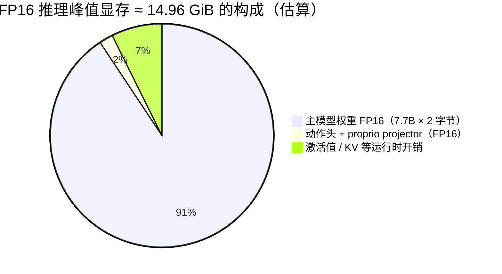
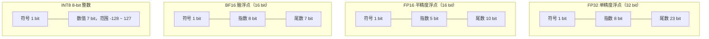
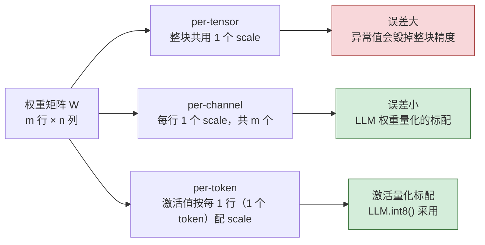
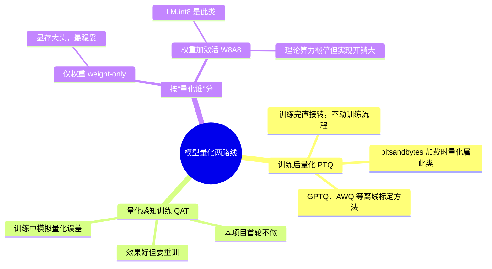
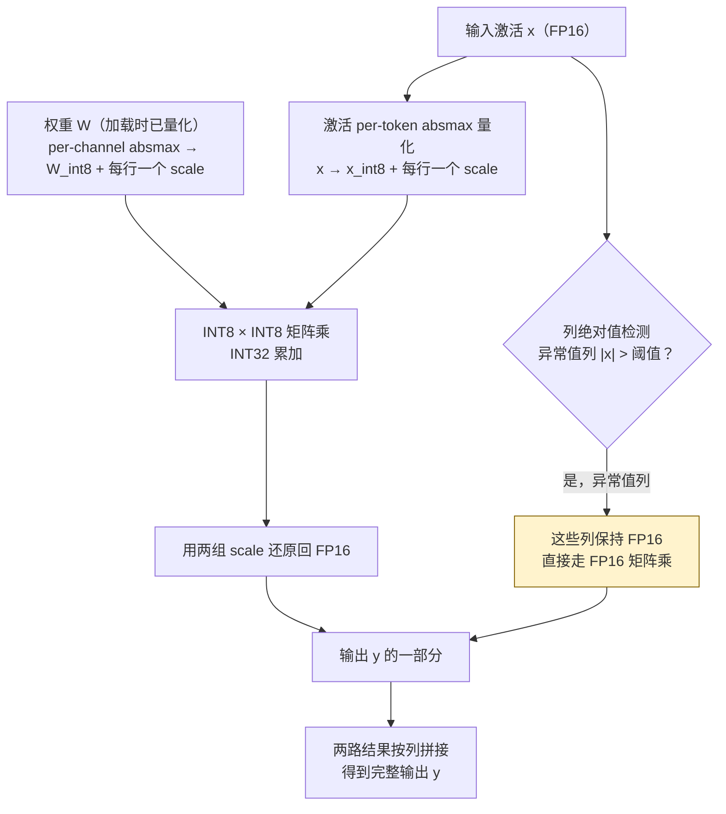
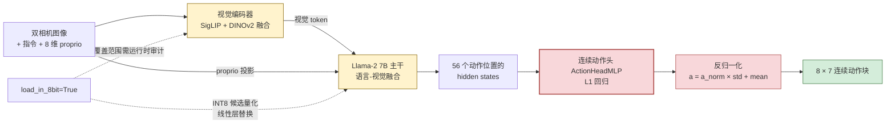
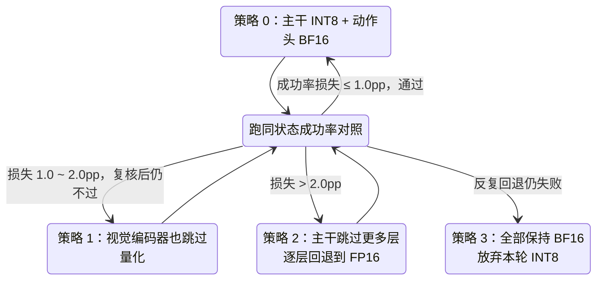
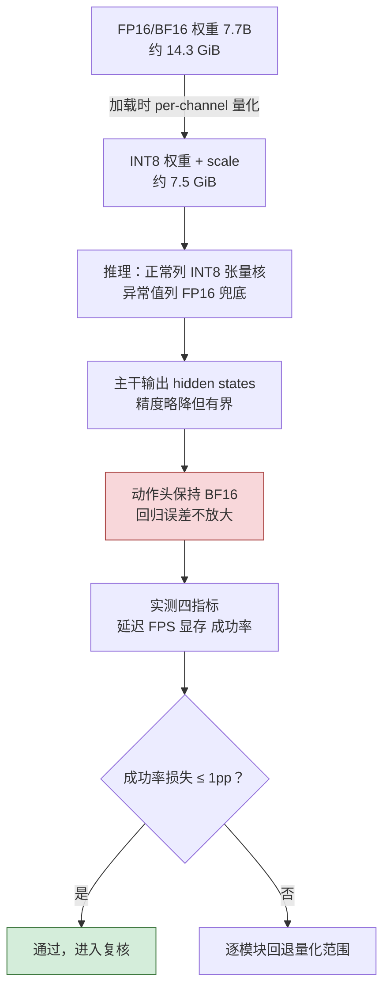

# INT8 与 FP16 量化教程和入门手册

> **读者定位**：第一次接触模型量化、要在本项目（OpenVLA-OFT @ A10 24G）上跑通并记录一次 INT8 推理的工程师。
> **写法约定**：先讲直觉再讲公式，所有关键机制配 Mermaid 图；所有项目数字都来自本工作区已有文档与源码，标注出处。
> **本手册对应任务**：任务 2（弄懂 INT8 量化原理）+ 任务 1（跑一遍 INT8 推理并记录）。
>
> **只想快速认识量化在 VLA 里干什么？先读 [00-先读我·全景速览](./00-先读我-量化在VLA中的全景速览.md)（10 分钟）。**
> 本手册是它的展开版：§1–§5 讲原理，§6 讲 VLA 敏感度，§7 讲怎么跑。

---

## 0. 这份手册能让你得到什么

| 你的任务 | 对应章节 |
|---|---|
| 弄懂 INT8 量化原理 | §1–§5（数值格式 → 量化数学 → LLM.int8()） |
| 理解为什么"主干 INT8、动作头保高精度" | §6（VLA 三个部件的敏感度） |
| 跑一遍 INT8 推理并记录延迟 / FPS / 显存 / 成功率损失 | §7（动手实验）+ §8（排查表） |

配套文档：
- 并行解码原理 → [02-VLA并行解码深入原理与算法](./02-VLA并行解码深入原理与算法.md)
- 环境从零搭建 → [03-A10部署手册与实验文档框架](./03-A10部署手册与实验文档框架.md)
- 实验验收红线 → [../08-后续实验验证/INT8实验验收标准与文档总结.md](../08-后续实验验证/INT8实验验收标准与文档总结.md)

---

## 1. 为什么量化：A10 24G 上的现实压力

OpenVLA-OFT 的主模型约 7.7B 参数（Llama-2 7B 主干 + SigLIP/DINOv2 视觉编码器），用 16-bit 浮点存储时：

```text
7.7 × 10⁹ 参数 × 2 字节 ≈ 15.4 GB ≈ 14.3 GiB   ← 只是权重
```

本项目实测 FP16 推理峰值显存 **14.96 GiB**（A10 总共 24 GiB）。这意味着：

- 再叠加仿真环境、评测脚本、其他进程，余量已经很薄；
- 想做 50 Hz 高频控制实验（deadline 只有 80 ms，见并行解码手册 §5）需要更低的推理延迟；
- 部署侧希望同卡塞下更多东西。

量化把每个参数从 2 字节压到 1 字节，权重体积**近乎减半**，这是最直接、最便宜的显存优化手段。

### 一次 FP16 推理的显存构成（A10 实测口径，数值为约数）



> 注意：这是估算拆分，用于建立直觉；权威数字以实测 `nvidia-smi` 采样（`gpu_memory.csv`）为准。

---

## 2. 数字表示基础：FP32 / FP16 / BF16 / INT8 长什么样

所有量化讨论的前提是搞清楚"数在硬件里怎么放"。浮点数把比特拆成三段：**符号、指数、尾数**；INT8 就是一个普通的 8-bit 有符号整数。



| 格式 | 位宽 | 指数/尾数 | 数值范围 | 有效十进制精度 | 在本项目中的角色 |
|---|---|---|---|---|---|
| FP32 | 32 | 8 / 23 | ~±3.4×10³⁸ | ~7 位 | 训练优化器状态、累加器 |
| **FP16** | 16 | 5 / 10 | ±65504 | ~3 位 | 历史性能基线（219.5 ms）的口径 |
| **BF16** | 16 | 8 / 7 | 同 FP32 量级 | ~2~3 位 | **当前 checkpoint 与推理代码的原生精度** |
| **INT8** | 8 | （整数） | -128 ~ 127 | 整数，靠 scale 还原 | 本实验的量化目标（bitsandbytes） |

三个新手最容易混淆的点：

1. **FP16 ≠ BF16。** 两者都是 16 bit，但 BF16 的指数位和 FP32 一样多，所以动态范围大、精度低；FP16 反过来，范围小（|x| > 65504 直接溢出）、精度高。大模型普遍用 BF16，因为深度网络里"数值范围大"比"精度高"更保命。
2. **INT8 不是浮点。** 它没有小数点，表达能力来自"整数 × 一个缩放因子"（§3）。一个 INT8 数组配上一个 FP16 scale 数组，平均下来每参数仍约 1 字节出头。
3. **本项目现在跑的是 BF16，不是字面 FP16。** 所以当前实验的严格名称是 **"BF16 baseline vs INT8 主模型 + BF16 动作头"**。如果要做标题上的"FP16→INT8"，必须让主干、输入、动作头、proprio projector 全部显式切到 FP16 并重跑基线——这是验收文档 §5 的硬规则 3。历史上那份 219.5 ms 基线文件名叫 fp16，只能作为性能参考。

---

## 3. 量化的数学：scale、零点与误差从哪来

### 3.1 对称量化（absmax，bitsandbytes 的核心做法）

把一组浮点权重 `W` 压成 INT8，最常用的是对称量化：

```text
scale  s = max|W| / 127
量化   q = clamp(round(W / s), -127, +127)
反量化 Ŵ = s × q          （近似还原回浮点）
```

**走一遍具体数字。** 设某行权重 `[0.12, -0.53, 0.31, -0.07]`：

```text
max|W| = 0.53
s      = 0.53 / 127 ≈ 0.004173
q      = round([28.8, -127, 74.3, -16.8]) = [29, -127, 74, -17]
Ŵ      = s × q = [0.121, -0.530, 0.309, -0.071]
误差   |Ŵ - W| ≤ s/2 ≈ 0.0021（每个数最多差半个量化台阶）
```

结论直觉：**相对误差上界约为 1/254 ≈ 0.39%**。对绝大多数网络层这无伤大雅，但对"输出直接是物理量"的动作头（§6）就不一定。

> **两套写法别混淆。** 本节把 `s` 定义成"除数"（`s = max|W|/127`，反量化时乘回去）；
> bitsandbytes 内部的 `SCB` 存的是它的倒数 `127/max|W|`（量化时乘、反量化时除）。
> 这是同一个东西的两种记法，**不影响任何结论**。写报告时说明用哪套即可。
>
> **一眼判断对称 / 非对称的办法：看 `0` 映射到哪。**
> 对称量化 `0 → 0`（无 zero-point）；非对称量化 `0 → z ≠ 0`。
> 十秒自证命令见 [00 §2](./00-先读我-量化在VLA中的全景速览.md)。
>
> **本项目的实际取值**（bitsandbytes 0.43.3 实测）：确认是**对称 absmax**、
> 权重逐输出通道、激活逐 token —— 与本节描述一致，非对称那条路（§3.2）本项目未使用。

### 3.2 非对称量化（zero-point）

当数据分布明显偏向一侧（比如都是正数）时，引入零点把整数范围利用满：

```text
s = (max - min) / 255
z = round(-min / s)          零点
q = clamp(round(W / s) + z, 0, 255)
Ŵ = s × (q - z)
```

### 3.3 粒度：per-tensor / per-channel / per-token

scale 的粒度越细，量化误差越小，代价是 scale 变多：



LLM 场景的事实标准是：**权重 per-channel（按输出通道/每行）+ 激活 per-token**，这正是下节 LLM.int8() 的做法。

### 3.4 两条技术路线：PTQ 与 QAT



本项目的 `load_in_8bit=True` 属于 **PTQ + 加载时量化 + weight 权重 8bit + 激活 8bit（LLM.int8() 内核）**，下一节展开。

---

## 4. LLM.int8()：bitsandbytes 到底对你的模型做了什么

### 4.1 入口：`load_in_8bit=True` 改变了什么

本项目把 `load_in_8bit` 传给 Hugging Face 的 `AutoModelForVision2Seq.from_pretrained`（见 `int8_complete_runtime_v3/experiments/robot/openvla_utils.py:286`）。Transformers 会扫描模型里的 `nn.Linear`，把符合条件的替换成 bitsandbytes 的 `Linear8bitLt`：

```text
普通 nn.Linear：        y = W_fp16 @ x_fp16 + b
Linear8bitLt：          y = LLM.int8_kernel(W_int8, s_w, x_int8, s_x, W_outlier_fp16) + b
```

**关键认知：checkpoint 文件一个字节都没变。** 这是"加载时量化"——每次加载模型时在线转换。所以"INT8 实验"不产生新的权重文件，只改变运行时的数值路径与显存占用。

### 4.2 LLM.int8() 的两阶段计算

LLM.int8()（Dettmers et al., 2022）对一个线性层的前向分三步：



**异常值分解是 LLM.int8() 不崩溃的灵魂。** 大语言模型的激活分布里存在极少数"异常值维度"，绝对值动辄上百。如果强行把这些列也压进 ±127 的 INT8，其余正常值会被压得几乎为零，模型直接失智。LLM.int8() 的做法是：把异常值列切出来留在 FP16 走原路，正常列走 INT8 快路，最后拼回来。

- 论文使用的阈值 α = 20；Transformers 侧 `BitsAndBytesConfig` 的默认 `llm_int8_threshold = 6.0`，本项目未显式设置，以实际 fork 版本为准。
- 这也解释了一个现象：**INT8 显存不会精确减半**——异常值列的权重仍以 FP16 保存，外加两组 scale 和反量化缓冲。

### 4.3 显存账本：从"推算"到"实测校验"

#### 先统一单位（最容易翻车的地方）

`GB`（10⁹ B）与 `GiB`（2³⁰ B）差 **7.4%**，混用会让结论偏出可观的误差。
本文约定：**文件大小写 GB（十进制），显存计数器写 GiB（二进制，与 `nvidia-smi` / torch 口径一致）**。
换算关系：`15.08 GB = 14.05 GiB`。

#### 第一步：参数量用文件字节倒推，不要猜

```text
model-00001..00004.safetensors 合计   15,082,600,832 B
÷ 2（bf16 每参数 2 字节）             ≈ 7.54B 参数
```

交叉验证：`7.54B − Llama-2-7B 的 6.74B = 0.80B`，正好对应一个 SigLIP-SO400M 量级的视觉编码器
—— 说明"全部按 2 字节存储"这个假设成立，推算可信。

#### 第二步：换 dtype 就是换乘数

```text
每参数字节：INT8 = 1 · FP16/BF16 = 2 · FP32 = 4 · FP64 = 8
权重 = 参数量 × 每参数字节
```

因为是**同一组参数**，比例只由字节数比决定，不必重算参数量：

| dtype | 相对 BF16 | 权重（主干 safetensors） | 装得进 24 GB 吗 |
|---|---|---:|---|
| INT8 | ×0.5 | 7.54 GB（7.02 GiB） | ✅ |
| BF16 | ×1 | **15.08 GB（14.05 GiB）** | ✅ 当前 |
| FP32 | ×2 | 30.17 GB（28.09 GiB） | ❌ |

#### 第三步（关键）：用实测计数器校验

`04-评测结果/baseline/openvla_oft_fp16_baseline.json` 里有 torch 的内存计数器，
把它们与 `nvidia-smi` 采样对齐，得到完整的四项账本：

| 层 | GiB | 来源字段 |
|---|---:|---|
| 权重 + 常驻张量 | 14.3987 | `benchmark_allocated_before_gib` |
| ＋ 推理激活 | 0.5640 | `inference_peak_delta_allocated_gib` |
| ＝ torch 峰值分配 | 14.9627 | `inference_peak_allocated_gib` |
| ＋ 缓存碎片 | 0.0412 | `reserved − allocated` |
| ＝ torch 峰值保留 | 15.0039 | `inference_peak_reserved_gib` |
| ＋ CUDA context / 驱动 | 0.4649 | `nvidia-smi` 与 torch 之差 |
| ＝ **实测峰值** | **15.4688** | `gpu_memory.csv` 的 15839 MiB |

四段加总 `14.3987 + 0.5640 + 0.0412 + 0.4649 = 15.4688`，与 nvidia-smi 完全吻合。

反过来也能校验权重那一项：`14.3987 GiB × 1.0737 ≈ 15.45 GB`，
正好等于**全部** checkpoint 文件字节和（safetensors 15.08 GB ＋ 动作头 0.30 GB ＋ proprio 0.07 GB）
—— 说明"参数量 × 字节数"这个模型本身是准的。

#### 结论：怎么估才安全

- **权重占 93%**，所以"换 dtype 换乘数"只对权重那一项成立，**不能**拿它直接推整机峰值。
- 残差（激活 ＋ 碎片 ＋ context）在 BF16 下约 **1.1 GiB**；INT8 下更大 ——
  实测 INT8 峰值 **9.10 GiB**，而纯理论权重只有 7.02 GiB，多出来的部分是
  **动作头/proprio 仍留 BF16（0.37 GB）＋ 异常值列 FP16 副本 ＋ 每组 scale ＋ 反量化缓冲**。
- 实用法则：**权重估算 × 1.15 ~ 1.25** 才是安全预算；**最终以 `gpu_memory.csv` 采样为准** ——
  这正是验收门 G3 存在的意义。

### 4.4 延迟账本：为什么"显存减半"不自动等于"快一倍"

A10（Ampere 架构）的峰值算力：

| 精度 | A10 峰值（dense） | 备注 |
|---|---|---|
| FP32（CUDA 核） | **31.2 TFLOPS** | 不走 Tensor Core，最慢的一档 |
| TF32 Tensor Core | 62.5 TFLOPS | 指数位同 FP32、尾数 10 位 |
| FP16 / BF16 Tensor Core | **125 TFLOPS** | 当前主干的运行档 |
| INT8 Tensor Core | **250 TOPS** | 理论峰值为 FP16 的 2 倍 |
| 显存带宽 | 600 GB/s | batch=1 解码的真正约束 |

理论上有两个利好：INT8 tensor core 峰值翻倍；batch=1 的解码是**带宽受限**的（每层都要把权重从显存读一遍），权重体积减半意味着搬运减半。

但 LLM.int8() 同时有三笔开销：

1. 激活量化/反量化的额外 kernel；
2. 异常值列的分离与拼接（相当于一次矩阵切两半算再拼）；
3. bitsandbytes 内核本身对 7B 这种中等规模、batch=1 的场景并不总是最优。

所以诚实的预期是：**显存收益是确定的（约省 6 GiB），延迟收益必须在 A10 上实测**。验收门 G2 的措辞正是"INT8 平均延迟不高于高精度组，可称性能无回退；要称性能收益，必须报告实测 speedup"。

**实测结论（2026-09-15，本机 A10，完整 500 配对 episodes）：显存收益兑现，延迟是净亏，任务能力无观测损失。**

```text
峰值显存   15839 MiB → 9315 MiB      省 6524 MiB（−41.2%）  ← 方向与量级都符合预期
平均延迟   217.24 ms → 555.49 ms     speedup 0.391×         ← 慢了 2.56 倍
deadline 达标率（≤400 ms）  98.4% → 0.0%                      ← 结构性未达标
成功率     99.2% → 98.8%             损失 +0.4 pp           ← 在 ≤1.0 pp 门槛内
```

上面三笔开销全部兑现，而 batch=1 的带宽利好不足以抵消：

- 激活的量化 / 反量化各是一个额外 kernel；
- 离群维度把一次矩阵乘切成两半，多一次拼接；
- 逐行 scale 让反量化时的访存变碎；
- VLA 单步推理 **batch = 1、序列短**，没有 batch 可以摊薄这些固定开销。

**不要把它当 bug 排查。** LLM.int8() 在低 batch 推理上慢于 BF16 是已知现象，
不是配置错误。验收门 G2 的措辞"INT8 平均延迟**不高于**高精度组，只能称性能无回退"
正是为此留的余地 —— 而实测连"无回退"都没达到，应如实判定 **G2 未通过**。

> 完整数据与三条判读见 [00 §4](./00-先读我-量化在VLA中的全景速览.md)。

---

## 5. 运行时审计：确认"到底量化了谁"

`load_in_8bit=True` 交给 Transformers 后，哪些 `nn.Linear` 会被替换，取决于模块命名和版本行为——**视觉编码器的线性层可能被量化，也可能没有**。验收门 G1 明确要求运行时审计，不许未经检查就写"只量化了 LLM"。

### 5.1 实测结论（OpenVLA-OFT, A10, bnb 0.43.3）

> 已用 `audit_int8_coverage.py` 在本项目 checkpoint 上跑出确切结果，
> **这是本文所有"量化了谁"表述的权威依据**：

| 项 | 实测 |
|---|---:|
| `Linear8bitLt`（被量化） | **436** |
| 普通 `nn.Linear`（未量化） | 1（末端动作输出投影） |
| 量化覆盖率（线性层） | **436 / 437 = 99.8%** |
| 按顶层模块归组 | `language_model` 224、`vision_backbone` 209、`projector` 3 |
| 动作头 dtype | `bf16`（16 个张量） |
| proprio projector dtype | `bf16`（4 个张量） |

**判读**：**视觉编码器确实在量化范围内**（209 层，占近一半）。
因此本项目正确的表述是「**主干 + 视觉编码器均被量化**」，
显存收益是两侧共同贡献的，回退案例的归因也必须同时考虑视觉特征退化。

### 5.2 复现这段审计

加载模型后跑这一段（可加进评测脚本或单独 notebook）：

```python
import bitsandbytes as bnb
from collections import Counter

int8_layers = [n for n, m in model.named_modules()
               if isinstance(m, bnb.nn.Linear8bitLt)]      # model = get_vla(cfg) 的返回值
n_plain = sum(1 for m in model.modules()
              if isinstance(m, torch.nn.Linear) and not isinstance(m, bnb.nn.Linear8bitLt))

print(f"量化线性层数量: {len(int8_layers)}")
print(f"未量化线性层  : {n_plain}")
print("按顶层模块归组:", Counter(n.split('.')[0] for n in int8_layers))
print("视觉编码器在内?", any('vision' in n.lower() for n in int8_layers))
```

> **两个易错点**：
> ① 统计必须作用在 **`get_vla(cfg)` 的返回值**上 —— 它返回的是 `vla.model`，
> 不是 wrapper（见 `openvla_utils.py:346`）。
> ② 不要用 `elif` 把 `nn.Linear` 分支挂到 `if LinearbitLt` 后面 ——
> `Linear8bitLt` **不是** `nn.Linear` 的子类，两者是并列关系，
> 写错会把未量化层数永远统计成 0。

判定规则：

- `量化线性层数量 > 0` → INT8 路径确实生效（G1 通过的前半）；
- 把归组结果写进实验记录，这就是"实际量化覆盖范围"的审计证据；
- 若为 0 → 量化没生效，检查 bitsandbytes 版本与 CUDA 可用性，不许拿 BF16 结果改名充数。

现成脚本（自包含、只读、不推理）：

```bash
python /mnt/workspace/audit_int8_coverage.py \
    --checkpoint /mnt/workspace/openvla-oft-ckpts/openvla-7b-oft-finetuned-libero-spatial \
    --with-head
```

产物 `audit_int8_coverage.txt` 会被 `fill_report.py` 自动读取并填入报告 §4。

顺手做一个 8-bit 内核冒烟（30 秒确认 bitsandbytes 与 CUDA ABI 匹配）：

```python
import torch, bitsandbytes as bnb
x = torch.randn(8, 8, device="cuda", dtype=torch.float16)
lin = bnb.nn.Linear8bitLt(8, 8, has_fp16_weights=False).cuda()
y = lin(x)
assert y.shape == (8, 8) and torch.isfinite(y).all()
print("[OK] bitsandbytes INT8 kernel 工作正常")
```

---

## 6. VLA 的量化敏感度：为什么动作头必须保高精度

### 6.1 一条流水线上的三种零件

把 VLA 想成一条生产线：**视觉编码器负责"看"，LLM 主干负责"理解"，动作头负责"把理解翻译成机械臂命令"**。三个零件对数值误差的容忍度完全不同。



| 模块 | 误差会怎样表现 | 为什么 | 本实验策略 |
|---|---|---|---|
| 视觉编码器 | 几何特征轻微偏移 | 影响的是"看到什么"，有较多下游冗余 | 可量化，覆盖范围需审计 |
| LLM 主干 | hidden states 偏移 | 理解层，误差会被后续层部分吸收 | **INT8 量化主体** |
| proprio projector | 本体状态嵌入偏移 | 输入路径，影响小 | 保留 BF16 |
| **动作头** | 直接输出位移 / 姿态 / 夹爪命令 | 见 6.2，误差会累积并跨阈值 | **必须保留 BF16/FP16** |

### 6.2 动作头为什么是"误差过敏体质"

动作头对量化误差的敏感，本质是四个机制叠加：

1. **它是回归，不是分类。** 分类模型输出 logits，Argmax 对小扰动有天然容忍（第一名和第二名的差距远大于量化误差）；回归模型输出的每一个数**本身就是物理量**，误差 1:1 传导到末端位置。

2. **反归一化会放大误差。** 模型输出的是归一化动作 `a_norm`，执行前要做

   ```text
   a = a_norm × std + mean
   ```

   位置维的 `std` 通常是厘米~分米量级，输出侧千分之几的相对误差会乘上这个尺度，变成毫米级的位置偏差——在抽屉这种狭窄空间里足够致命。

3. **开环执行会让误差累积。** 并行解码一次出 8 步动作后**连着执行**（不重看画面），第 k 步的动作误差叠在已漂移的状态上，越走越偏。这正是并行解码手册 §5 讲的 open-loop 特性——它是效率的来源，也是误差的放大器。

4. **夹爪闭合是一个阈值事件。** 抓取阶段 gripper 维度从 +1（开）走向 -1（合），闭合时机由连续值跨过判定线决定。哪怕位置误差很小，只要让闭合动作晚发生 1~2 步，任务就失败。

本项目已有实证支撑（见 `00-项目文档时间线.md` §2026-09-06）：head-only 实验中，基座与微调模型的**上游 hidden state 完全一致（最大差异 0）**，唯一变化是动作头输出单维约 **0.047** 的偏移——就足以把 state 29 这类困难抓取推过失败线。这从反面证明：动作头所在路径上，哪怕远小于 INT8 量化误差的扰动都值得警惕。

> **常见追问：既然动作头要保精度，为什么不干脆上 FP32？**
>
> 因为 FP32 在这块卡上**最慢**，而且换不到精度。
>
> 1. **A10 的 FP32 吞吐垫底。** FP32 走 9216 个 CUDA 核，只有 **31.2 TFLOPS**；
>    BF16 走 Tensor Core，是 **125 TFLOPS** —— **BF16 是 FP32 的 4 倍**。当前方案已经在最快那一档。
> 2. **动作头不是瓶颈。** 主干 7B 约 **15.08 GB（14.05 GiB）** 权重，动作头只有 0.30 GB（151M 参数，bf16），
>    是主干的 **1/50**。它在端到端 584 ms 里大约只占 0.5 ms；改它，总延迟变化在 1% 以内。
> 3. **FP32 换不回精度。** 动作头的输入是主干吐出的 hidden state，**本来就是 BF16**（7 位尾数）；
>    cast 成 FP32 不会长回已经丢掉的低位 —— 精度天花板在上游。何况这个 checkpoint 是在
>    BF16 下训练与验证的，改成 FP32 只是把数值路径挪到一个没验证过的状态，
>    结果只会"不一样"，不是"更准"。
>
> 还有副作用：head 是 FP32、输入是 BF16 会触发**隐式 upcast kernel**，多一次显存往返，
> 还可能打断融合算子 —— 实测往往**更慢一点点**。
>
> 工程上也不好改：`openvla_utils.py:492` 写死 `.to(torch.bfloat16)`，
> `09_int8_benchmark.sh:91` 固定写 `action_head_dtype=bf16`，
> `summarize_int8_benchmark.py:132` 断言它必须等于 `"bf16"`；改了还得把 BF16 基座也重跑才配对。
>
> **一句话**：动作头已经是"够用且最快"的一档，它既不是精度瓶颈，也不是速度瓶颈。

> **追问 2：那把主干改成 FP32 呢？**
>
> 这次问对了对象 —— 主干**确实**是瓶颈（占了 99% 的时间）。但方向还是反的，而且更严重：
> **它根本跑不起来。**
>
> - **装不下（决定性）。** 全模型 7.54B 参数：bf16 存 2 字节 = **15.08 GB（14.05 GiB）**，
>   就是当前 checkpoint；fp32 存 4 字节 = **30.17 GB（28.09 GiB）**，
>   而 A10 只有 **24 GB**（`nvidia-smi` 报 23028 MiB ≈ **22.5 GiB** 可用）→ **加载阶段就 OOM**。
>   连"跑起来测一测"的机会都没有。
> - **更慢。** 假设换张卡装下了：FP32 矩阵乘走 CUDA 核只有 **31.2 TFLOPS**，
>   是 BF16 Tensor Core（125）的 **1/4**；权重还要占 **2 倍** 显存带宽（A10 600 GB/s）。
>   batch=1 下本来就是访存受限，预计延迟再翻一倍以上。
> - **精度也提不了。** ckpt 盘上就是 **bf16** 存的（`openvla_utils.py:285` 的
>   `torch_dtype=torch.bfloat16`；7.54B × 2 B ≈ 15.08 GB 正好对上）。
>   加载时 cast 成 FP32，只是给每个权重**补上 9 个零**，被截掉的低位不会回来。
>   想真正回到 FP32 精度，只能**在 FP32 下重新训练** —— 那是另一个项目。
> - **顺带纠正叫法**：FP32 不是"量化"。量化 = **降**位宽（bf16 → int8），换来省显存；
>   FP32 是**升**位宽，准确说法是"以 FP32 加载 / 推理"。
>
> > **中间档 TF32**：Ampere 的 Tensor Core 支持 TF32（**62.5** TFLOPS，指数位同 FP32、尾数 10 位），
> > 比 FP32 快一倍、尾数比 BF16 多 3 位。但同样**恢复不了 bf16 权重已经丢掉的位**，
> > 所以救不了精度；它只适合"训练时就想要 FP32 的指数范围"的场景。
>
> **结论**：**BF16 就是这套 VLA 在 A10 上的甜点** —— 它同时是最快（之一）和最省显存的**可行**档。
> 真要提精度，正道是**微调（LoRA / QLoRA）**，而不是改 dtype。

### 6.3 混合精度策略与失败升级路径



两条红线（来自验收文档）：

- **任何时候都不量化动作头和 proprio projector**——它们在 Hugging Face 主模型之外单独构造，当前代码明确 `.to(torch.bfloat16)`，`09_int8_benchmark.sh` 甚至内置检查：确认不了动作头是 BF16 就拒绝开跑。
- **成功率结论只用完整 500 episodes 同状态对照**，5 个困难状态的快跑只做冒烟。

> **注意这套阶梯解决的是什么问题**：它只针对**成功率损失**。
> 如果延迟本身就退化了（本机实测 **2.56×**），那是 G2 的性能问题 ——
> 按这张表往上回退模块**只会更慢**，方向正好相反。
> 性能问题的出路是换量化路线（weight-only / GPTQ / AWQ），不是缩小量化范围。
> 两者要分清：**"掉点"和"变慢"是两类故障，处理手段相反。**

---

## 7. 动手实验：跑一遍 INT8 推理并记录

### 7.1 你将得到什么对照

```text
A 组：BF16 baseline                 （load_in_8bit=False）
B 组：INT8 主模型 + BF16 动作头/proprio（load_in_8bit=True, load_in_4bit=False）
```

两组除 `load_in_8bit` 外**一切相同**：同一 checkpoint、同一 task/state、同一 seed=7、同一 open_loop=8、同一 control_freq=20Hz。成功率损失只在严格配对下才有意义。

### 7.2 两条命令

环境准备见部署手册。**下面这段是实测跑通过的形式，三个坑都在里面**：

```bash
cd /mnt/workspace/openvla-oft
source /mnt/workspace/activate_oft.sh
export MUJOCO_GL=egl PYOPENGL_PLATFORM=egl     # ← 坑①：必须在 source 之后设

# 快速冒烟：5 个已知困难状态（task:state），验证量化路径能跑通
export RUN_TAG=int8-quick-$(date +%Y%m%d-%H%M%S)
bash /mnt/workspace/run_detached.sh int8quick bash tools/09_int8_benchmark.sh all

# 正式对照：完整 LIBERO-Spatial 500 episodes（约 6~8 小时；先确认冒烟通过）
export TARGETS=""                              # ← 坑②：不设只跑那 5 个冒烟状态
export RUN_TAG=int8-full-$(date +%Y%m%d-%H%M%S)
bash /mnt/workspace/run_detached.sh int8full bash tools/09_int8_benchmark.sh all
```

| # | 坑 | 说明 |
|---|---|---|
| ① | `MUJOCO_GL` 必须写在 `source activate_oft.sh` **之后** | `_common.sh` 里是 `MUJOCO_GL="${MUJOCO_GL:-osmesa}"`，activate 脚本可能把它设回 `osmesa`；本机**没有 libOSMesa**，osmesa 会直接报 `glGetError` |
| ② | 完整评测必须显式 `export TARGETS=""` | 默认值是那 5 个冒烟状态；忘了设就会"跑了几分钟就结束"，还以为成功了 |
| ③ | 用 `run_detached.sh` 而不是前台跑 | 实测 Web IDE 终端会异常退出；detached（`setsid` + `nohup` + stdin 接 `/dev/null`）能扛住断连，日志落在 `/mnt/workspace/_run_<标签>.latest.log` |

> **"命令跑完但没结果"的标准排查顺序**：先 `tail` 那条 latest 日志，
> 再看结果目录里是 `bf16/`+`int8-mixed/` 齐全还是只有一个 —— 只有一个说明中途断了，
> 每个 episode 都已落盘，可以从断点判断进度。

可用的环境变量（脚本 `_common.sh` / `09_int8_benchmark.sh` 定义）：

| 变量 | 默认 | 含义 |
|---|---|---|
| `TARGETS` | `4:29,4:32,5:35,6:20,7:27` | 冒烟目标集；置空为全部 500 episodes |
| `RUN_TAG` | 时间戳 | 结果目录名，建议带 `int8-quick/int8-full` 前缀 |
| `OPEN_LOOP` | 8 | 每 chunk 执行步数，1~8 |
| `SEED` | 7 | 随机种子，两组必须一致 |
| `CONTROL_FREQ` | 20 | 控制频率 Hz，决定 deadline 预算 |
| `GPU_SAMPLE_SECONDS` | 0.2 | 显存采样周期 |

脚本自动完成：量化生效检查（找不到 BF16 动作头直接拒绝开跑）→ 每组先跑评测、`nvidia-smi` 每 0.2 s 采样显存、dump 每个 chunk 的动作 → 调用 `summarize_int8_benchmark.py` 汇总。

### 7.3 产物在哪里、长什么样

```text
<openvla-oft>/experiments/failure_study_runs/<RUN_TAG>/
├── bf16/                     # A 组
│   ├── run_config.txt        #   配置快照（seed、targets、ckpt 路径）
│   ├── console.log           #   完整控制台输出
│   ├── gpu_memory.csv        #   显存采样（timestamp, used MiB, util%）
│   └── actions/**/           #   chunks.jsonl + episode_summary.json
├── int8-mixed/               # B 组，同结构
└── summary/
    ├── metrics.csv           # 两组全部指标
    └── report.md             # 自动生成的对照报告
```

`metrics.csv` 每组包含：`success_rate`、`latency_mean/p50/p95_ms`、`policy_query_fps`、`predicted_action_fps`、`memory_min/peak/delta_mib`。

### 7.4 指标怎么算：四个公式的手感

延迟统计**丢弃前 3 个 warmup chunk**（前几步含 CUDA 预热，不代表稳态）：

```text
policy_query_fps      = 1000 / mean_latency_ms        每秒模型 forward 次数
predicted_action_fps  = 8 × policy_query_fps          每秒可产出的动作数
chunk_deadline 预算    = open_loop / control_freq × 1000 = 8/20×1000 = 400 ms
success_loss_pp       = (BF16成功率 − INT8成功率) × 100
```

用已有 FP16 基线练一次手（来自 `04-评测结果/baseline/openvla_oft_fp16_baseline.json`）：

```text
mean = 219.520 ms
policy_query_fps = 1000 / 219.520 = 4.56
predicted_action_fps = 8 × 4.56 = 36.44
deadline 利用率 = 219.520 / 400 = 54.9%
峰值显存 = 14.963 GiB
```

**算完必须做的两个比较**（只看延迟数字会漏掉真正的结论）：

```text
① 延迟 vs deadline 预算 400 ms
   BF16  217.24 ms → 占用 54.3%　达标
   INT8  555.49 ms → 占用 138.9%　超预算 38.9%，不达标

② 动作产出 FPS vs 控制频率 20 Hz
   BF16  36.82 FPS ≥ 20 → 够用，余量 1.84×
   INT8  14.40 FPS < 20 → 供不上，缺口 28.0%
```

② 比 ① 更本质：它直接回答"机械臂要动作的时候，模型供得上吗"。
本项目 `open_loop = chunk_size = 8`，所以动作产出 FPS 就是 `8 / 平均延迟`。

**实测结果（2026-09-15，完整 500 配对 episodes）**：

```text
峰值显存   15839 MiB（15.47 GiB） → 9315 MiB（9.10 GiB）   省 6524 MiB（−41.2%）
平均延迟   speedup 0.391×                                   慢了 2.56 倍
deadline 达标率（≤400 ms）  98.4% → 0.0%                    结构性不达标
成功率     99.2% → 98.8%（损失 +0.4 pp，≤1.0 pp 门槛内）    无观测损失
```

结论方向与 §4.4 的预测一致：**显存收益兑现，延迟净亏，实时性不达标，任务能力无观测损失**。

### 7.5 记录模板（跑完直接填）

```markdown
## INT8 对照实验记录 <RUN_TAG>

- 日期 / 实例：2026-__-__，dsw-________
- GPU：NVIDIA A10 24G，驱动 ______
- torch 2.2.0+cu121；bitsandbytes ______；transformers fork ______
- checkpoint：openvla-7b-oft-finetuned-libero-spatial
- seed=7，open_loop=8，control_freq=20Hz，deadline=400ms
- 量化覆盖审计：共 ____ 个 Linear8bitLt，分组 ____________

| 指标 | BF16 baseline | INT8 主干+BF16 头 | 差值 |
|---|---|---|---|
| 成功率 | /500（__%） | /500（__%） | 损失 __.__ pp |
| mean 延迟 | ____ ms | ____ ms | ____ |
| P50 / P95 | ___ / ___ ms | ___ / ___ ms | — |
| policy query FPS | 4.56 | ____ | ____ |
| predicted action FPS | 36.44 | ____ | ____ |
| 峰值显存 | 14.96 GiB | ____ GiB | −____ GiB |
| chunk deadline 达标率 | ____ % | ____ % | — |

- paired regressions（BF16 成功而 INT8 失败的同一 task/state）：____ 个，清单：________
- 量化覆盖分组审计输出粘贴：________
- 结论判定：□ ≤1pp 通过  □ 1~2pp 需复核  □ >2pp 失败
```

### 7.6 三条硬规则（重申）

1. **同配置才有对照**：两组 checkpoint、state 集合、seed、open_loop、控制频率任一不同，成功率损失作废。
2. **5 状态只冒烟**：不许用 `int8-quick` 的结果宣称"量化无损"。
3. **命名要诚实**：当前对照是 BF16 vs INT8+BF16；写"FP16→INT8"前必须完成严格 FP16 全链路重跑。

---

## 8. 常见坑与排查表

| 现象 | 根因 | 处理 |
|---|---|---|
| `import bitsandbytes` 报 CUDA/ABI 错 | bnb 与 torch/CUDA 不匹配 | 记录三方版本；换 bnb 稳定版（如 0.43.x）；**绝不**改跑 4-bit 冒充 INT8 |
| dtype mismatch 崩溃 | 量化主干输出与 FP16 动作头/输入衔接处 | 检查 hidden states 与动作头的 dtype 转换点 |
| 显存几乎没降 | 量化没生效或覆盖范围与预期不符 | 跑 §5 审计；确认 `Linear8bitLt` 数量 > 0；排除其他 GPU 进程 |
| 显存反而更高 | CUDA 上下文 / 缓存分配器 / 量化缓冲 | 检查 `nvidia-smi` 进程列表；两组同实例连续跑 |
| **延迟大幅上升（实测 2.56×）** | **LLM.int8() 在 batch=1 低 batch 推理的固有开销，不是配置错误** | 见 §4.4；如实记为"有性能回退"，**不要靠调参硬追**；要提速应换 weight-only / GPTQ / AWQ 等另一条路线 |
| 输出出现 NaN/Inf | 反归一化统计量异常 | 确认 checkpoint 内 `libero_spatial_no_noops` 统计量存在，勿用自制统计量 |
| 成功率下跌 | 量化误差跨过敏感阈值 | 按 §6.3 升级路径逐模块回退，先保动作头高精度 |
| `--load_in_8bit` 报无效参数 | 它是评估脚本参数，不是 `finetune.py` 的 | 只在 `run_libero_eval.py` 里使用 |
| numpy 相关 `umath` 报错 | numpy 被升到 2.x | `pip install --force-reinstall numpy==1.26.4` |

---

## 9. 术语速查表

| 术语 | 一句话解释 |
|---|---|
| 量化 Quantization | 用低位宽整数 + scale 近似表示高位宽浮点 |
| Scale / 零点 | 把整数还原回实数的"比例尺"/"原点偏移" |
| absmax | 对称量化的标定方式：scale = 最大绝对值 / 127 |
| per-channel / per-token | 每行权重 / 每个激活行各配一个 scale |
| PTQ / QAT | 训练后直接量化 / 训练中模拟量化 |
| weight-only | 只量化权重，激活保持浮点 |
| LLM.int8() | bitsandbytes 的 8-bit 方案：W8A8 + 异常值列走 FP16 |
| 异常值 outlier | 激活中绝对值极大的少数维度，是 INT8 崩溃的主因 |
| 混合精度 | 不同模块用不同精度，如本实验主干 INT8 + 动作头 BF16 |
| 带宽受限 | batch 小时推理速度受显存搬运速度而非算力限制 |
| 反归一化 denorm | 模型输出的归一化动作 × std + mean，还原成物理动作 |
| open-loop | 执行 chunk 内动作期间不再观察环境 |

---

## 附：一页流程总览


