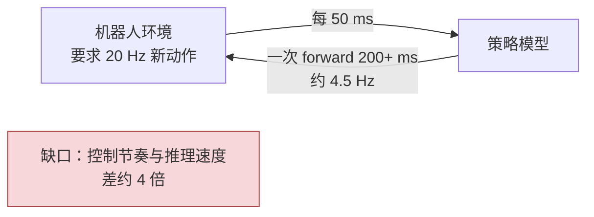
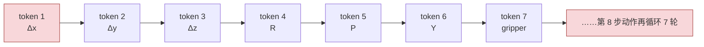
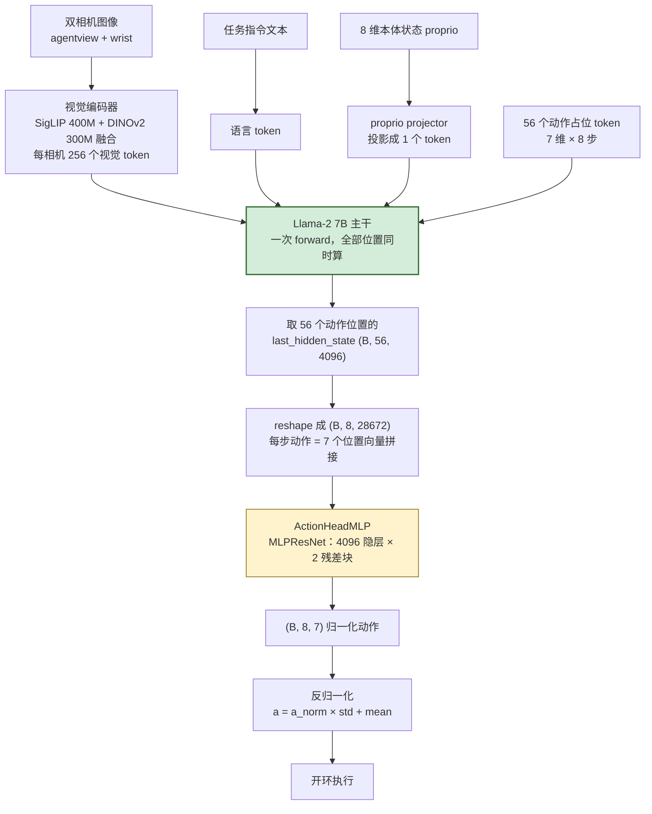
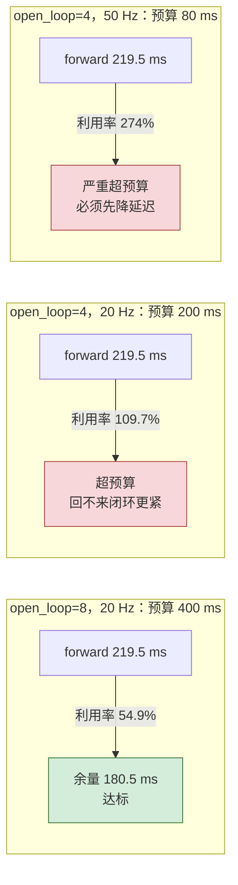
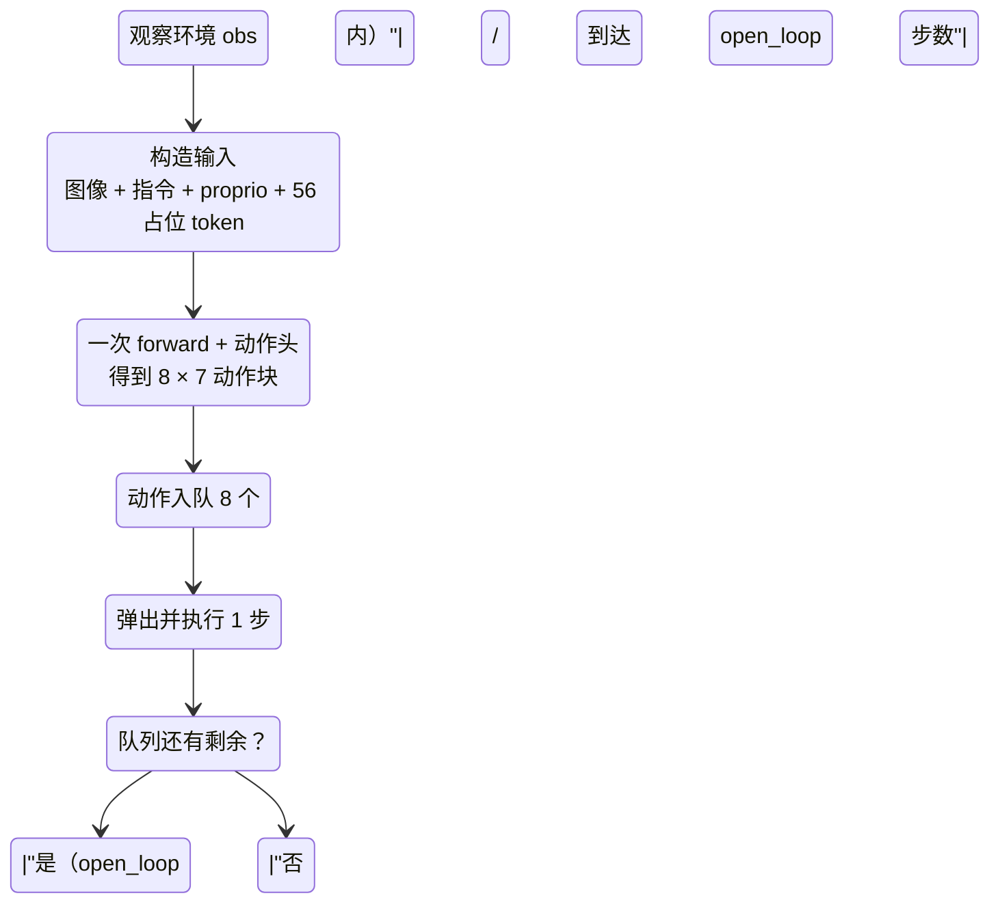
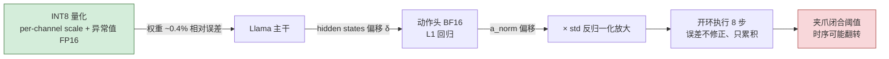

# VLA 并行解码：深入原理与算法

> **读者定位**：已读过 OFT 的基本用法，想真正搞懂"一次 forward 吐出 8×7 动作块"为什么可行、有多快、边界在哪的工程师。
> **本手册对应任务**：任务 3（弄懂并行解码原理）。
> 所有源码引用均来自本工作区 `01-上游源码/openvla-oft-upstream/`，可对照阅读。
>
> **还没建立全局印象？先读 [00-先读我·全景速览](./00-先读我-量化在VLA中的全景速览.md)（10 分钟）。**

---

## 0. 一分钟版本

标准自回归策略像**接力赛**：第 1 个 token 生成完才能生成第 2 个，一个 7 维动作要跑 7 轮，8 步动作块要 56 轮。
OpenVLA-OFT 的并行动作头像**一次合影**：把 56 个"动作占位 token"和画面、指令一起塞进主干跑**一次** forward，然后从 56 个位置各取一份 hidden states，交给一个小 MLP 一次性回归出全部 8×7 个连续动作数。

于是有本项目的核心公式：

```text
policy_query_fps     = 1000 / 平均 forward 延迟(ms)
predicted_action_fps = chunk_size × policy_query_fps   （本项目 chunk_size=8）
```

---

## 1. 问题起点：机器人 20 Hz，模型只有 4~5 Hz

真实控制回路要求环境每 50 ms（20 Hz）收到一个新动作。而 VLA 是一个 7.7B 参数的模型，在 A10 上一次 forward 约 200+ ms。矛盾的结构如下：



两种互补的解法，OFT 同时用了：

1. **动作分块（action chunking）**：一次预测未来多步动作，执行期间不再推理——把一次推理的成本摊到多个动作上；
2. **并行动作解码**：让"一次预测多步"只花**一次** forward，而不是多轮自回归。

---

## 2. 自回归解码为什么慢：因果链的代价

### 2.1 原版 OpenVLA 的做法

原版 OpenVLA 把每个动作维度离散成 256 桶（256-bin token），模型一次 forward 只能吐 **1 个 token = 1 个动作维度**。要输出一个完整的 7 维动作（3 平移 + 3 旋转 + 1 夹爪），必须连续解码 7 轮；要给 8 步的动作块，就是 56 轮。

每轮之间是硬因果链——下一个 token 的生成以已生成的为条件：



数学上，自回归策略在做链式分解：

```text
p(a₁, …, a₇ | o) = p(a₁|o) · p(a₂|a₁,o) · p(a₃|a₁,a₂,o) · … · p(a₇|a₁…a₆,o)
```

这个分解**强制了串行**：每一项都依赖前一项，所以必须一步步算。

### 2.2 延迟账

```text
T_AR = N_tokens × L_fwd
```

用 A10 的物理下限估一估（batch=1 时每次 forward 都要把全部权重从显存读一遍，是带宽受限）：

```text
读一遍 14.3 GiB 权重 ÷ 600 GB/s ≈ 24 ms        ← 一次 forward 的理论地板
56 个 token × ~24-40 ms ≈ 1.3 ~ 2.2 s / chunk
```

对比 OFT 的单次 forward（本项目实测口径 219.5 ms），差出一个数量级——这就是 OFT 论文里"并行解码带来巨大加速"的来源。数字是估算口径，用于建立直觉，不是承诺值。

---

## 3. OFT 的回答：动作根本不需要自回归

### 3.1 关键洞察

自回归的因果依赖是**"逐 token 生成"这一表示方式的产物**，不是动作数据本身的性质。整个动作块 `A ∈ ℝ⁸ˣ⁷` 都是**同一个观测 `o` 的函数**：

```text
p(a₁, …, a₈ | o) = ∏ₜ p(aₜ | o)      ← 每一步都只依赖观测，彼此条件独立
```

既然 8 步动作在给定观测下互不依赖，就没有理由让它们的计算互相等待——把 8×7 = 56 个输出放到同一个 forward 里并行算，是结构上合法的。

### 3.2 OFT 一次查询的完整数据流

以下是本仓库源码的真实流程（`prismatic/extern/hf/modeling_prismatic.py` + `prismatic/models/action_heads.py`）：



源码对照（三处关键行）：

```python
# modeling_prismatic.py:745-747 —— 占位 token 的来历
# Add (ACTION_DIM * NUM_ACTIONS_CHUNK) placeholder tokens to input_ids to simulate action tokens
input_ids = torch.cat([input_ids, torch.ones(...)], dim=1)   # 追加 7×8 = 56 个占位

# modeling_prismatic.py:925 —— 一次 forward 后取动作位置
actions_hidden_states = last_hidden_state[:, NUM_PATCHES + NUM_PROMPT_TOKENS :
                                          NUM_PATCHES + NUM_PROMPT_TOKENS + ACTION_DIM * NUM_ACTIONS_CHUNK]

# action_heads.py:predict_action —— L1 回归头
rearranged = actions_hidden_states.reshape(batch_size, NUM_ACTIONS_CHUNK, -1)  # (B, 8, 28672)
action = self.model(rearranged)                                                # (B, 8, 7)
```

**读法**：`reshape(B, 8, -1)` 之后，第 t 步动作的特征是它名下 7 个位置向量的拼接；8 步共享同一个 MLPResNet，由 `nn.Linear` 对最后一维广播，**天然并行**，互不等待。动作头内部结构（`action_heads.py`）：

```text
LayerNorm → Linear(28672→4096) → ReLU
→ [LayerNorm → Linear(4096→4096) → ReLU + 残差] × 2
→ LayerNorm → Linear(4096→7)
```

训练时对归一化动作做 **L1 回归损失**；一次训练 forward 同时拿到 8 步的监督信号，这是 OFT 微调效率高的重要原因之一。

### 3.3 张量形状速查

| 阶段 | 形状 | 说明 |
|---|---|---|
| 输入序列 | 视觉 512 + 语言 N + proprio 1 + 动作 56 | 本项目双相机 |
| 主干输出 hidden | (B, 序列长, 4096) | 一次 forward |
| 动作位置切片 | (B, 56, 4096) | `NUM_PATCHES+NUM_PROMPT` 之后 56 个 |
| reshape | (B, 8, 28672) | 7×4096 拼接 |
| 动作头输出 | (B, 8, 7) | 归一化动作块 |
| 反归一化后 | (8, 7) | 位移 3 + 旋转 3 + 夹爪 1 |

---

## 4. 时间摊销：三个 FPS 指标到底在说什么

### 4.1 公式与本项目实例

一次 forward（219.5 ms）的固定成本被摊到 8 个动作上：

```text
policy_query_fps      = 1000 / 219.52        = 4.56      模型每秒被查询几次
predicted_action_fps  = 8 × 4.56             = 36.44     每秒"产出"多少步动作
executed_action_capacity = open_loop × query_fps         每秒实际执行多少步
```

三个 FPS **不是一回事**，混用是本项目文档反复纠正的错误：

| 指标 | 本项目值 | 它回答的问题 |
|---|---|---|
| 视频 30 FPS | — | 仿真画面渲染/录制的帧率 |
| policy query FPS | 4.56 | 模型推理能力（每秒几次 forward） |
| predicted action FPS | 36.44 | 理论动作产出能力 |
| 控制频率 20 Hz | — | 环境要求动作送达的节奏 |

### 4.2 deadline：这个 FPS 够不够用

`open_loop=8` 时，一次 forward 的产出要够机器人跑 8 步，8 步 × 50 ms/步 = **400 ms 时间窗**。只要 forward 延迟 ≤ 400 ms，动作就供得上：



这张表解释了两件项目里真实发生的事：

1. 为什么验收标准把 `chunk_deadline_met` 达标率 ≥95% 当硬门——**"50 Hz 支持"只能由实测 deadline 证明，不能靠宣称**（`05_freq_ablation.sh` 的验收逻辑）；
2. 为什么 INT8 量化对 50 Hz 实验有战略意义：预算 80 ms 时，即使 INT8 只把 219 ms 压到 130 ms 也仍然不够——**量化的主要收益在显存，延迟收益必须实测**，两件事要分开下结论。

### 4.3 open_loop = 8 还是 4：速度与闭环的交换

`num_open_loop_steps` 的语义（本项目评测脚本）：模型**永远预测 8 步**，`open_loop=4` 表示只执行前 4 步就扔掉后 4 步、重新观察再查一次。

```text
open_loop=8：每 400 ms 观察一次，8 步全盲执行      → 快、省，但开环漂移窗口大
open_loop=4：每 200 ms 观察一次，只信 4 步          → 闭环紧一倍，模型查询频率翻倍
```

> 本项目实测教训：open_loop 8→4 并没有救回 episode 233/378，因为抓取失败的关键切换发生在 **chunk 内部**（233 在 chunk 5 / action 1，378 在 chunk 4 / action 6）——缩短开环窗口 ≠ 修正 chunk 内的错误动作。详见 `00-项目文档时间线.md` §2026-08-31 / 09-01。

---

## 5. 开环执行循环：chunk 队列的状态机

一次查询产出的 8×7 动作进入队列，控制循环逐个弹出执行。这是理解"并行解码 + 开环执行"运行时行为的准确模型：



要点：

- **执行队列期间不看画面**——这就是开环（open-loop）。漂移风险随 open_loop 增大。
- 本项目评测还叠了一层工程机制：`--target_motion_replan_threshold_m` 检测目标被推移时丢弃剩余队列强制重规划（episode 321 的对策），以及规划中的"首次闭合动作取出时拦截"的 verify_grasp 状态机（03 号实验）。
- 这些机制都作用在**队列语义**上，与"并行解码"本身正交：并行解码解决"一次查询多贵"，队列机制解决"查完之后怎么聪明地花"。

---

## 6. 算法伪代码

### 6.1 自回归基线（原版 OpenVLA 风格，供对比）

```python
def ar_action_chunk(model, obs, chunk=8, action_dim=7):
    actions = []
    for t in range(chunk):                     # 8 步，串行
        for d in range(action_dim):            # 7 维，串行
            token = model.decode_next_token(obs, actions)   # 依赖全部历史
            actions.append(dequantize(token))               # 256 桶 → 连续值
    return np.array(actions).reshape(chunk, action_dim)
# forward 次数 = 8 × 7 = 56，全部串行
```

### 6.2 OFT 并行解码 + 开环执行（本项目路径）

```python
def oft_query(model, obs, instruction, proprio):     # 一次 forward
    tokens = build_sequence(obs, instruction, proprio,
                            n_action_placeholders=ACTION_DIM * NUM_ACTIONS_CHUNK)  # 56
    hidden = model.backbone.forward(tokens)           # 全部位置一次算完
    h = hidden[:, action_positions]                   # (1, 56, 4096)
    actions_norm = model.action_head.predict_action(h)    # reshape (1,8,28672) → (1,8,7)
    return denormalize(actions_norm, norm_stats)      # 反归一化 → 物理动作 (8,7)

def control_loop(env, model, open_loop=8):
    while not env.done():
        actions = oft_query(model, env.obs(), env.instruction, env.proprio)
        for a in actions[:open_loop]:     # 开环执行 chunk 内动作
            env.step(a)                   # 执行期间不观察
        # 队列空 → 回到 while，重新观察、重新查询
```

对照 6.1：**56 次串行 forward → 1 次 forward + 一次小 MLP**，这就是"并行"的全部含义。模型内部对 56 个位置的计算由 transformer 的一次矩阵乘批量完成，没有任何"分 8 次跑"的过程。

---

## 7. 术语澄清：此"并行解码"非彼"并行解码"

| | OFT 并行动作解码（本手册） | LLM 投机解码 Speculative Decoding |
|---|---|---|
| 领域 | VLA 连续动作生成 | 文本 token 生成 |
| 思路 | 动作块对观测条件独立 → 一次联合预测 | 小模型起草 + 大模型并行验证，只接受前缀 |
| 是否存在自回归链 | **否**（动作间无因果依赖） | 是（验证后仍逐 token 输出） |
| 输出 | 8×7 连续回归值 | 离散 token |
| 关系 | 与量化实验直接相关 | 与本项目无关，仅防概念混淆 |

另有一类相近概念"流匹配 / diffusion 动作头"（OFT 代码里有 `ActionHeadDiffusion` 变体；π0 等模型用流匹配），它们同样**并行输出整个动作块**，只是把回归换成生成式去噪。本项目 checkpoint 用的是最朴素的 L1 回归头，本手册围绕它展开。

---

## 8. 并行解码 × INT8 量化：为什么误差从主干流向动作头

并行动作头让"hidden states → 动作"的通路变得极短：主干量化带来的任何 hidden state 偏移，**不再有自回归的多步稀释机会**，直接进入动作头回归：



这也回答了"为什么动作头保持 BF16 也还不够、必须实测成功率"：

- 动作头本身不被量化，但它**吃的是被量化主干的输出**——混合精度挡住的是"动作头内部再放大误差"，挡不住"输入已经带误差"；
- 所以验收的最终裁判不是数值指标，而是同状态 500 episodes 成功率（损失 ≤ 1.0 pp 通过）；

反过来，并行解码也是量化的**盟友**：一次 forward 输出 8 步，误差传导链比自回归短得多（自回归会把每步的量化误差作为条件喂给下一步）。这是"VLA 主干量化比 LLM 文本生成量化更可预期"的结构性原因之一。

---

## 9. 常见误区清单

| 误区 | 事实 |
|---|---|
| "并行 = 同时跑 8 个模型" | 一次 forward，56 个位置批量计算，模型只有一份 |
| "并行解码让模型变聪明了" | 它只改变计算组织方式；成功率高来自连续回归头 + 分块摊销 + 微调配方，三件事绑定 |
| "predicted action FPS 就是控制频率" | 36.44 是产出能力；控制频率是环境要求的 20 Hz，两码事 |
| "视频 30 FPS = 推理 30 Hz" | 渲染帧率与推理/控制频率无关 |
| "chunk 越长越好" | chunk 长摊销好但开环漂移窗口大；本项目 8→4 的消融未解决困难抓取 |
| "并行解码必须配 KV cache 优化" | 单次 forward 无逐 token 解码，KV cache 在这条路径上不是瓶颈 |
| "量化只影响精度指标" | 对 VLA 还会经 hidden states → 动作 → 阈值事件传导为成功率变化 |

---

## 10. 指标速算卡（贴在实验记录旁）

```text
mean_latency_ms        ← summary/metrics.csv（已去前 3 个 warmup chunk）
policy_query_fps       = 1000 / mean_latency_ms
predicted_action_fps   = 8 × policy_query_fps
deadline 预算 ms       = open_loop / control_freq × 1000     # 8/20 → 400
deadline 达标率        = 满足 延迟 ≤ 预算 的 chunk 占比       # ≥95% 才算实时达标
success_loss_pp        = (高精度成功率 − INT8 成功率) × 100  # ≤1.0 通过
显存节省 GiB           = 高精度峰值 − INT8 峰值              # 预期约 5~6
```

本项目基线数字（FP16/BF16 口径，A10）：`219.520 ms · 4.56 · 36.44 · 14.963 GiB`。INT8 组的数值留给你跑完 `09_int8_benchmark.sh` 后填进量化手册 §7.5 的记录模板。
