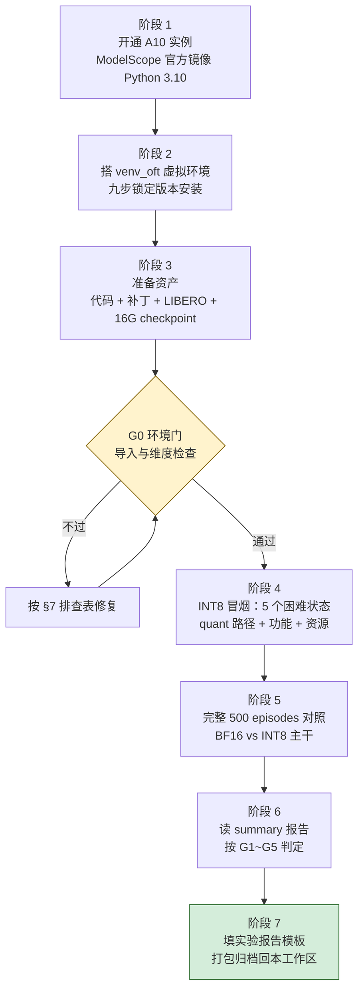
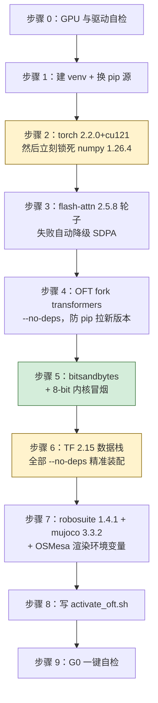
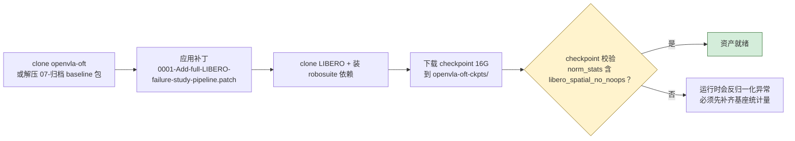

# A10 显卡虚拟环境部署手册与实验文档框架

> **目标**：在全新的魔搭 A10 24G 实例上，从零搭出可跑 OpenVLA-OFT INT8 对照实验的环境，并按统一框架产出可直接归档的实验文档。
> **依据**：本文版本锁定与踩坑清单全部来自 [OpenVLA-OFT环境搭建与训练方案.md](../OpenVLA-OFT环境搭建与训练方案.md) 与 [INT8实验验收标准与文档总结.md](../08-后续实验验证/INT8实验验收标准与文档总结.md)，是已验证组合，不要自由发挥版本号。
> **对应任务**：任务 1 的执行环境 + 实验记录的文档框架。
>
> **还没建立全局印象？先读 [00-先读我·全景速览](./00-先读我-量化在VLA中的全景速览.md)（10 分钟）。**

---

## 0. 全景路线图



---

## 1. 阶段 1：开通实例

| 项 | 选择 | 原因 |
|---|---|---|
| 平台 | 魔搭 ModelScope「我的 Notebook」免费 GPU 实例（PAI-DSW） | 项目一直用此平台，历史经验可直接复用 |
| GPU | NVIDIA A10 24G | 显存够 FP16 基线（14.96 GiB），INT8 更宽裕 |
| 镜像 | ModelScope 官方镜像 **Python 3.10** 版 | openvla-oft 要求 py310；flash-attn 预编译轮子只有 cp310 |

**持久化规则（重要）**：只有 `/mnt/workspace` 在实例**重启后保留**；实例**释放**后全部丢失。所以虚拟环境、代码、权重、激活脚本必须全部放在 `/mnt/workspace` 下。

```text
/mnt/workspace/
├── venv_oft/                  # Python 虚拟环境（§2 建）
├── activate_oft.sh            # 激活脚本（§2.8）
├── openvla-oft/               # OFT 代码 + 已应用补丁（§3）
├── LIBERO/                    # LIBERO 仿真代码
└── openvla-oft-ckpts/
    └── openvla-7b-oft-finetuned-libero-spatial/   # 16G 权重
```

---

## 2. 阶段 2：九步搭出 venv_oft

安装顺序本身就是一份依赖冲突地图，**顺序不能换**：



```bash
# 步骤 0：确认 GPU 与驱动
nvidia-smi    # 应显示 NVIDIA A10，驱动 >= 535 类，CUDA Version >= 12.1

# 步骤 1：建虚拟环境
export WS=/mnt/workspace
python -m venv $WS/venv_oft
source $WS/venv_oft/bin/activate
pip config set global.index-url https://mirrors.aliyun.com/pypi/simple/

# 步骤 2：PyTorch + 锁 numpy（防被后续包升到 2.x —— 项目第一大坑）
pip install torch==2.2.0 torchvision==0.17.0 torchaudio==2.2.0
pip install --force-reinstall "numpy==1.26.4"

# 步骤 3：flash-attn 预编译轮子（可选；失败自动降级 SDPA，结果等效）
pip install https://github.com/Dao-AILab/flash-attention/releases/download/v2.5.8/flash_attn-2.5.8+cu122torch2.2cxx11abiFALSE-cp310-cp310-linux_x86_64.whl \
  || echo "[warn] flash-attn 安装失败，稍后打 SDPA 补丁"

# 步骤 4：OFT 专用 transformers fork（必须 --no-deps，否则 pip 会重排全套依赖）
pip install --no-deps git+https://github.com/moojink/transformers-openvla-oft.git

# 步骤 5：bitsandbytes（INT8 实验的新增依赖）
pip install "bitsandbytes==0.43.3"
```

装完立刻做 **8-bit 内核冒烟**（这一步通过，G1 的 ABI 前提就有了）：

```bash
python - <<'PY'
import torch, bitsandbytes as bnb
print("bnb", bnb.__version__, "| torch", torch.__version__, "|", torch.cuda.get_device_name(0))
x = torch.randn(8, 8, device="cuda", dtype=torch.float16)
lin = bnb.nn.Linear8bitLt(8, 8, has_fp16_weights=False).cuda()
y = lin(x)
assert y.shape == (8, 8) and torch.isfinite(y).all()
print("[OK] INT8 kernel 工作正常")
PY
```

```bash
# 步骤 6：TF 数据栈（RLDS 加载用；protobuf/metadata 版本是两个埋雷点）
pip install "tensorflow-cpu==2.15.0"
pip install --no-deps "tensorflow-datasets==4.9.3" "tensorflow-metadata==1.15.0" \
  "tensorflow-graphics==2021.12.3" dlimp json-numpy
pip install --no-deps "protobuf==4.25.3"

# 步骤 7：仿真栈（mujoco 必须 3.3.2，3.4+ 与 robosuite 1.4.1 断言冲突）
pip install "robosuite==1.4.1" "mujoco==3.3.2" "opencv-python-headless==4.9.0.80"
pip install accelerate "sentencepiece==0.1.99" "draccus==0.8.0" h5py pillow tqdm pyyaml rich \
  "matplotlib==3.8.4" "wandb==0.16.6" jsonlines filelock requests

# 无 flash-attn 时打 SDPA 补丁（幂等，可重复执行）
python -c "import flash_attn" 2>/dev/null || \
  sed -i 's/attn_implementation="flash_attention_2"/attn_implementation="sdpa"/' \
  $WS/openvla-oft/prismatic/models/backbones/llm/prompting/*.py \
  $WS/openvla-oft/prismatic/models/backbones/vision/*.py 2>/dev/null || true
```

```bash
# 步骤 8：激活脚本（以后每次开终端先执行它）
cat > $WS/activate_oft.sh <<'EOF'
#!/usr/bin/env bash
source /mnt/workspace/venv_oft/bin/activate
export MUJOCO_GL=osmesa
export PYOPENGL_PLATFORM=osmesa
export HF_ENDPOINT=https://hf-mirror.com
export WANDB_MODE=offline
export TOKENIZERS_PARALLELISM=false
export NO_GCE_CHECK=true
echo "[venv_oft] python=$(which python)"
EOF
chmod +x $WS/activate_oft.sh
```

```bash
# 步骤 9：G0 一键自检（全部 OK 才允许开始长评测）
source $WS/activate_oft.sh
python - <<'PY'
import sys
assert sys.prefix != sys.base_prefix, "没有在 venv_oft 里！"
import torch, numpy, gym, robosuite, mujoco, transformers, bitsandbytes, tensorflow
assert torch.cuda.is_available(), "CUDA 不可用"
print(f"torch {torch.__version__} | numpy {numpy.__version__} | GPU {torch.cuda.get_device_name(0)} | 显存 {torch.cuda.get_device_properties(0).total_memory/2**30:.1f} GiB")
from prismatic.models.action_heads import ActionHeadMLP
from prismatic.constants import NUM_ACTIONS_CHUNK, ACTION_DIM, PROPRIO_DIM
assert (NUM_ACTIONS_CHUNK, ACTION_DIM, PROPRIO_DIM) == (8, 7, 8), "OFT 常量与预期不符"
print(f"[G0 OK] chunk={NUM_ACTIONS_CHUNK}, action_dim={ACTION_DIM}, proprio_dim={PROPRIO_DIM}")
PY
```

> **为什么这两格标黄**：步骤 2 的 numpy 锁定与步骤 6 的 TF 装配，是历史上 15 项迁移事故里复发率最高的两类（numpy 2.x 炸 torch/tf；新 tensorflow-metadata 的 gencode 6.x 与运行时 protobuf 冲突）。

---

## 3. 阶段 3：准备资产（代码 / 补丁 / 权重）



```bash
cd $WS
git clone https://github.com/moojink/openvla-oft.git openvla-oft
cd openvla-oft
# 应用本项目补丁（从工作区 03-补丁/ 上传，或解压 int8_complete_runtime_v3.zip 直接覆盖）
git apply 0001-Add-full-LIBERO-failure-study-pipeline.patch

cd $WS && git clone https://github.com/Lifelong-Robot-Learning/LIBERO.git LIBERO

# checkpoint：约 16G，务必校验 norm_stats
python - <<'PY'
import os, json
p = "/mnt/workspace/openvla-oft-ckpts/openvla-7b-oft-finetuned-libero-spatial"
print(os.path.getsize(p)/2**30, "GiB" if os.path.isdir(p) else "路径不存在")
PY
```

**INT8 运行包**：本工作区 `08-后续实验验证/int8_complete_runtime_v3.zip` 内含三样关键物（以 v3 为最新）：

| 文件 | 作用 |
|---|---|
| `tools/09_int8_benchmark.sh` | BF16 vs INT8 对照主脚本（含量化/BF16 头预检、显存采样、结果拒绝覆盖） |
| `tools/_common.sh` | 路径与 OSMesa/HF 镜像环境变量 |
| `tools/summarize_int8_benchmark.py` | 汇总 metrics.csv + report.md |
| `experiments/robot/libero/run_libero_eval.py`、`experiments/robot/openvla_utils.py` | 已带 `--load_in_8bit` 入口与 BF16 动作头保障 |

解压到 `$WS/openvla-oft/` 覆盖同名文件即可。

---

## 4. 阶段 4：INT8 冒烟（5 个已知困难状态）

```bash
source /mnt/workspace/activate_oft.sh
cd /mnt/workspace/openvla-oft

# 开跑前确认 GPU 上没有别的进程（否则显存采样被污染，结果要标记无效）
nvidia-smi --query-compute-apps=pid,process_name,used_memory --format=csv,noheader

RUN_TAG=int8-quick-$(date +%Y%m%d-%H%M%S) bash tools/09_int8_benchmark.sh all
```

脚本内部自动跑两组（BF16 → INT8），每组：写 `run_config.txt` → 后台 0.2 s 采样 `gpu_memory.csv` → 评测并 dump 动作 → tee `console.log`。结束时自动汇总。

**冒烟要看的四个信号**：

1. `console.log` 中 `load_in_8bit=True` 生效、无 NaN/Inf、无 OOM；
2. 每次 forward 输出 `[8, 7]`，动作头保持 BF16（脚本启动即检查，不满足直接拒绝）；
3. 两组 `gpu_memory.csv` 的 INT8 峰值应显著低于 BF16（预期低 5~6 GiB）；
4. 5 状态成功率**只用于判断"代码通了"**，禁止外推为量化无损结论。

## 5. 阶段 5：完整 500 episodes 正式对照

```bash
TARGETS="" RUN_TAG=int8-full-$(date +%Y%m%d-%H%M%S) bash tools/09_int8_benchmark.sh all
```

约束（缺一不可，否则成功率损失无效）：同 checkpoint、同 seed=7、同 `open_loop=8`、同 `control_freq=20`、同实例同环境连续完成、GPU 上无其他进程。跑完先到 `summary/report.md`。

## 6. 阶段 6：读报告与判定

`summary/metrics.csv` 每行一个精度组，字段：`success_rate`、`latency_mean_ms / latency_p50_ms / latency_p95_ms`、`policy_query_fps`、`predicted_action_fps`、`memory_min_mib / memory_peak_mib / memory_delta_mib`。对照判定：

| 门 | 条件 | 不过怎么办 |
|---|---|---|
| G1 功能 | 有量化线性层；输出 [8,7]；无 NaN/OOM | 跑审计脚本定位覆盖范围 |
| G2 实时 | mean/P50/P95 完整；deadline 达标率 ≥95%（预算 400 ms） | 只能算冒烟，不能下性能结论 |
| G3 显存 | INT8 峰值 ≤ 高精度峰值 | 审计覆盖范围与其他进程 |
| G4 成功率 | 500 episodes 损失 ≤1.0 pp 通过；1~2 pp 需复核；>2 pp 失败 | 按量化手册 §6.3 回退范围 |
| G5 复现 | 版本、seed、ckpt、产物齐全 | 缺件重跑，不许补填 |

## 7. 常见故障排查表（历史 15 项事故浓缩版）

| # | 症状 | 根因 | 一招修复 |
|---|---|---|---|
| 1 | `numpy.core.umath failed to import` | 某包把 numpy 拉到 2.x | `pip install --force-reinstall numpy==1.26.4` |
| 2 | `runtime_version` protobuf 报错 | 新 tensorflow-metadata gencode 6.x | `protobuf==4.25.3` + `tensorflow-metadata==1.15.0`（均 --no-deps） |
| 3 | flash-attn wheel 404 / ABI 报错 | torch pip 版是 FALSE ABI | 用 2.5.8 指定轮子，失败改 SDPA |
| 4 | robosuite `binding_utils` 断言 | mujoco 被装到 3.4+ | `pip install mujoco==3.3.2` |
| 5 | 重启后仿真黑屏/渲染失败 | 默认 GL 后端不可用 | `MUJOCO_GL=osmesa PYOPENGL_PLATFORM=osmesa` |
| 6 | pip 无限回溯 | torch 与 tf 依赖互搏 | 全部关键包 --no-deps 精准装 |
| 7 | `ModuleNotFoundError: tensorflow_datasets` | 没激活 venv | 先 `source activate_oft.sh` |
| 8 | bitsandbytes CUDA 报错 | ABI/版本不匹配 | 记录版本组合；换 bnb 0.43.x；禁止改跑 4-bit 冒充 |
| 9 | dtype mismatch | 量化主干与 FP16 头衔接 | 检查 hidden states / 动作头 dtype 转换点 |
| 10 | 显存没降 | 量化未生效或覆盖不符 | 跑量化手册 §5 审计 |
| 11 | 反归一化异常/全失败 | norm_stats 缺失或误用自制统计量 | 恢复基座 `libero_spatial_no_noops` 统计量 |
| 12 | `--load_in_8bit` 无效参数 | 传给了 finetune.py | 它是评估脚本参数，只在 run_libero_eval 用 |
| 13 | 训练 OOM | 激活峰值 + 碎片化 | `PYTORCH_CUDA_ALLOC_CONF=expandable_segments:True` |
| 14 | 结果目录写不进去 | 同名 RUN_TAG 已存在 | 脚本拒绝覆盖是保护；换新 RUN_TAG |
| 15 | 迁移新实例全崩 | 依赖/补丁没随迁 | 按本手册从头重装 + 带上补丁与版本清单 |

---

## 8. 实验文档框架（阶段 7）

### 8.1 结果目录命名与结构

```text
openvla-oft/experiments/failure_study_runs/
└── int8-full-20260913-1030/          # RUN_TAG = 前缀 + 时间戳
    ├── bf16/…                        # 结构见量化手册 §7.3
    ├── int8-mixed/…
    └── summary/{metrics.csv, report.md}
```

归档到本工作区时：整目录打成 zip，放进 `08-后续实验验证/`，命名 `int8_complete_results_<vN>.zip`；同时更新 `00-项目文档时间线.md` 的对应条目。

### 8.2 实验报告模板

报告模板**不再在本手册内维护**，统一使用
[05-INT8实验结果报告模板](./05-INT8实验结果报告模板.md)。
它由 `fill_report.py` 从实验产物自动填充：G1~G5 逐门判定、speedup、显存降幅、
成功率损失、配对胜负、deadline 达标率全部自动算好，只剩三处标 `✍️` 的判断性内容需要人工补：

1. 量化覆盖模块的明细（G1 审计）；
2. 失败案例的 task/state 对照；
3. 局限性条目。

```bash
# 跑完实验后
python /mnt/workspace/fill_report.py --run-dir <RUN_TAG 目录>
# → <RUN_TAG>/INT8实验报告.md
```

> **为什么不在这里再放一份模板**：两份模板必然随实验演进而漂移，已经出现过口径不一致。
> **单一事实源是 05**。填写时仍须遵守 §8.3 的五条红线。

### 8.3 文档写作红线

1. 5 状态结果只能写"冒烟通过"，永远不与成功率结论混写；
2. 指标名用全称（policy query FPS / predicted action FPS / 控制频率），不写裸"FPS"；
3. 显存只认 `gpu_memory.csv` 实测峰值，不写理论值；
4. 历史基线（219.5 ms / 14.96 GiB / 99%）引用时注明口径与"非同状态配对"属性；
5. 结论段必须包含"边界声明"——说了什么、没说什么。

---

## 9. 最终一页清单（打印用）

```text
□ 实例：A10 24G + Python 3.10 镜像，/mnt/workspace 布局就位
□ 九步安装完成，G0 自检全绿（含 bitsandbytes 内核冒烟）
□ 补丁已应用；checkpoint 16G 就位；norm_stats 校验通过
□ nvidia-smi 无其他进程
□ 冒烟：int8-quick 通过（功能/显存/形状/无 NaN）
□ 正式：TARGETS="" 跑完 500 episodes × 2 组
□ summary/report.md 已读，G1~G5 逐门判定
□ 报告模板已填，产物齐全，打包归档 + 更新时间线
```
