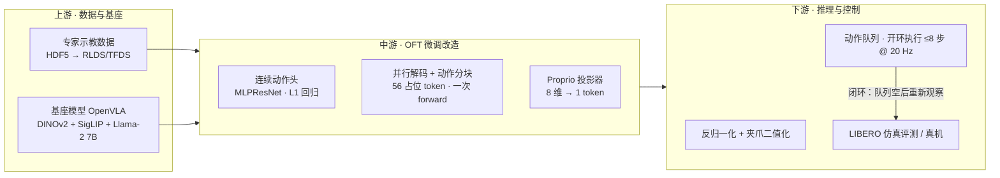
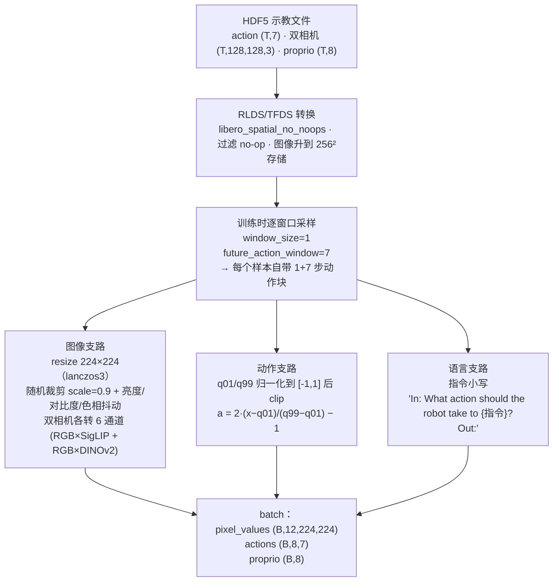
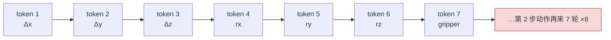
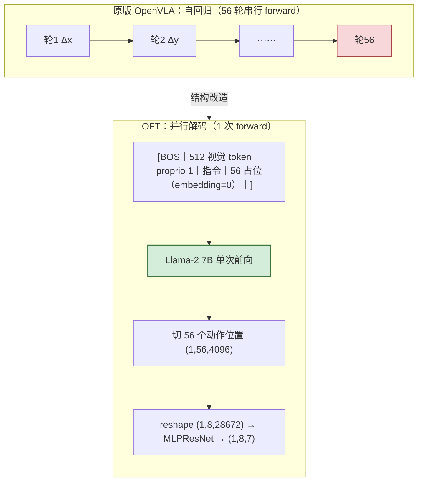
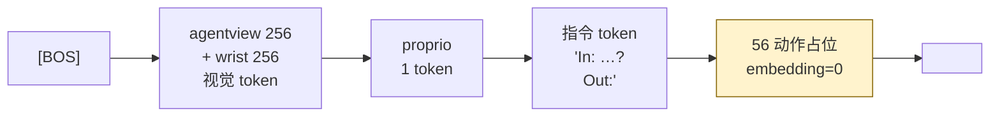
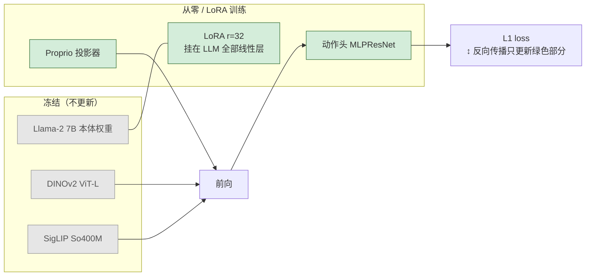
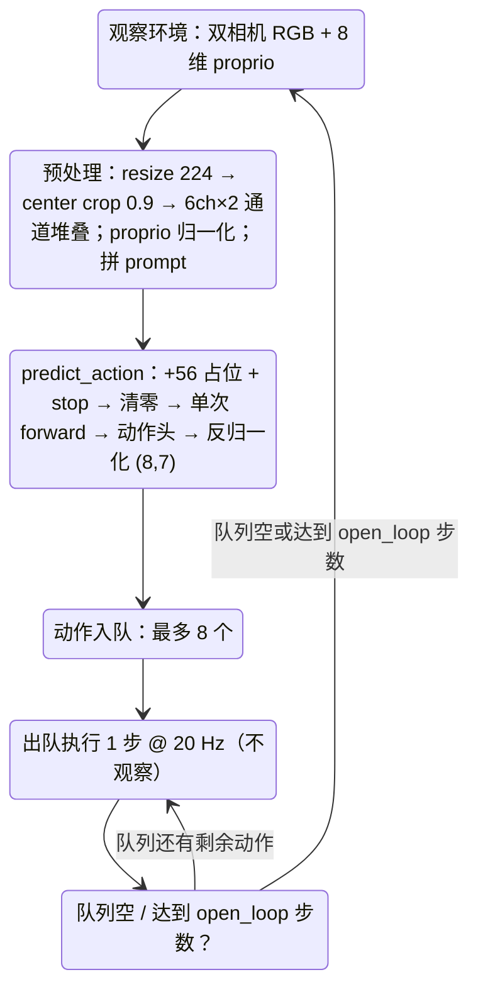
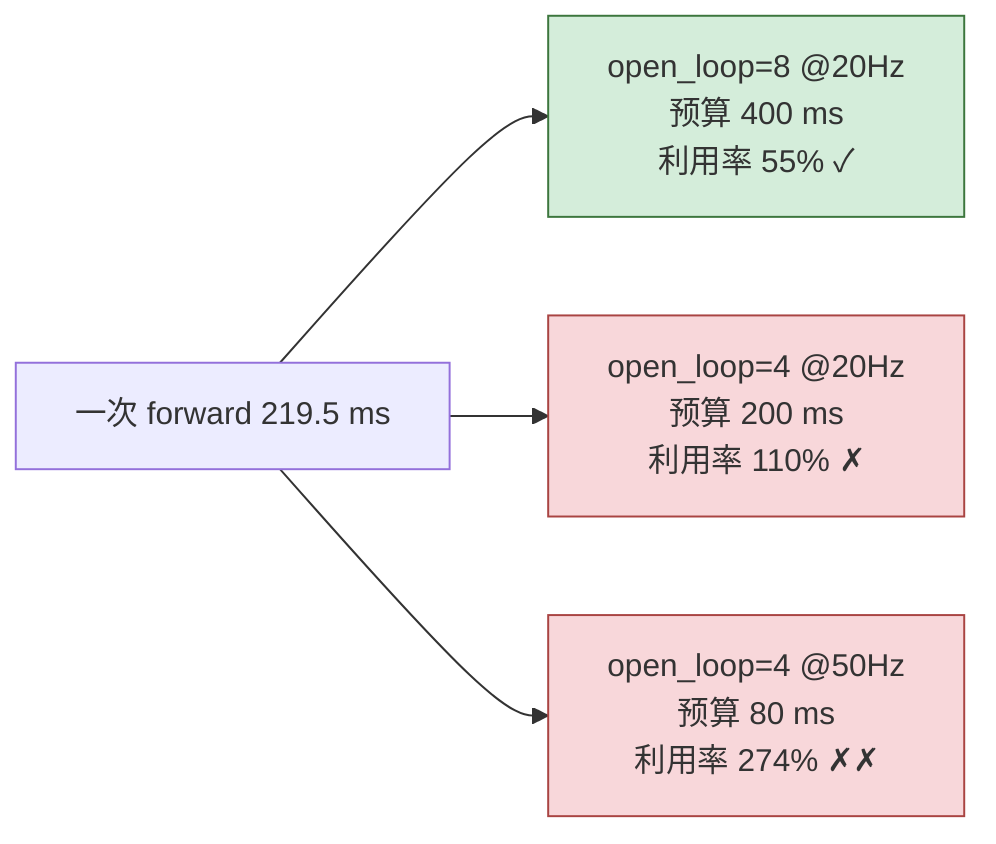
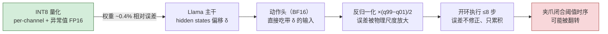

# OpenVLA-OFT 算法原理详解：从上游到下游

> 整理日期：2026-09-13
> 素材来源：本工作区 `01-上游源码/openvla-oft-upstream/` 源码逐行核对 + `总结文档.md`、`00-项目文档时间线.md`、`10-INT8量化与并行解码教材/`、`09-行为蒸馏实验/` 等项目文档。
> 配套交互式架构图（可缩放、可切换主题、可聚焦路径）：
> - [OpenVLA-OFT系统架构图.html](OpenVLA-OFT系统架构图.html) —— 系统全景：上游数据 → 模型 → 下游控制
> - [OpenVLA-OFT推理时序图.html](OpenVLA-OFT推理时序图.html) —— 一次动作查询的完整时序

---

## 目录

- [0. 一页总览：OFT 到底改了什么](#0-一页总览oft-到底改了什么)
- [1. 上游 I：数据管线 —— 示教数据如何变成训练样本](#1-上游-i数据管线--示教数据如何变成训练样本)
- [2. 上游 II：基座模型 —— Prismatic VLM 与原版 OpenVLA 的瓶颈](#2-上游-ii基座模型--prismatic-vlm-与原版-openvla-的瓶颈)
- [3. 中游 I：OFT 三大结构改造](#3-中游-ioft-三大结构改造)
- [4. 中游 II：训练配方](#4-中游-ii训练配方)
- [5. 下游 I：推理与闭环控制](#5-下游-i推理与闭环控制)
- [6. 下游 II：部署优化与本项目的扩展实验](#6-下游-ii部署优化与本项目的扩展实验)
- [7. 全链路代码索引](#7-全链路代码索引)
- [8. 术语表与常见误区](#8-术语表与常见误区)

---

## 0. 一页总览：OFT 到底改了什么

**OpenVLA-OFT**（Optimized Fine-Tuning，Kim et al. 2025，*Fine-Tuning Vision-Language-Action Models: Optimizing Speed and Success*）不是一个新的模型家族，而是一套针对 7B 级 VLA（Vision-Language-Action）模型的**微调配方**：基座仍是 OpenVLA 的 Prismatic VLM（DINOv2 + SigLIP 双视觉编码器 + Llama-2 7B），但把"自回归生成离散动作 token"换成"**一次前向并行回归连续动作块**"，同时补上本体状态（proprioception）输入通道。论文口径下，LIBERO-Spatial 成功率从原版 OpenVLA 的 84.7% 提升到 **97.6%**，推理加速 **26–50 倍**；本项目在 LIBERO-Spatial 上复现的基座模型达到 **495/500（99%）**。

OFT 的三个结构改造，一句话各说清：

1. **连续动作头**：LLM 末层 hidden states 不再走词表 softmax，而是交给一个小 MLP（MLPResNet）直接回归 7 维连续动作，用 L1 损失监督——动作是连续量，离散成 256 桶再自回归生成既慢又丢信息。
2. **并行解码 + 动作分块**：8 步 × 7 维 = 56 个"动作占位 token"与图像、指令一起塞进主干，**一次 forward** 同时读出全部 56 个位置的 hidden states——因为整个动作块都是同一个观测的函数，彼此条件独立，无需自回归。
3. **本体状态输入**：8 维机器人状态（末端位姿 6 维 + 夹爪 2 维）经两层 MLP 投影成 1 个 token，拼在视觉 token 之后——语言动作模型不看"自己的手"，就永远在开环猜。



> 上图是静态示意；打开 [系统架构图](OpenVLA-OFT系统架构图.html) 可交互探索"推理闭环主路径 / 训练侧路径 / 模型内部前向"三条引导视图。

阅读建议：想理解"为什么快"，读 §3.2；想理解"为什么准"，读 §3.1 与 §4；想理解"为什么本项目会在 chunk 内部翻车"，读 §5 与 §6.3。

---

## 1. 上游 I：数据管线 —— 示教数据如何变成训练样本

OFT 不直接读 HDF5，一切训练数据都走 **RLDS/TFDS**（TensorFlow Datasets）格式。这一层是全链路的"上游水源"：数据语义（相机路数、本体维度、夹爪符号、动作归一化）一旦定错，模型学到的就是错的世界。

### 1.1 原始示教数据的形状（本项目实测口径）

以本项目采集并校验过的 `libero_spatial_top_drawer` 专家数据为例（`总结文档.md` §3.3）：

| 字段 | 形状 / 取值 | 说明 |
|---|---|---|
| episodes | 50 条，共 7479 transitions | 单条 127–190 步 |
| action | `(T, 7)` | 位移 3 + 轴角旋转 3 + 夹爪 1 |
| agentview RGB | `(T, 128, 128, 3)` | 第三视角主相机 |
| wrist RGB | `(T, 128, 128, 3)` | 腕部相机 |
| proprio | `ee_states(6) + gripper_states(2)` = 8 维 | 末端位置+轴角、夹爪两指 |
| 夹爪符号 | HDF5 中 `-1=开，+1=关` | RLDS 侧约定与此对齐 |

官方训练集 `openvla/modified_libero_rlds` 的 `libero_spatial_no_noops` 在此基础上**过滤了 no-op 动作**（夹爪不动、末端不动的空转帧），这是它名字里 `no_noops` 的含义。

### 1.2 从示教到 batch 的四步加工



三个容易踩坑的细节：

- **动作块在数据侧就已成形。** RLDS 管线用 `future_action_window_size = NUM_ACTIONS_CHUNK − 1 = 7`，把"当前步 + 未来 7 步"打包成一条样本（`prismatic/vla/datasets/datasets.py`）。模型学的从来不是"下一步"，而是"从这个观测出发的 8 步"。
- **归一化统计量是模型身份的一部分。** 训练用数据集自己的 q01/q99；推理时**必须**用同一组统计量反归一化。本项目 head-only 实验早期把"自定义统计"与"基座统计"混用，直接导致反归一化动作异常、评测崩溃（`总结文档.md` §9.1），后来才确立"基座 `libero_spatial_no_noops` 统计量为准"。
- **prompt 模板里也藏着动作 token。** 训练样本的文本是 `In: ...?\nOut: <56 个离散动作 token></s>`——这是为了兼容 OpenVLA 预训练词表（动作离散 token 占据词表末段 256 个位置，从 31743 号起）。OFT 训练时这些动作 token 的 **embedding 会被清零**（§3.2），但位置和 labels 仍要保留。

---

## 2. 上游 II：基座模型 —— Prismatic VLM 与原版 OpenVLA 的瓶颈

### 2.1 视觉主干：两个 ViT 融合成一路 token

OpenVLA 的视觉主干是 **Prismatic "fused backbone"**：同一张 224×224 图像分别过两个视觉编码器，然后**沿特征维拼接**（不是把两串 token 接起来）：

| 编码器 | timm 型号 | 单图输出 | 特征维 |
|---|---|---|---|
| DINOv2 | `vit_large_patch14_reg4_dinov2.lvd142m`（ViT-L/14） | 16×16 = 256 patch | 1024 |
| SigLIP | `vit_so400m_patch14_siglip_224`（So400M/14） | 16×16 = 256 patch | 1152 |

两者都在**倒数第二个 transformer block** 取 patch 特征（丢弃 CLS/register token），逐空间位置拼成 **2176 维**，即每张图 **256 个视觉 token**。LIBERO 用双相机（agentview + wrist），所以是 **512 个视觉 token**。随后一个三层 MLP 投影器 `2176 → 8704 → 4096 → 4096`（`PrismaticProjector`）把视觉特征投到 LLM 的隐空间。

为什么用两个编码器？消融结论（OpenVLA 论文）：DINOv2 的自监督特征偏空间/几何结构，SigLIP 的图文对齐特征偏语义，融合后在机器人操作上稳赢单编码器。

### 2.2 语言主干与词表

LLM 是 `meta-llama/Llama-2-7b-hf`：32 层、hidden 4096、causal attention。加一个 `<PAD>` 并把词表 pad 到 64 倍数：32000 → **32064**。原版 OpenVLA 的动作离散 token 就藏在词表末段（`ACTION_TOKEN_BEGIN_IDX = 31743`，共 256 桶）。

### 2.3 原版 OpenVLA 的瓶颈：自回归离散动作

原版 OpenVLA 输出动作的方式是"语言化"的：每个动作维离散成 256 桶，模型像生成文字一样**一个 token 一个 token 地自回归**。一个 7 维动作要 7 轮，8 步动作块要 **56 轮串行 forward**：



数学上这是链式分解 `p(a₁..a₅₆|o) = ∏ₜ p(aₜ|a₁..aₜ₋₁, o)`——**串行是这个表示方式的产物，不是动作数据的性质**。代价有两层：

- **慢**：batch=1 时每次 forward 都要把 ~14 GiB 权重从显存读一遍（带宽受限），A10 上单次理论地板 ~24 ms，56 轮就是秒级；论文口径 OpenVLA 输出一个动作块约 0.6 s+，无法支撑 20 Hz 控制。
- **信息损失**：连续动作量化到 256 桶，精细对齐（抽屉内抓碗这类场景）的分辨率被量化步长卡死；而且交叉熵只惩罚"桶选错"，不感知"错得多近"。

OFT 的全部结构改造，都是针对这两条的。

---

## 3. 中游 I：OFT 三大结构改造

### 3.1 连续动作头：`L1RegressionActionHead`（MLPResNet）

源码位置：`prismatic/models/action_heads.py`。它读走 LLM 末层在 **56 个动作位置**的 hidden states，一次回归出整块动作：

```text
输入  actions_hidden_states : (B, 56, 4096)      ← 8 步 × 7 维，每维一个位置
reshape                      : (B, 8, 28672)      ← 每步动作 = 它名下 7 个位置向量拼接
LayerNorm → Linear(28672→4096) → ReLU
→ [LayerNorm → Linear(4096→4096) → ReLU ⊕ 残差] × 2   ← MLPResNet 两个 Pre-LN 残差块
→ LayerNorm → Linear(4096→7)
输出  predicted_actions      : (B, 8, 7)          ← 归一化坐标系下的连续动作
```

训练损失就是一行：`loss = L1Loss(ground_truth_actions, predicted_actions)`（`vla-scripts/finetune.py`）。为什么选 MLP-ResNet 而不是纯 MLP：论文消融里带残差块的版本在 LIBERO/ALOHA 上成功率更稳（残差让"恒等映射"成为退化解，深层 MLP 不容易把早期层学到的位姿结构洗掉）。代码里另有 `DiffusionActionHead`（DDIM 去噪头）作为实验分支，**OFT 的 LIBERO 配方用的是最朴素的 L1 回归头**。

配套的概念修正：**损失从"分类"变"回归"的真正收益**不只是免量化——L1 梯度对误差大小敏感，越接近目标修得越细，这正是抽屉内 2 cm 级对齐需要的学习信号。

### 3.2 并行解码 + 动作分块：56 个"清零占位 token"

这是 OFT 加速的全部来源，也是最容易以讹传讹的部分。**源码里不存在"可学习的 query embedding"**——所谓 query 就是 56 个普通词表位置，只是它们的 embedding 被**清零**（`prismatic/extern/hf/modeling_prismatic.py`）：

```python
# 训练时：input_ids 本来就有 56 个真值动作 token（用于对齐位置），
# 但 forward 中把它们的 embedding 清零——模型无法从输入端"抄答案"
all_actions_mask = all_actions_mask.unsqueeze(-1)
input_embeddings = input_embeddings * ~all_actions_mask
# 推理时：在 prompt 后追加 56 个占位 token（值全 1）+ 1 个 stop token，同样清零
```

于是一次 LLM forward 之后，取 `last_hidden_state[:, NUM_PATCHES + NUM_PROMPT_TOKENS : +56]`，即 `(B, 56, 4096)`，交给动作头。**合法性论证**：给定同一观测 o，动作块各步彼此条件独立 `p(a₁..a₈|o) = ∏ₜ p(aₜ|o)`，所以 56 个位置可以在同一个 forward 里并行算完，不需要互相等待。占位 token 提供的只有**位置信息**（rotary position encoding 仍然生效），输出信息全部来自 attention 对视觉/指令/proprio token 的汇聚。



术语澄清（详见 [并行解码教材 §7](../10-INT8量化与并行解码教材/02-VLA并行解码深入原理与算法.md)）：此"并行解码"与 LLM 推理优化里的"投机解码（speculative decoding）"毫无关系——后者仍是逐 token 自回归，只是用小模型起草、大模型验证；OFT 的并行是**动作之间根本没有自回归链**。

### 3.3 本体状态输入：proprio projector（及未被 LIBERO 配方启用的 FiLM）

**Proprio 投影器**（`prismatic/models/projectors.py`）：两层 MLP `8 → 4096 → 4096`（GELU 居中），把 8 维本体状态变成 **1 个 token**，直接 append 在 512 个视觉 token 之后（`_process_proprio_features`）。推理前 proprio 用 q01/q99 归一化并 clip 到 [-1,1]，与动作同一套统计口径。

**FiLM**（`prismatic/models/film_vit_wrapper.py`，OFT 论文的第 4 个可选项）：用指令 embedding 的**序列平均**向量，对两个 ViT 的**每个 transformer block** 做 `x ⊙ (1+γ) + β` 调制（γ/β 由语言向量线性映射而来，初始化近似恒等）。注意它调制发生在**视觉编码器内部**而不是 LLM——动机是研究发现 LLM 对连续输入的利用效率低，让"任务指令"直接在视觉特征层面施压。**OFT 官方 LIBERO 命令 `use_film=False`**，它是消融选项，不是必要件。

最终送入 LLM 的序列构造顺序（与很多二次解读相反，**指令在视觉 token 之后**，`modeling_prismatic.py:482-485`）：



对照本项目诊断记录：`总结文档.md` §8.1 抓到的基座/head-only hidden state 形状 `(1, 56, 4096)`，正是这 56 个动作位置的末层 hidden states——两个模型在这里**逐位一致（最大绝对差 0）**，差异全部出现在动作头输出。这是"问题定位到动作头"这一关键结论的张量级证据。

### 3.4 端到端张量流（LIBERO 配置，batch=1）

| # | 阶段 | 形状 | 源码锚点 |
|---|---|---|---|
| 1 | 双相机输入（各 6 通道，通道堆叠） | `(1, 12, 224, 224)` | `openvla_utils.py` prepare |
| 2 | 拆 2 相机 × (SigLIP 3ch + DINOv2 3ch)，各出 256 patch | `(1,256,1152)` + `(1,256,1024)` × 2 | `modeling_prismatic.py:193-236` |
| 3 | 特征维融合 + 序列拼接 | `(1, 512, 2176)` | 同上 |
| 4 | 三层 MLP 视觉投影 | `(1, 512, 4096)` | `:240-271` |
| 5 | append proprio token | `(1, 513, 4096)` | `:458-468` |
| 6 | 拼 BOS / 指令 / 56 清零占位 / stop | `(1, 1+513+N_prompt+57, 4096)` | `:470-493, 743-764` |
| 7 | Llama-2 单次 forward | 末层 `(1, L, 4096)` | `:908-919` |
| 8 | 切 56 个动作位置 | `(1, 56, 4096)` | `:921-927` |
| 9 | reshape + MLPResNet 动作头 | `(1, 8, 28672)` → `(1, 8, 7)` | `action_heads.py:94-107` |
| 10 | q01/q99 反归一化 | `(8, 7)` 物理动作 | `:781-800` |

---

## 4. 中游 II：训练配方

源码入口：`vla-scripts/finetune.py`（注意：官方仓库里没有 `finetune_oft.py`，OFT 配方就是这份 `finetune.py` + LIBERO 命令行参数）。官方 LIBERO-Spatial 命令（`LIBERO.md`）的关键配置：

| 项目 | 值 | 说明 |
|---|---|---|
| 损失 | L1 回归（归一化动作坐标系） | 扩散分支关闭 |
| 动作块 | `NUM_ACTIONS_CHUNK=8`，`ACTION_DIM=7` | 查询位恒为 8×7=56 |
| LoRA | r=32，alpha=16，dropout=0，`target_modules="all-linear"`，高斯初始化 | 只支持 LoRA，不支持全参 |
| 学习率 | 5e-4，AdamW，MultiStepLR 在 100K 步 ×0.1 | 可选 10%→100% warmup |
| batch | 8/GPU，150,005 步 | bf16 autocast + DDP |
| 训练的参数 | LoRA 适配器 + 动作头 + proprio 投影器 | 视觉骨干与 LLM 本体**冻结** |
| 数据增强 | 默认开启（随机裁剪 scale=0.9 + 颜色抖动） | 推理端 center-crop 0.9 与之对齐 |
| 产物 | 合并后的模型 + `action_head--150000_checkpoint.pt` + `proprio_projector--150000_checkpoint.pt` | 推理时要分别加载 |



这样"冻结"的取舍是：机器人示教数据量（单任务 50 条 = 7479 transitions）远不足以微调 7B 本体而不灾难性遗忘；LoRA + 小头把可训练参数压到 1% 量级，同时动作头/投影器从零初始化以适配新动作空间。本项目后来的对照实验（`总结文档.md` §7）也反过来证明了这套配方的脆弱性边界：head-only 重训若没对齐归一化统计或没正确 resume 150K 动作头，上游 hidden state 可以完全不变（差为 0）而动作输出已经偏移到失败。

---

## 5. 下游 I：推理与闭环控制

推理入口在 `experiments/robot/openvla_utils.py` 的 `get_vla_action` 与 `modeling_prismatic.py` 的 `predict_action`；评测主循环在 `experiments/robot/libero/run_libero_eval.py`。完整交互时序见 [推理时序图](OpenVLA-OFT推理时序图.html)。

### 5.1 一次查询的完整流程



关键细节与源码锚点：

- **图像预处理复刻训练增强的确定性版本**：resize 224（lanczos3 + JPEG 往返）后 **center crop 0.9**——训练时随机裁剪 scale=0.9，推理时用中心 90% 对齐同一分布（`openvla_utils.py:596-626`）。双相机不做像素拼接，而是各自 6 通道后沿 batch 通道维堆成 `(1, 12, 224, 224)`。
- **prompt 硬编码**：`In: What action should the robot take to {任务指令小写}?\nOut:`，再补一个空格 token（29871）。
- **反归一化**：`a = 0.5·(y+1)·(q99−q01) + q01`，然后**夹爪维二值化 + 符号反转**（对齐训练数据 0=闭合、LIBERO 环境的夹爪约定，`run_libero_eval.py:408-418`）。评测时 LIBERO 相机图像还要**旋转 180°** 才进模型（`libero_utils.py:38-50`）。
- **`num_open_loop_steps` 的准确语义**：模型**永远预测 8 步**，`open_loop=4` 只是"只执行前 4 步就丢弃后 4 步、重新观察再查"——它改变闭环频率，不改变模型输出。

### 5.2 实时性预算：三个 FPS 与一条 deadline 红线

本项目实测（A10，FP16）：单次 forward 平均 **219.5 ms**，峰值显存 **14.96 GiB**。由此导出教材里反复强调的三个不同指标（`10-INT8量化与并行解码教材/02` §4）：

| 指标 | 本项目值 | 回答的问题 |
|---|---|---|
| policy query FPS | 1000/219.5 ≈ **4.56** | 模型每秒能被查几次 |
| predicted action FPS | 8 × 4.56 ≈ **36.4** | 每秒理论产出多少步动作 |
| 控制频率 | **20 Hz** | 环境要求动作送达的节奏 |

deadline 预算 = `open_loop / 控制频率`：open_loop=8 → 400 ms（实测达标率 97.8%）；open_loop=4 → 200 ms（本项目 3 条定向轨迹实测达标率 **0%**）；若强上 50 Hz → 80 ms（更不可能）。这就是为什么"把 open-loop 从 8 缩到 4 换更紧的闭环"在当前推理速度下不是实时可执行的方案——**缩短开环窗口 ≠ 免费的闭环收益，先得付得起推理账单**。



### 5.3 队列语义与本项目发现的结构性缺陷

控制循环作用在**动作队列**上，而本项目 500-episode 基座评测（495/500）的 5 个失败案例暴露的正是队列语义的盲区：episode 233/378 的**首次夹爪闭合都发生在 chunk 内部**（分别在 c5/a1、c4/a6），而系统只在固定 chunk 边界才有机会干预——闭合失败后，剩余的搬运/放置动作照常执行。由此形成 `00-项目文档时间线.md` 里的核心改进方向：**在"首次闭合动作出队"时立即验证抓取**（双指接触 + 夹爪-目标距离 + 目标是否随末端抬升），失败则清空队列、张开、重观察、有限重试。这类机制全部作用在队列语义层，与并行解码正交——并行解码回答"一次查询多贵"，队列机制回答"查完之后怎么聪明地花"。

---

## 6. 下游 II：部署优化与本项目的扩展实验

### 6.1 INT8 量化：显存减半的确定性收益 + 必须实测的延迟收益

方案是 LLM.int8()（bitsandbytes，加载时量化，权重文件不变）：权重 per-channel absmax INT8 + 激活 per-token，**绝对值超阈值的异常值列保持 FP16** 走原路，两路结果按列拼接。预期显存从 ~15 GiB 降到 ~7.5–9.5 GiB（异常值列与 scale 缓冲使它不会精确减半）。详见 [INT8 手册](../10-INT8量化与并行解码教材/01-INT8与FP16量化教程和入门手册.md)。

与 OFT 结构的耦合点值得单独画出来——**并行解码让量化误差的传导链变短也更直接**：



两个推论：动作头保持 BF16 挡住的是"头内部再放大"，挡不住"输入已带误差"，所以最终裁判必须是同状态 500 episodes 成功率（验收线：损失 ≤ 1.0 pp）；反过来，并行解码没有自回归链，不会像文本生成那样把每步量化误差当条件喂给下一步——这是"VLA 主干量化比 LLM 文本量化更可预期"的结构性原因。

### 6.2 行为蒸馏：冻结教师，只修最后一层

`09-行为蒸馏实验/` 设计了一个极保守的候选头方案：视觉/语言/proprio/Transformer **全冻结**，基座动作头作为**在线教师**也冻结；学生头从基座逐位初始化，只训练最后一层的 6 个位姿输出（夹爪行强制零梯度），损失 = 专家 L1 + 选择性教师蒸馏 + 参数锚定。验收分四道闸（Gate 0 权重完整性 → Gate 1 六状态筛选 → Gate 2 同条件 50 状态配对 ≥48/50 且新增回归 ≤1 → Gate 3 五 seed 250 episode 稳健性 + McNemar 检验）。它针对的正是 §4 结尾那个痛点——在 96–99% 的基座上做任何再训练，主要风险是"恢复被破坏的能力"而非"获得新能力"。

### 6.3 本项目实验在链路上的位置

把 `总结文档.md` 的实验放到本条的"上游→下游"坐标系里，每一组实验都有明确落点：

| 链路层 | 实验 | 结论 |
|---|---|---|
| 数据（§1） | HDF5→TFDS/RLDS 转换 + 完整性校验 | 50 条 / 7479 transitions / 8 shards 跑通 |
| 模型（§3） | 基座 vs head-only 的 hidden state 对照 | 上游 `(1,56,4096)` 完全一致，差异全在动作头输出 |
| 训练（§4） | 全量 LoRA / head-only / 统计量混用 | 均未超过基座 48/50，统计量错配是主要事故源 |
| 推理（§5） | open-loop 8→4、腕部权重 1.0→1.25、清队列重规划 | 均无成功率增益；open_loop=4 deadline 全灭 |
| 控制（§5.3） | chunk 边界 / 首次闭合定位 | 闭合发生在 chunk 内部 → 需要 verify_grasp 状态机 |
| 部署（§6.1–6.2） | INT8 量化、行为蒸馏 | 方案与验收红线已定，待执行 |

> 诚实边界：以上"已完成"项均有 CSV/日志/视频证据；"待执行"项（50 Hz 消融、位移重定位配对、INT8 全量验收、蒸馏 Gate 2/3）在文档中只是方案，不写成结论。

---

## 7. 全链路代码索引

路径均相对 `01-上游源码/openvla-oft-upstream/`：

| 环节 | 文件 | 关键内容 |
|---|---|---|
| 数据集配置 | `prismatic/vla/datasets/rlds/oxe/configs.py:645-679` | `libero_*_no_noops`：双相机 + EEF/gripper |
| 归一化 | `prismatic/vla/datasets/rlds/utils/data_utils.py:52-94` | q01/q99 → [-1,1] |
| RLDS 加载/采样 | `prismatic/vla/datasets/datasets.py:94-179` | `future_action_window_size=7` |
| prompt 构造 | `prismatic/models/backbones/llm/prompting/base_prompter.py:36-37` | `In: …?\nOut:` |
| 动作离散 token（兼容层） | `prismatic/vla/action_tokenizer.py:13-47` | 256 bins → 词表末段 |
| 视觉融合主干 | `prismatic/extern/hf/modeling_prismatic.py:67-236` | 倒数第二层特征、特征维拼接 |
| 视觉投影器 | `prismatic/extern/hf/modeling_prismatic.py:240-271` | 2176→8704→4096→4096 |
| Proprio 投影器 | `prismatic/models/projectors.py:6-24` | 8→4096→4096 两层 MLP |
| FiLM（可选） | `prismatic/models/film_vit_wrapper.py` | ViT 每层 x(1+γ)+β |
| 动作头 | `prismatic/models/action_heads.py:84-107` | MLPResNet，(B,56,4096)→(B,8,7) |
| HF 模型（前向/生成） | `prismatic/extern/hf/modeling_prismatic.py` | 占位清零 `:626-630`；序列构造 `:470-493, 743-764`；反归一化 `:781-800` |
| 训练脚本 | `vla-scripts/finetune.py` | L1 损失 `:386-397`；LoRA/优化器 `:845-935` |
| 推理工具 | `experiments/robot/openvla_utils.py` | 图像预处理 `:520-626`；`get_vla_action :761-847` |
| LIBERO 评测 | `experiments/robot/libero/run_libero_eval.py` | 队列循环 `:488-566`；夹爪处理 `:408-418` |
| 官方命令 | `LIBERO.md:98-120` | 150K 步、lr 5e-4、LoRA r=32 |

---

## 8. 术语表与常见误区

| 术语 | 一句话解释 |
|---|---|
| VLA | 视觉-语言-动作模型：看图像 + 听指令 → 出机器人动作 |
| Prismatic | OpenVLA 的 VLM 底座：双 ViT 视觉编码 + Llama-2 |
| OFT | Optimized Fine-Tuning：本篇讲解的微调配方 |
| action chunk | 一次预测的 8 步 × 7 维动作块 |
| 占位/查询 token | 56 个 embedding 清零的输入位置，只为并行读出 hidden states |
| proprio | 机器人本体状态：末端位姿 6 维 + 夹爪 2 维 |
| q01/q99 | 归一化用分位数边界（比 min/max 抗异常值） |
| open-loop steps | 一次预测最多连续执行的步数，执行期间不观察 |
| LoRA | 冻结本体、训练低秩旁路矩阵的参数高效微调 |
| LLM.int8() | 权重 per-channel INT8 + 激活 per-token + 异常值列保 FP16 的量化方案 |
| DAgger | 数据集聚合：用当前策略跑 rollout、专家标注修正、混合重训 |

**常见误区清单**（多数在本项目文档中被真实踩过）：

1. "OFT 用了 K 个可学习 query embedding"——错，是清零的普通 token 位置，可学习的只有位置信息之外的注意力和动作头。
2. "FiLM 调制 LLM"——错，FiLM 包在两个 ViT 的每个 block 上，且 LIBERO 配方没开。
3. "指令在图像 token 前面"——错，顺序是 [BOS→视觉→proprio→指令→占位→</s>]。
4. "并行解码 = 同时跑 8 个模型 / 用了 KV cache 优化"——都不是，就是一次 forward 里 56 个位置批量矩阵乘；单次前向路径上 KV cache 不是瓶颈。
5. "predicted action FPS = 控制频率"——36.4 是产出能力，20 Hz 是环境要求，deadline 达标率才是供需是否匹配的裁判。
6. "缩短 open-loop 就能救失败案例"——本项目实测无增益：错误发生在 chunk 内部（首次闭合时机），缩短窗口只让同样的错误更频繁地重新生成。
7. "训练脚本叫 finetune_oft.py"——官方就叫 `finetune.py`；"MLP action head" 在代码里叫 `L1RegressionActionHead`。
8. "量化只看困惑度/数值指标"——VLA 的误差会经 hidden states → 动作 → 反归一化 → 阈值事件传导为成功率变化，必须同状态配对评测。

---

## 附：权威口径与延伸阅读

- 基座成功率、失败案例与实验状态以 [`00-项目文档时间线.md`](../00-项目文档时间线.md) 和 [`06-文档/OpenVLA-OFT实验流程与阶段结论-2026-09-07.md`](../06-文档/OpenVLA-OFT实验流程与阶段结论-2026-09-07.md) 为准（495/500 基座；top drawer 48/50 为当前实例权威对照）。
- 并行解码的数学与延迟账：[`10-INT8量化与并行解码教材/02-VLA并行解码深入原理与算法.md`](../10-INT8量化与并行解码教材/02-VLA并行解码深入原理与算法.md)
- 量化原理与实验验收红线：[`10-INT8量化与并行解码教材/01-INT8与FP16量化教程和入门手册.md`](../10-INT8量化与并行解码教材/01-INT8与FP16量化教程和入门手册.md)、[`08-后续实验验证/INT8实验验收标准与文档总结.md`](../08-后续实验验证/INT8实验验收标准与文档总结.md)
- 蒸馏实验设计与验收闸门：[`09-行为蒸馏实验/README.md`](../09-行为蒸馏实验/README.md)
- 论文：Kim et al., *Fine-Tuning Vision-Language-Action Models: Optimizing Speed and Success* (2025)；仓库：`moojink/openvla-oft`（本工作区克隆于 `01-上游源码/openvla-oft-upstream/`，基线 commit `e4287e9` + 本地 LIBERO failure study 补充）。
