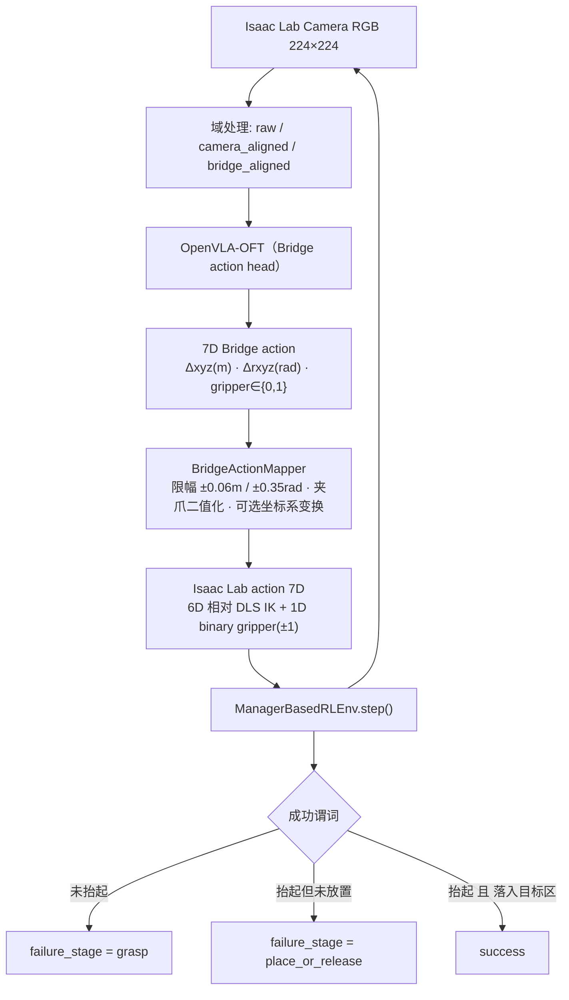

# A10 GPU 上的 Isaac Lab 仿真与 Franka 抓取实验全流程

本文回答两个问题：

1. **怎么在 A10 云实例上把 Isaac Lab 仿真跑起来**——环境配置（驱动 / CUDA / 依赖版本）、启动与运行步骤、关键参数、以及按症状排查的排障手册。
2. **怎么在仿真之上做机械臂抓取实验**——场景搭建、抓取任务配置与策略、实验运行流程、结果评估方式。

---

## 0. 读前须知

### 0.1 术语与文档分工

需求里提到的仿真平台即 NVIDIA **Isaac Lab**（本文统一用这个词）。本目录下三份文档分工如下，不要混读：

| 文档 | 覆盖范围 | 不要在里面找什么 |
|---|---|---|
| [`A10-IsaacLab-安装与入门.md`](A10-IsaacLab-安装与入门.md) | 安装、官方示例、Franka 基础练习、远程可视化 | 抓取任务的评测协议 |
| **本文** | 环境全貌 + 启动运行 + 参数 + 排障 + 抓取实验全流程 | 逐条安装命令的逐字解释 |
| [`Bridge-迁移掉点分析报告.md`](Bridge-迁移掉点分析报告.md) | 成对评测协议、结果表、失败归因规则 | 环境安装 |

代码与命令的权威来源是同目录的 [`../README.md`](../README.md) 与各 `.py` 文件；本文只做组织与解释，不改写契约。

### 0.2 数据纪律（重要）

本文严格区分两类内容：

- **已实测**：可追溯到工作区文件、带日期的数字，会标注来源。
- **`待实跑` / `待实测`**：Isaac Lab 侧本项目尚未实跑的指标。**一律留空，不估算、不填占位百分比。**

> [!IMPORTANT]
> 本工作区本机没有安装 Isaac Lab / Isaac Sim（`import isaaclab` 与 `import torch` 均不可用），因此 Isaac 侧只做过纯 Python 语法检查与无 Isaac 依赖的单测（`tests/`）。所有成功率、显存峰值、单步延迟都必须由 A10 实跑产生。

---

## 1. 环境配置

### 1.1 先看硬件门槛：A10 能跑，A100 不能

这是整套方案里最反直觉、也最容易被忽略的一条：

| 门槛项 | 官方要求（Isaac Sim 5.1.0） | A10 24GB | 说明 |
|---|---|---|---|
| **RT Core** | 必须有。官方明确列出 **「GPUs without RT Cores (A100, H100) are not supported」** | ✅ 有 | A10 基于 GA102，带 RT Core |
| GPU 显存 | ≥ 16 GB（渲染场景需更多余量） | ✅ 24 GB | 但只够「Isaac 单独跑」，见 §6 |
| 操作系统 | Ubuntu 22.04 / 24.04（x86_64），或 Windows 10/11 | 以云实例实际系统为准 | 容器方案仅 Linux |
| 主机内存 | ≥ 32 GB | 以云实例配置为准 | Isaac Sim 启动吃内存 |
| 磁盘 | ≥ 50 GB SSD | 另需给资产缓存留空间 | 首次运行会下载资产 |
| 驱动 | Linux ≥ **580.65.06** | 需 `nvidia-smi` 核对 | 云平台可能无法自行升级 |
| GLIBC | ≥ **2.35**（仅 pip 安装方式要求） | `ldd --version` 核对 | Ubuntu 20.04 = 2.31，只能走二进制包 |

> [!IMPORTANT]
> **反直觉点：算力更强的那张卡反而跑不了。**
> A100 / H100 是纯计算卡，没有 RT Core，RTX 渲染管线起不来，Isaac Sim 官方直接列为不支持。
> A10 是专业可视化卡，**带 RT Core**，所以是「能跑但不算快」；A100 是「跑不了」。
> 如果手上的 A100-40G 环境是想拿来跑仿真的，**这条路走不通**，别在驱动和 CUDA 上浪费时间——先确认卡型再谈版本。

**驱动版本必须先查再动手**：

```bash
nvidia-smi                       # 看 Driver Version 与 GPU 型号
ldd --version | head -n 1        # 看 GLIBC
uname -a                         # 看内核与架构
```

`nvidia-smi` 里若驱动 < 580.65.06，先不要装 Isaac Sim 5.1。退路见 §1.6。

### 1.2 软件版本矩阵

| 组件 | 锁定版本 | 为什么是这个版本 |
|---|---|---|
| Python | **3.11**（Isaac Sim 5.x 强制） | Isaac Sim 按特定 Python 版本构建，Isaac Lab 必须对齐 |
| Isaac Sim | **5.1.0** | Isaac Lab v2.3.x 的配套稳定版 |
| Isaac Lab | **v2.3.2**（稳定标签） | 3.0 开发线已切到 Isaac Sim 6.x / Python 3.12 且含 API 变化，本项目代码基于 2.x 接口 |
| PyTorch | **2.7.0 + cu128**（torchvision 0.22.0） | 与 Isaac Sim 5.1 匹配 |
| CUDA 运行时 | 12.8 线（随 PyTorch 轮子） | Isaac Sim 自带所需 CUDA 运行时，通常无需系统级 CUDA Toolkit |
| 驱动 | Linux ≥ 580.65.06 | 官方验证版本 |
| GLIBC | ≥ 2.35 | pip 安装方式的硬门槛 |

**本项目 OpenVLA-OFT 侧已有基线（对照用）**：Python 3.10 / torch 2.2.0+cu121 / numpy 1.26.4 / TF 2.15 / robosuite 1.4.1 / mujoco 3.3.2。

> [!WARNING]
> 两边是**两套互斥的 Python 版本线**：Isaac Lab 要 3.11，OFT 是 3.10。
> 不要试图把 Isaac Sim 装进 `venv_oft`，也不要在任何时候让 pip 去"顺手升级"torch / numpy。
> 装任何第三方包沿用项目既有约定：**一律加 `--no-deps`**，避免 pip 把 torch 拖坏。

### 1.3 建立独立环境并安装

```bash
export WS=/mnt/workspace
mkdir -p "$WS/isaaclab"
python3.11 -m venv "$WS/venv_isaaclab"
source "$WS/venv_isaaclab/bin/activate"
python -m pip install --upgrade pip
```

```bash
# 1) Isaac Sim 本体（NVIDIA PyPI 源）
python -m pip install 'isaacsim[all,extscache]==5.1.0' \
  --extra-index-url https://pypi.nvidia.com

# 2) 匹配的 CUDA 版 PyTorch
python -m pip install torch==2.7.0 torchvision==0.22.0 \
  --index-url https://download.pytorch.org/whl/cu128

# 3) Isaac Lab 源码（锁 v2.3.2）
git clone --branch v2.3.2 --depth 1 \
  https://github.com/isaac-sim/IsaacLab.git "$WS/isaaclab/IsaacLab"
cd "$WS/isaaclab/IsaacLab"
./isaaclab.sh --install none
```

`--install none` 只装 Isaac Lab 本体扩展，不额外拉 RL 算法库；后续要用某个训练框架再按需装。

**首次启动的预期行为**（不是故障）：

- 会下载/编译扩展、填充着色器缓存，**启动可能超过 10 分钟**。
- 会弹出 NVIDIA Omniverse EULA 提示，需要交互确认。
- 不要在无人值守脚本里擅自设置 `OMNI_KIT_ACCEPT_EULA=YES` 之类的变量绕过它——许可条款应由使用者本人确认。

### 1.4 安装验收（三级，逐级过）

**级 1：包与 CUDA 可用性**

```bash
python - <<'PY'
import torch, isaaclab, isaacsim
print('torch:', torch.__version__)
print('torch CUDA:', torch.cuda.is_available())
print('GPU:', torch.cuda.get_device_name(0) if torch.cuda.is_available() else 'unavailable')
print('isaaclab:', isaaclab.__file__)
print('isaacsim:', isaacsim.__file__)
PY
```

判据：`torch CUDA: True`，GPU 名字是 A10，两个包的路径都落在 `venv_isaaclab` / IsaacLab checkout 里。**路径指错位置说明装重了**，先清理再继续。

**级 2：官方空场景**

```bash
./isaaclab.sh -p scripts/tutorials/00_sim/create_empty.py --headless
```

判据：进程能正常启动并退出；日志里没有 `ModuleNotFoundError`、CUDA 初始化错误、RTX 渲染器初始化失败、PhysX 崩溃。
如果该标签下的脚本不接受 `--headless`，先跑 `--help` 看它自己的参数——**不要照抄开发分支的教程**。

**级 3：本项目任务可注册**

```bash
./isaaclab.sh -p -c "import gymnasium as gym, register_env; print(gym.spec('Isaac-Bridge-PickPlace-Franka-IK-Rel-v0').id)"
```

或在 Isaac Lab 的 python 里直接 `import bridge_pick_place_env_cfg`，能过就说明 `FrankaCubeLiftEnvCfg` 的继承链没断。

### 1.5 驱动不达标的退路

若驱动 < 580.65.06 且平台不允许自行升级：

| 退路 | 做法 | 代价 |
|---|---|---|
| 降 Isaac Sim 版本 | Isaac Sim **4.5** + Isaac Lab v2.1.x / v2.2.x，**Python 3.10** | 好处是能与 OFT 同 Python 版本线；但本项目的 `isaaclab_tasks` 导入路径与配置字段需逐个核对（`待验证`） |
| 二进制包代替 pip | 下载 Isaac Sim 预编译包 + `ISAACSIM_PATH` + `_isaac_sim` 软链 | 绕开 GLIBC 2.35 限制，Ubuntu 20.04 走这条 |
| 换平台 | 找一台能装新驱动的 Ubuntu 22.04 + RT Core 卡 | 最省事 |

---

## 2. 仿真的启动与运行

### 2.1 启动时序铁律（代码级）

Isaac Lab 的扩展是**在仿真器启动时热加载**的。因此顺序必须是：

```text
import argparse
  → AppLauncher.add_app_launcher_args(parser)
  → parser.parse_args()
  → AppLauncher(args)            ← 仿真器在这里起来
  → 此后才能 import isaaclab.sim / gymnasium / torch / 本项目模块
```

正确写法：

```python
import argparse
from isaaclab.app import AppLauncher

parser = argparse.ArgumentParser()
AppLauncher.add_app_launcher_args(parser)
args = parser.parse_args()
app_launcher = AppLauncher(args)          # 先起仿真器
simulation_app = app_launcher.app

# 之后才 import 其余一切
import gymnasium as gym
import torch
```

错误写法（会报 missing module 类的错，且报错信息通常指向别处，很难查）：

```python
import torch                               # ❌ 不能先 import torch
from isaaclab.app import AppLauncher
```

本项目 `run_closed_loop.py` / `record_video.py` / `camera_sweep.py` 都已按铁律书写：`main()` 里第一件事就是 `AppLauncher(args)`，`register_env` 与 `gymnasium` / `torch` 全在其后 import。

> [!WARNING]
> **一个进程只能有一套 Isaac 仿真。** 不要在同一进程里创建多个 Isaac Lab 环境或多次 `AppLauncher`。
> 需要独立的采集器 / 评测器 / 渲染器 → 用**独立进程**。

### 2.2 四种启动模式

| 模式 | 参数 | 加载的 experience | 适用 |
|---|---|---|---|
| 纯无头（无渲染） | `--headless` | `isaaclab.python.headless.kit` | 只看物理、跑状态观测 |
| 无头 + 相机 | `--headless --enable_cameras` | `isaaclab.python.headless.rendering.kit` | **本项目必需**（要 RGB） |
| 有界面 | 不加 `--headless`（可选 `--enable_cameras`） | `isaaclab.python.kit` / `...rendering.kit` | 本地有受支持的 RTX 卡时练 Stage / Viewport |
| 串流 | `--headless --livestream 2 --enable_cameras` | 无头渲染 | 云端想看画面 |

`--livestream` 取值：`0` 关闭，`1` WebRTC 公网，`2` WebRTC 局域网/私网。

### 2.3 关键启动参数速查

| 参数 | 本项目默认 | 作用与坑 |
|---|---|---|
| `--enable_cameras` | **无默认，必须显式加** | 环境里只要有 `CameraCfg`，**不加这个参数渲染器就不启动，相机输出是空张量**。这是本项目最容易漏的一个参数 |
| `--headless` | 建议加 | 无头模式 |
| `--device` | `cuda:0` | 物理计算设备 |
| `--rendering_mode` | 不指定 | `performance` / `balanced` / `quality`，显存紧张选 `performance` |
| `--num_envs` | `8` | 并行环境数，直接决定显存与耗时（注意 §3.6 的坑） |
| `--episodes` | `50` | **批次数，不是 episode 总数**，见 §5.4.4 |
| `--max_steps` | `240` | 单批次最大控制步数（与 `episode_length_s` 对齐） |
| `--open_loop_steps` | `1` | 1 = 每个控制周期重新渲染 + 重新推理，是真闭环；`5` 只用于 action chunk 消融 |
| `--domain_mode` | `bridge_aligned` | `raw` / `camera_aligned` / `bridge_aligned` |
| `--policy` | `openvla` | `openvla` / `heuristic` |
| `--video` | 关 | 需 Isaac Lab 环境里有 `imageio` |
| `--seed` | `7` | 同 seed 才能做 raw vs aligned 成对比较 |

### 2.4 六步渐进验证顺序（把官方练习映射到本项目）

**一次只解决一层问题**，不要一上手就跑 VLA 闭环。

| 步骤 | 命令 | 验收判据 | 这一层排除掉什么 |
|---|---|---|---|
| A 看 Stage / USD | 本地 GUI 有卡时启动 Isaac Sim | 能看懂 Stage 树、属性面板 | USD 层级认知 |
| B 空场景步进 | `./isaaclab.sh -p scripts/tutorials/00_sim/create_empty.py --headless` | 起得来、退得掉 | 安装完整性 |
| C 刚体交互 | 官方刚体/物体教程 | 能看到重力、碰撞、`reset()` 生效 | 物理栈 |
| D Franka 差分 IK | `./isaaclab.sh -p scripts/tutorials/05_controllers/run_diff_ik.py --robot franka_panda --num_envs 1` | 末端目标框与真实末端同向运动 | 关节名 / body 名 / IK 控制器 |
| E 官方方块任务 | `./isaaclab.sh -p scripts/environments/list_envs.py \| grep 'Lift-Cube-Franka-IK-Rel'`，再用官方 play 脚本跑 `Isaac-Lift-Cube-Franka-IK-Rel-v0`，1 个环境 | 能观察 reset / obs / action / terminated / truncated | ManagerBased 环境机制 |
| F 读配置 | 打开官方 `franka/ik_rel_env_cfg.py`，对照 Scene / Actions / Observations / Rewards / Terminations | 能说清 `env.step(action)` 进出什么 | 后面改配置不至于瞎改 |
| **G 本项目 smoke** | 见 §5.3 阶段 1 | 渲染出图 + IK 走通 + 判定生效 | 本项目与官方的接口差 |

D 和 E 都只用 **1 个环境**；官方性能示例里的 128 / 4096 环境不要照抄。

### 2.5 A10 上的远程可视化

1. **本地工作站 GUI**：在有受支持 NVIDIA RTX GPU 的机器上装同版本 Isaac Sim/Lab，专门用来熟悉界面。
2. **云端 WebRTC 串流**：`--livestream 2` + WebRTC Streaming Client。**先确认云平台网络策略**——普通 Notebook 的浏览器代理通常不会自动转发这些端口。
3. **纯 headless 出产物**：A10 上跑脚本，保存 RGB / MP4 / 状态日志，在本地看。**这是本项目推荐的默认路径。**

---

## 3. 关键参数设置

### 3.1 时间步与控制频率链

`bridge_pick_place_env_cfg.py` 里锁定的时序：

| 参数 | 值 | 含义 |
|---|---|---|
| `sim.dt` | `0.01` | 物理步长 10 ms |
| `decimation` | `5` | 每个控制步走 5 个物理步 |
| **控制周期** | `0.01 × 5 = 0.05 s` | **= 20 Hz** |
| `episode_length_s` | `12.0` | 12 s ÷ 0.05 s = **240 控制步** |
| `--max_steps` | `240` | 与上式一致 |
| `sim.render_interval` | `= decimation` | 相机每个控制周期更新一次 = 20 Hz |

> [!IMPORTANT]
> **这五个参数是一根链条，动一个就动全部。**
> 改 `decimation` → 控制频率变 → 相机/推理频率变 → 与「推理延迟必须 < 控制周期」这条约束的关系被破坏。
> 本项目在 LIBERO 侧已经实测过这条约束的代价（400 ms deadline、open-loop=8 不可缩短）；仿真侧同样不能随手调。**要改就整条链一起重算，别只改一个。**

### 3.2 动作空间参数（7D 契约）

机械臂动作项（`DifferentialInverseKinematicsActionCfg`）：

| 参数 | 值 | 说明 |
|---|---|---|
| `asset_name` | `"robot"` | 指向场景里的 Franka |
| `joint_names` | `["panda_joint.*"]` | 7 个臂关节 |
| `body_name` | `"panda_hand"` | 末端参考 body |
| `controller.command_type` | `"pose"` | 位姿指令（非 twist） |
| `controller.use_relative_mode` | `True` | **相对模式**，动作是增量不是绝对位姿 |
| `controller.ik_method` | `"dls"` | 阻尼最小二乘，窄空间下比伪逆稳 |
| `scale` | `(1,1,1,1,1,1)` | 不做二次缩放（单位/限幅已在映射器里处理） |
| `body_offset.pos` | `[0, 0, 0.107]` | 从 `panda_hand` 到夹爪中心点的偏移 |

夹爪动作项：`BinaryJointPositionActionCfg`，输入是**符号值**（`+1` 开 / `-1` 闭）。

最终送给 `env.step()` 的张量形状是 `(num_envs, 7)` = `[臂 6D, 夹爪 1D]`。

> [!WARNING]
> 7 维顺序 = `ActionsCfg` 里的**定义顺序**，由 manager 拼接而成。
> 如果重排 `arm_action` 与 `gripper_action` 的顺序（或在中间插入新的 action term），这个 7D 契约会**静默失效**——不报错，只是机器人在做完全不相干的事。改 `ActionsCfg` 后必须重跑 `tests/test_action_mapper.py` 并做一次 heuristic smoke。

### 3.3 相机参数

| 参数 | 值 |
|---|---|
| `height` / `width` | `224` / `224` |
| `data_types` | `["rgb"]` |
| `spawn.focal_length` | `28.0` |
| `spawn.focus_distance` | `1.0` |
| `spawn.horizontal_aperture` | `20.955` |
| `spawn.clipping_range` | `(0.05, 3.0)` |
| `offset.convention` | `"ros"`（相机朝向约定；对齐扫描时**只调这个和 pos**） |
| `update_period` | `0.0`（每步都更新） |
| 对齐位姿 `BRIDGE_CAMERA_POS` | `(1.05, -1.05, 0.82)` |
| 对齐姿态 `BRIDGE_CAMERA_ROT` | `(0.64, -0.28, 0.28, 0.66)` |
| 原始位姿 `RAW_CAMERA_POS` | `(1.20, -1.20, 1.05)` |

`apply_camera_profile()` 的行为：`raw` 只换 `pos`；`camera_aligned` / `bridge_aligned` 用对齐 `pos` + `rot`。

> [!NOTE]
> **一个待核对点：方形相机 + 4:3 中心裁剪。**
> `domain_randomization.center_crop_to_aspect()` 会把图裁成 4:3（对齐 BridgeData V2 的 640×480 构图）。
> 但当输入是 **224×224 方形图**时，裁剪逻辑走的是"高度方向裁"这一支：`new_height = 224 / (4/3) = 168`，
> 输出变成 **168×224**，即裁掉了上下各 28 行。
> 单测里验证的是 `(80,120) → (80,107)`（横向裁），**方形输入这一支没有被测试覆盖**。
> 如果发现模型对物体的垂直定位持续偏移，先把相机原生分辨率改成 4:3（例如 224×168）或补一条方形输入的单测，再谈别的。

### 3.4 动作映射参数（`BridgeActionMappingConfig`）

| 参数 | 默认 | 作用 |
|---|---|---|
| `max_position_delta_m` | `0.06` | 位移增量限幅（米）。防异常反归一化导致穿模 |
| `max_rotation_delta_rad` | `0.35` | 旋转增量限幅（弧度） |
| `bridge_frame` | `"world"` | Bridge 动作所在坐标系 |
| `ik_frame` | `"root"` | Isaac Lab IK 期望的坐标系 |
| `gripper_input` | `"absolute_01"` | Bridge 夹爪编码：**0 = 闭，1 = 开** |
| `open_threshold` | `0.5` | 二值化阈值 |

坐标系转换只在以下组合触发（其余组合不做旋转，也不需要提供末端四元数）：

```text
(bridge_frame ∈ {world, root} 且 ik_frame == "body")
(bridge_frame == "body"        且 ik_frame == "root")
```

默认 `(world, root)` **不触发转换**——因为默认场景里 Panda 基座与 Bridge 桌面坐标轴一致。
若非单位姿态基座，加 `--bridge_frame world --ik_frame body`，映射器会用当前末端四元数把增量从世界系转到 body 系（此时 `run_closed_loop.py` 会自动传入 `target_quat_w`）。

### 3.5 观测参数（proprio 7 维）

`make_openvla_observation()` 产出的 `state` 是 7 维：

| 维度 | 内容 | 关键处理 |
|---|---|---|
| 0:3 | 末端位置 | **减去 `env.scene.env_origins`**，从世界系转到本地桌面系 |
| 3:6 | 末端姿态 | 四元数（wxyz）→ 轴角（exponential coordinates） |
| 6 | 夹爪开合度 | `mean(手指关节位置) / 0.04`，再 clip 到 `[0, 1]` |

> [!IMPORTANT]
> **夹爪存在两套编码，不要互抄：**
> - **观测里**是 `[0, 1]` 的**绝对量**（0 闭 / 1 开）—— Bridge `full_state` 的原生语义。
> - **动作里**是 `±1` 的**符号量**——因为 Isaac Lab 的 `BinaryJointPositionAction` 吃符号输入。
>
> 把观测的 `[0,1]` 直接当动作发下去，或把动作的 `±1` 写进观测，都会让夹爪行为完全错乱，而且不会报错。
> 相关常量：`PROPRIO_DIM = 7`、`ACTION_DIM = 7`，且**映射器不再做二次反归一化**（`get_vla_action()` 已按 checkpoint 统计量反归一化过）。

### 3.6 并行度与显存参数

| 参数 | 值 | 说明 |
|---|---|---|
| `scene.num_envs` | `8`（`_PLAY` 版为 1） | 并行环境数 |
| `scene.env_spacing` | `2.5` | 环境间距（米），太小会让邻场物体入镜 |

> [!IMPORTANT]
> **反直觉点：物理并行 ≠ 推理并行。**
> `run_closed_loop.py` 的动作循环是
> `for env_id, policy in enumerate(policies): frame_obs = ...; bridge_action = policy.act(frame_obs)`
> —— 而 `policies = [policy] * num_envs`，**8 个环境共用同一个模型实例，逐个串行推理**。
> 所以 `--num_envs` 提升的是**物理仿真吞吐**，**不是** VLA 吞吐：
> 每增加一个并行环境，就多一次串行前向。拿 LIBERO 侧实测的 217 ms / 次估量，8 环境意味着**单个控制周期要串 8 次推理**。
> 结论：**不要把「8 环境并行」当成「快 8 倍」来规划实验时间**。真要提吞吐，要么把推理批量化，要么把物理并行数压到刚好喂满 GPU。

### 3.7 成功判定参数

`_success_state()` 的谓词（位置均已减去 `env_origins`，即本地桌面系）：

| 判定 | 条件 | 说明 |
|---|---|---|
| 抬起过 | `z > 0.12` | 累积事件（`ever_lifted`），一旦为真不再清零 |
| 已放置 | `‖xy − target_xy‖ < 0.075` 且 `|z − target_z| < 0.035` | 同时满足 |
| 成功 | `ever_lifted & placed` | **必须先抬起、后落入**，缺一不可 |
| `target_xyz` | `(0.68, -0.18, 0.055)` | 与 `BRIDGE_TARGET_XYZ` / 绿色 `place_target` 一致 |

绿色目标板是 `size=(0.14, 0.14, 0.004)` 的无碰撞立方体，半宽 0.07 m；判定半径 0.075 m 略大于板边，属有意留的容差。

---

## 4. 常见问题排查

### 4.1 速查表（症状 → 根因 → 定位）

| # | 症状 | 最可能的根因 | 定位 / 验证 | 修复 |
|---|---|---|---|---|
| 1 | `ModuleNotFoundError` / 扩展类缺失，且报错位置很奇怪 | 导入时序反了：在 `AppLauncher()` 之前 import 了 `isaaclab.sim` / `torch` | 检查脚本头部 import 顺序 | 按 §2.1 重排：先起 app，再 import |
| 2 | 相机输出空张量 / 全黑 / `key not found: rgb` | **漏了 `--enable_cameras`** | 加参数前后各跑一次 `record_video.py`，对比 `raw_only.mp4` | 命令行补 `--enable_cameras` |
| 3 | RTX 渲染器初始化失败 / `GPU not supported` | 卡没有 RT Core（A100/H100）或驱动过旧 | `nvidia-smi` 看型号与驱动版本 | 换 RT Core 卡；或升级驱动到 ≥ 580.65.06 |
| 4 | 首次启动卡在 EULA / 十几分钟没动静 | 正常：在编译扩展 + 填着色器缓存 | 看是否还在写日志/占 CPU | 耐心等；首次冷启动可能 > 10 分钟 |
| 5 | `isaacsim` 装不上，报 GLIBC 相关错误 | 系统 GLIBC < 2.35（Ubuntu 20.04 = 2.31） | `ldd --version \| head -n 1` | **不要升级系统 GLIBC**；改走二进制包或容器 |
| 6 | CUDA OOM | Isaac Sim 与 OpenVLA 抢同一张 24 GB 卡 | 分别单跑，记录峰值 | 见 §6 的三种架构方案 |
| 7 | Franka 完全不动 / 动作像被忽略 | `joint_names` / `body_name` 不匹配；`scale` 被改成 0；动作被限幅吃光 | 先跑步骤 D 的官方 diff IK；再打印 mapper 输出 | 对齐关节/body 名；确认 `scale=(1,1,1,1,1,1)` |
| 8 | 夹爪行为反向（想抓反而张开） | 混淆了观测 `[0,1]` 与动作 `±1` 两套编码 | 打印 `mapper.to_isaac_action(...)` 末位 | 按 §3.5 的编码约定核对 |
| 9 | 相机里出现相邻环境的桌子 | `env_spacing` 太小 | 看 RGB 边缘 | 调大 `env_spacing`（当前 2.5） |
| 10 | 想在同进程跑两个仿真/两个 AppLauncher | 违反「一进程一套仿真」 | 报错通常很含糊 | 拆成独立进程 |
| 11 | livestream 连不上 | 云平台端口未开放 / 代理不转发 | 先确认平台网络策略 | 改走 headless 出图出片 |
| 12 | `torch` 版本被 pip 改掉、OFT 环境跑不起来 | 没加 `--no-deps`，或在 OFT 环境里装 Isaac 依赖 | `python -c "import torch; print(torch.__version__)"` | `--no-deps`；两边环境严格隔离 |
| 13 | 路径/长路径类报错 | 在 Windows 上跑 | 看 traceback 里的路径 | Isaac Lab 生产运行建议放 Linux |
| 14 | 加了 `--enable_cameras` 仍然全黑 | 相机位姿在遮挡里 / `clipping_range` 不含目标 / `convention` 不对 | 用 `camera_sweep.py` 扫位姿出图 | 调 `offset.pos`、`clipping_range`、`convention` |
| 15 | 不报错但动作/观测维度对不上、模型输出像在乱来 | **平台常量被静默判成 LIBERO**（`PROPRIO_DIM=8`、`chunk=8`），而本项目 proprio 只有 7 维 | `check_env.py --simulate-argv "<真实命令>"` | 让命令里出现 `bridge` 字样（`--unnorm_key bridge_orig` 或 `--domain_mode bridge_aligned` 即可） |

### 4.2 几条展开说明

**关于 #2（最容易漏的一条）**
官方 API 文档对 `--enable_cameras` 的说明是：*"If True, the app will enable camera sensors and render them, even when in headless mode. This flag must be set to True if the environments contains any camera sensors."*
本项目场景里有 `CameraCfg`，所以**每一条会读 RGB 的命令都必须带它**，包括 `run_closed_loop.py`、`record_video.py`、`camera_sweep.py`。
漏了不会崩，只会安静地拿到空数据——**排查成本远高于记住它**。

**关于 #3 与 §1.1**
把「A100 跑不了 Isaac Sim」当成一条硬事实记住。这不是驱动问题、不是 CUDA 版本问题，是**硬件能力缺失**。在同一台 A100 上折腾驱动是纯浪费。

**关于 OOM（#6）**
先分别单跑取真实峰值，再决定共存方案。**不要凭官方 16 GB 下限去推算**——那个数字对应的是典型渲染场景，不是你这个小场景；同时你也不能因此就假设它一定够。**用实测峰值说话。**

**关于 #4**
云端无人值守时，EULA 和首次编译会在日志里表现为"卡住"。先确认进程还活着（CPU、磁盘 IO 有活动），别急着 kill。反复 kill 会造成缓存半成品，下次更慢。

**关于 #15（最隐蔽的一条）**
上游 `prismatic/vla/constants.py` 用 `detect_robot_platform()` **扫描 `sys.argv` 里的字符串**来决定平台常量：命中 `libero` / `aloha` / `bridge` 之一，**一个都不命中就默认 LIBERO**。

| 平台 | `NUM_ACTIONS_CHUNK` | `ACTION_DIM` | `PROPRIO_DIM` |
|---|---|---|---|
| BRIDGE（本实验需要） | 5 | 7 | **7** |
| LIBERO（兜底） | 8 | 7 | **8** |

本项目的观测只给 7 维 proprio（`observation.py` 里 `[eef_pos(3), axis_angle(3), gripper(1)]`），闭环默认 `open_loop_steps=1`。被判成 LIBERO 后 `PROPRIO_DIM` 变 8、`NUM_ACTIONS_CHUNK` 变 8，**不会报错**，只会让归一化统计量的取用与动作块语义悄悄错位。

两道保险：

1. `OpenVLAAdapter.__init__` 会在 `import openvla_utils` **之前**往 `sys.argv` 补一个 `--bridge`（前提是 argv 里本来不含 `bridge` 字样）。
2. 自己确认：`--unnorm_key bridge_orig` 或 `--domain_mode bridge_aligned` 里都带 `bridge`，命令行自然就命中了。用 `check_env.py --simulate-argv "<你的真实命令>"` 可以先离线验证，**不用真跑一遍才知道**。

---

## 5. 从仿真到机械臂抓取实验

### 5.1 场景搭建

任务定义（最小可验证）：

> 从桌面抓起一个立方体，移动到绿色目标区上方，松开并让立方体稳定落在目标区内。

配置继承链：

```text
Isaac Lab 官方  Isaac-Lift-Cube-Franka-IK-Rel-v0
        ↓ FrankaCubeLiftEnvCfg
BridgeTableSceneCfg          ← 加 place_target（绿色放置板）+ bridge_camera（固定相机）
        ↓
BridgePickPlaceEnvCfg        ← 锁时序、锁动作项、锁 Panda 高 PD 配置
        ↓
BridgePickPlaceEnvCfg_PLAY   ← num_envs=1、关掉观测 corruption（调试用）
```

注册：

```python
gym.register(
    id="Isaac-Bridge-PickPlace-Franka-IK-Rel-v0",
    entry_point="isaaclab.envs:ManagerBasedRLEnv",
    kwargs={"env_cfg_entry_point": "bridge_pick_place_env_cfg:BridgePickPlaceEnvCfg"},
    disable_env_checker=True,
)
```

场景元素对照：

| 元素 | 来源 | 作用 |
|---|---|---|
| 桌面 + 方块 | 官方 `ObjectTableSceneCfg` | 被抓取对象与支撑面 |
| Franka | `FRANKA_PANDA_HIGH_PD_CFG` | 机械臂，保留官方高 PD 增益 |
| `place_target` | 本目录新增 | 绿色放置板，`pos=(0.68,-0.18,0.055)`，**关闭碰撞**（只是视觉目标） |
| `bridge_camera` | 本目录新增 | 224×224 RGB，替代 Bridge 的腕部/第三人称视角 |
| `ee_frame` | 官方 | 提供 `target_pos_w` / `target_quat_w`，观测与坐标系转换都靠它 |

**为什么选继承官方而不是从零建场景**：官方 IK 配置已经把关节名、body 名、DLS 参数、PD 增益调过一轮，从零建等于把这些坑重踩一遍。本实验只做**加法**（相机 + 目标板），降低场景复杂度以隔离变量。

### 5.2 抓取任务的配置与策略

#### 5.2.1 动作空间对齐（最核心的一层）



契约表：

| Bridge 维 | 含义 | 单位 / 符号 | Isaac Lab 下游 |
|---|---|---|---|
| 0:3 | 末端位置增量 | m，Bridge 世界/基座坐标 | `DifferentialInverseKinematicsActionCfg` 位置 3 维 |
| 3:6 | 末端轴角增量 | rad，小角度 exponential coordinates | 同一 IK action 的旋转 3 维 |
| 6 | 夹爪 | Bridge 原生**绝对量** `0=闭, 1=开`；映射后统一成 `±1` | `BinaryJointPositionActionCfg` |

映射器只做三件事：**坐标系变换、限幅、夹爪二值化**。不做反归一化（上游 `get_vla_action()` 已经做了）。

#### 5.2.2 观测构造

`RGB（经域对齐） + state(7D) + task_description` 三项组装成 OpenVLA 期望的 dict：

```python
{
  "full_image": rgb,          # 域处理后的 224×224（或裁剪后）RGB
  "state": state,             # [eef_pos(3), axis_angle(3), gripper(1)]
  "task_description": "pick up the cube and place it on the green target",
  "_raw_rgb": raw_rgb,        # 保留原始帧，供离线域差距分析
}
```

`_raw_rgb` 是有意留下的：**没有它就没法把"视觉域的锅"和"控制器的锅"分开**（见 §5.4.4）。

#### 5.2.3 策略：三层，各司其职

| 策略 | 输入 | 用途 | **不要怎么用** |
|---|---|---|---|
| `HeuristicPickPlacePolicy` | 只用 `state`，**完全不看 RGB** | 5 阶段固定动作序列（预抓取 → 闭合 → 抬起 → 移到目标上方 → 松开），验证 **IK / 夹爪 / 场景 / 判定** 是否通 | **不能**用它产出任何模型指标 |
| `OpenVLAAdapter` | RGB + state + task | 复用 `02-实验代码/patch-check3` 的 `get_vla_action()`；取 chunk 第一帧作为单帧动作 | — |
| `open_loop_steps > 1` | — | 仅用于 action chunk 消融 | **不能**把 5 步的结果当闭环结果上报 |

`OpenVLAAdapter` 的三个实现细节值得知道：
- 它会在 `import openvla_utils` **之前**往 `sys.argv` 补一个 `--bridge`。上游 `prismatic/vla/constants.py` 靠扫描 argv 决定平台常量，**匹配不到就默认 LIBERO**——`PROPRIO_DIM` 变成 8（本项目观测只有 7 维）、`NUM_ACTIONS_CHUNK` 变成 8。不补的话契约会静默漂掉，详见 §4.2 关于 #15。
- 这个补丁只在 argv 里本来不含 `bridge` 字样时触发；用包装器重命名脚本后要确认它仍然生效。
- `--checkpoint` 与 `--unnorm_key` 必须配对：`dataset_statistics.json` 里要有 `unnorm_key` 那一层，且其下同时含 `action` 与 `proprio`（`get_vla_action()` 分别取 `vla.norm_stats[unnorm_key]["proprio"]` 与 `["action"]`）。这一步用 `check_env.py --checkpoint ... --unnorm-key ...` 可以离线校验。

#### 5.2.4 动作块与实时性预算

仿真侧默认 `open_loop_steps=1`（每周期重渲染 + 重推理），与 LIBERO 侧的 `open-loop=8` 是**两套不同口径**，不要混用结论：

| 口径 | 值 | 已验证结论 |
|---|---|---|
| LIBERO / BF16 | 217.24 ms/步 | 400 ms deadline 达标率 98.4% |
| LIBERO / INT8 | 555.49 ms/步 | deadline 达标率 **0.0%**，动作 14.4 FPS 喂不饱 20 Hz |
| **Isaac 仿真侧** | **待实跑** | 控制周期 50 ms 是硬上限 |

> [!IMPORTANT]
> 仿真侧控制周期是 **50 ms**，比 LIBERO 的 400 ms 预算**紧 8 倍**。
> 也就是说：**即便用 BF16（217 ms）也远远喂不饱 20 Hz 的 Isaac 闭环**。
> 所以本实验的定位是**离线/准离线的域差距与抓取能力评测**，不是实时闭环控制。
> 如果要把 `open_loop_steps` 提到 2 以上换取"看得过去"的节奏，必须在报告里显式声明，不能当闭环结果。

### 5.3 实验运行流程（四阶段）

#### 阶段 0：本机静态检查（不需要 Isaac）

```bash
# 0a. 环境变量 / 路径 / 依赖 / 硬件门槛 是否齐全
python 12-IsaacLab-Bridge-Franka/check_env.py
python 12-IsaacLab-Bridge-Franka/check_env.py --json          # 机器可读，便于写进 CI
python 12-IsaacLab-Bridge-Franka/check_env.py \
  --checkpoint /path/to/openvla-bridge --unnorm-key bridge_orig   # 顺带校验 unnorm_key 与 dataset_statistics.json 的配对

# 0b. 无 Isaac 依赖的单元测试
python -m pytest 12-IsaacLab-Bridge-Franka/tests -q
```

`check_env.py` 检查四段：**环境变量**（`OFT_ROOT` / `OPENVLA_OFT_ROOT` / `PYTHONPATH` / `ISAACLAB_LAUNCHER` / `SEED` / `UNNORM_KEY` / `CHECKPOINT`，以及 `ENABLE_CAMERAS`、EULA 这类 Isaac 运行态变量）、**路径与代码资产**、**依赖**（含平台常量探测）、**硬件门槛**（RT Core / 显存 / 驱动 / GLIBC / 架构 / 内存 / 磁盘）。退出码 `0` 无 FAIL、`1` 有 FAIL、`2` 加了 `--strict` 且有 WARN。

两个实用开关：
- `--ignore-hardware`：本机自检时跳过硬件门槛（本机 GPU 一般达不到 16 GB 下限）。
- `--simulate-argv "<真实命令>"`：**离线预演**上游会把这个命令判成哪个平台常量。判不成 `BRIDGE` 会静默退回 LIBERO（`PROPRIO_DIM` 8 而非 7），见 §4.2 关于 #15。

单元测试覆盖：动作映射（单位、限幅、夹爪符号、body↔root 变换）、RGB 对齐（4:3 裁剪、raw 确定性、dtype/shape 契约），以及 `check_env.py` 自身的回归（路径切分、RT Core 判定、平台探测、`unnorm_key` 校验、退出码）。
**这一步 0 显存、0 GPU，改完映射器或检查器必跑。**

#### 阶段 1：Isaac 内单环境 smoke（只用控制器）

```bash
./isaaclab.sh -p 12-IsaacLab-Bridge-Franka/run_closed_loop.py \
  --policy heuristic --num_envs 1 --episodes 1 --domain_mode bridge_aligned \
  --enable_cameras --video --headless
```

判据：
- 进程正常退出，`outputs/<timestamp>/` 下生成 `episodes.jsonl` / `summary.json` / `closed_loop_demo.mp4`；
- MP4 里能看清方块和绿色目标板（**能看清 = `--enable_cameras` 生效**）；
- 若 `success=false`，先看 `failure_stage`：`grasp` → IK/夹爪/场景问题；`place_or_release` → 目标坐标/释放时机问题。

> [!WARNING]
> **heuristic 失败时不要继续调 VLA。** 先修 controller、相机路径、Franka 关节/body 名、物理参数。
> 控制器都做不对的动作，加个 7B 模型只会把问题盖住。

#### 阶段 2：出可视化素材（域差距看得见）

```bash
# 相机位姿对齐扫描（可选 --reference_image 指向真实 Bridge 帧做 NCC 比较）
./isaaclab.sh -p 12-IsaacLab-Bridge-Franka/camera_sweep.py \
  --enable_cameras --output_dir 12-IsaacLab-Bridge-Franka/outputs/camera-sweep

# raw vs aligned 并排视频
./isaaclab.sh -p 12-IsaacLab-Bridge-Franka/record_video.py \
  --num_envs 1 --max_frames 200 --enable_cameras
```

产物：`comparison.mp4` / `raw_only.mp4` / `aligned_only.mp4` + 每 10 帧的关键帧 PNG + `sweep_results.json`。

#### 阶段 3：成对评测（raw vs bridge_aligned）

环境变量先设好：

```bash
export OFT_ROOT=/mnt/workspace/oft      # 换成实例上的实际路径
export OPENVLA_OFT_ROOT="$OFT_ROOT/02-实验代码/patch-check3"
export PYTHONPATH="$OFT_ROOT/12-IsaacLab-Bridge-Franka:$OPENVLA_OFT_ROOT:$PYTHONPATH"
export ISAACLAB_LAUNCHER=./isaaclab.sh
```

```bash
bash 12-IsaacLab-Bridge-Franka/run_domain_gap_eval.sh \
  /path/to/openvla-bridge-checkpoint 50 8
```

Windows 上用 `run_domain_gap_eval.ps1 -Checkpoint <path> -Episodes 50 -NumEnvs 8`，语义等价。

脚本做的事：同 seed、同 checkpoint、同 episode 数、同 `open_loop_steps=1` 跑 **raw** 与 **bridge_aligned** 两轮，各自落 `summary.json`，再调 `analyze_results.py` 生成 `domain_gap_report.md`。

需要逐条核对的外部输入：

| 项 | 要求 |
|---|---|
| `--checkpoint` | Bridge 微调 checkpoint 路径 |
| `--unnorm_key` | **必须与该 checkpoint 的 `dataset_statistics.json` 一致**（默认 `bridge_orig`） |
| checkpoint 与 `unnorm_key` 的配对 | 这是历史上翻过车的地方（norm_stats 注入不一致导致整条评测链路失效），**先核对再开跑** |
| 参数 | `--open_loop_steps 1` 不要改；改了就不是成对比较 |

#### 阶段 4：生成/复核报告

```bash
python 12-IsaacLab-Bridge-Franka/analyze_results.py \
  --before outputs/domain-gap/raw/<ts>/summary.json \
  --after  outputs/domain-gap/bridge_aligned/<ts>/summary.json \
  --report outputs/domain-gap/domain_gap_report.md
```

`run_domain_gap_eval.*` 已自动做这一步；单独执行用于重算或换配对。

### 5.4 结果评估方式

#### 5.4.1 产物与字段

| 产物 | 内容 |
|---|---|
| `outputs/<run>/episodes.jsonl` | 每行一条 episode 记录 |
| `outputs/<run>/summary.json` | 聚合结果 |
| `outputs/<run>/closed_loop_demo.mp4` | 第一条环境的闭环录像（与送入模型的 RGB 逐帧一致，含域对齐） |
| `domain_gap_report.md` | 由 `analyze_results.py` 从真实 `summary.json` 生成 |

`episodes.jsonl` 单条字段：

| 字段 | 含义 |
|---|---|
| `episode` | 全局编号 = `batch * num_envs + env_id` |
| `env_id` | 批内环境下标 |
| `seed` | 该批次使用的 seed |
| `domain_mode` | `raw` / `camera_aligned` / `bridge_aligned` |
| `success` | 是否成功（`ever_lifted & placed`） |
| `ever_lifted` | 是否曾抬起过（`z > 0.12`） |
| `failure_stage` | `success` / `place_or_release` / `grasp` |
| `steps` | 该批次实际走了多少控制步 |
| `scene_params` | 该 episode 的随机化参数（含 stage hook 报错字段，若有） |

`summary.json` 顶层字段：`n`、`successes`、`success_rate`、`ever_lifted_rate`、`failure_stage_counts`、`domain_mode`、`policy`、`open_loop_steps`、`episodes_jsonl`。

#### 5.4.2 指标定义

| 指标 | 定义 |
|---|---|
| 成功率 | `successes / n` |
| 抓取成功率 | `ever_lifted_rate`（曾抬起过的比例，无论后期是否放成功） |
| 放置成功率 | `successes / ever_lifted`（抬起者中最终成功放置的比例，需自行从 jsonl 算） |
| 首次接触步 / 推理延迟 / 碰撞掉落数 | 报告模板要求记录；**当前 `summary.json` 尚未输出这三项**（`字段缺失`，需要时得自行从 jsonl 或新增埋点补） |
| 95% 置信区间 | **Wilson 区间**（不是正态近似），`analyze_results.py` 内置 |
| 掉点 | `raw_success_rate − bridge_aligned_success_rate` 的相反数口径见下 |

```text
视觉补救收益 = bridge_aligned_success_rate − raw_success_rate
迁移前掉点   = raw_success_rate − （同 checkpoint 在 Bridge/真实数据上的参考成功率）
```

#### 5.4.3 失败归因顺序

严格按这个顺序判，不要跳步：

1. `ever_lifted = False` → **抓取失败**。先查：RBG 里方块的像素位置、夹爪接近高度、动作前 6 维单位/限幅、`+1=open / −1=close` 是否反了。
2. `ever_lifted = True` 且未放置 → **搬运/放置失败**。先查：`bridge_frame` / `ik_frame`、目标区坐标、释放时机、action chunk 是否过长。
3. raw 失败而 aligned 成功 → **域差距证据**。继续比较相机位姿、光照、材质、RGB 统计。
4. raw 与 aligned 都失败 → **先用 `--policy heuristic`** 验证 IK / 夹爪 / 场景，再排查 checkpoint 的 `unnorm_key` 与 `dataset_statistics.json`。
5. heuristic 也失败 → **停止调 VLA**。修 controller、相机路径、关节/body 名、物理参数。

#### 5.4.4 三个统计口径的坑

> [!IMPORTANT]
> **坑 1：`n ≠ --episodes`。**
> `run_closed_loop.py` 的外层 `while episode_count < args.episodes` 每轮往 `records` 里写 **`num_envs` 条**。
> 所以 `--episodes 50 --num_envs 8` 得到的 **`n = 400`**，不是 50。
> 报告里写"50 个 episode"会和 `summary.json` 的 `n` 对不上，必须先统一口径再落表。

> [!IMPORTANT]
> **坑 2：raw → aligned 的提升 ≠ sim-to-real 掉点。**
> 只有拿到**同一个 checkpoint 在 Bridge 真实数据上的参考成功率**，才能谈"迁移掉点"。
> 拿不到时，只能报 Isaac Lab 内部 raw → aligned 的差值，并明确它不是绝对掉点。

> [!IMPORTANT]
> **坑 3：不能把 aligned 的成功率提升归因于"微调有效"。**
> 要分离视觉补救与控制补救，必须同时保留：原始 RGB、随机化参数、推理时延、失败帧。
> 少任何一项，结论都是不可靠的。

#### 5.4.5 验收清单

未实跑的项保持未打勾——**不要提前打勾**：

- [ ] `check_env.py` 在目标实例上零 FAIL（环境变量与路径是后面一切的前提）
- [x] Bridge action 为 7D，前 6 维 EEF delta pose，末维 gripper
- [x] Isaac Lab arm action 为 6D relative pose，使用官方 DLS 差分 IK
- [x] Bridge 绝对夹爪 `0=close, 1=open` 映射为 Isaac Lab binary joint 的 `−1/+1`
- [x] 位移/旋转限幅在动作下发前执行
- [x] body/root 坐标变换有单测，默认 Panda base 对齐时不做额外变换
- [ ] Isaac Lab headless smoke 通过（含 `--enable_cameras`）
- [ ] OpenVLA raw / aligned 成对评测完成
- [ ] demo MP4、`episodes.jsonl`、最终掉点百分比归档
- [ ] Isaac + OpenVLA 共存时的显存峰值与单步延迟记录

---

## 6. 单卡 A10 的显存与算力预算（工程现实）

这是整个方案里**最硬的约束**，也是唯一必须靠实测拍板的地方。

### 6.1 已知的显存占用

| 进程 | 峰值显存 | 来源 |
|---|---|---|
| OpenVLA-OFT **BF16** 推理 | **15839 MiB** | 本项目 A10 实测（2026-09-15 配对实验） |
| OpenVLA-OFT **INT8-mixed** 推理 | **9315 MiB**（−6524 MiB / −41.2%） | 同上 |
| Isaac Sim headless + 1~8 env + 224×224 相机 | **待实测** | 官方 16 GB 是典型渲染场景下限，本小场景会低，但**不得据此推算** |

### 6.2 三种架构方案

| 方案 | 做法 | 优点 | 代价 / 风险 |
|---|---|---|---|
| **A. 单进程共存** | 同一进程里跑 Isaac + VLA | 无通信开销 | **不可行**：违反"一进程一套仿真"；且 BF16 15839 MiB + Isaac 已接近/超过 24 GB |
| **B. 双进程同卡** | Isaac 进程 + OFT 推理服务进程，本地 HTTP/队列通信 | 职责清晰，可单独重启 | 显存仍需共存。若 Isaac 实测 < 9 GB，则 **INT8 共存**是比较现实的组合（但 INT8 单步 555 ms，只适合离线）；BF16 需 Isaac < 8 GB，概率很低 |
| **C. 时间分片 / 离线两段式** | Isaac 只负责**录帧 + 执行动作**，VLA 推理在另一时间段跑（或另一台机器） | 显存零竞争；不需要实时性 | 需要落盘中间帧；不是在线闭环 |

### 6.3 推荐路径

1. **先单跑 Isaac**，用 `nvidia-smi` 记录 `--num_envs 1` 与 `8` 两种配置下的峰值显存和每步耗时 → 填掉上表的「待实测」。
2. **再单跑 OpenVLA**（BF16 / INT8 各一次），确认与既有实测一致。
3. **按实测差值选方案**：差值够 → 试 B（优先 INT8）；不够 → 直接走 C。
4. 无论哪种，**先记录合并运行的显存峰值与单步延迟，再谈结果**。

> [!IMPORTANT]
> **不要用"应该能跑"来判断。** 官方给的 16 GB 是场景相关的最小值，你的场景比它小；但你同时还要塞一个 7B 模型。
> 这两个方向相反的估计不能互相抵消——**只有实测峰值是裁判**。

---

## 7. 关联材料与官方参考

**本目录**

- [`../README.md`](../README.md)：闭环链路图、动作空间契约、域差距实验设计、官方接口依据
- [`A10-IsaacLab-安装与入门.md`](A10-IsaacLab-安装与入门.md)：安装与入门练习细节
- [`Bridge-迁移掉点分析报告.md`](Bridge-迁移掉点分析报告.md)：成对评测协议、结果表模板、失败归因规则
- [`../check_env.py`](../check_env.py)：环境自检（环境变量 / 路径资产 / 依赖 / 硬件门槛 / Isaac 运行态），支持 `--json`、`--simulate-argv`
- `../tests/`：不依赖 Isaac Sim 的动作映射、RGB 对齐单测，以及 `check_env.py` 自身的回归测试
- 项目级量化与实时性结论：`10-INT8量化与并行解码教材/05-INT8实验报告.md`

**官方**

- [Isaac Sim 5.1.0 系统要求](https://docs.isaacsim.omniverse.nvidia.com/5.1.0/installation/requirements.html)：RT Core、显存 16 GB、驱动 580.65.06、RAM 32 GB
- [Isaac Lab 安装说明](https://isaac-sim.github.io/IsaacLab/main/source/setup/installation)：Python 3.11、GLIBC 2.35、版本兼容矩阵
- [AppLauncher API](https://isaac-sim.github.io/IsaacLab/main/source/api/lab/isaaclab.app.html)：`--enable_cameras` / `--livestream` / `--rendering_mode` / experience 文件选择规则
- [相机与 Tiled Rendering](https://isaac-sim.github.io/IsaacLab/main/source/overview/core-concepts/sensors/camera.html)：相机传感器与 `--enable_cameras` 的关系
- [Franka 差分 IK 教程](https://isaac-sim.github.io/IsaacLab/v2.3.1/source/tutorials/05_controllers/run_diff_ik.html)
- [OpenVLA-OFT action encoding](https://github.com/moojink/openvla-oft/blob/main/prismatic/vla/datasets/rlds/oxe/configs.py)：`ACTION_DIM=7`、`PROPRIO_DIM=7`

---

*最后更新：2026-10-05 · 本文所有 Isaac 侧指标标记为「待实跑」，未实跑项不填数字*
