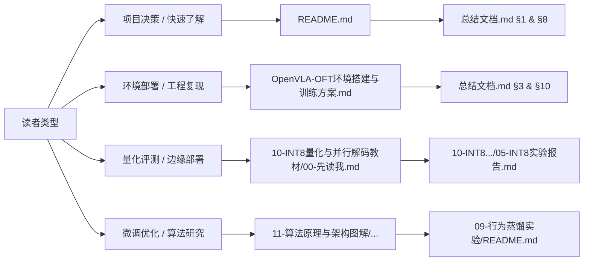

# OpenVLA-OFT: LIBERO-Spatial 评测、诊断、量化与微调工程全景

[](https://github.com/openvla/openvla)
[](https://github.com/Lifelong-Robot-Learning/LIBERO)
[-brightgreen.svg)](#一核心成果看板)
[-orange.svg)](#一核心成果看板)
[](#一核心成果看板)

本项目针对具身智能基础模型 **OpenVLA-OFT**（7B 参数量，集成 SigLIP、DinoV2 与 Llama-2，搭载 8 步并行 OFT 动作头），在机械臂操作标准基准 **LIBERO-Spatial** 上构建了从环境搭建、基线评测、失败归因诊断、数据管道转换、微调消融、物理碰撞动力学分析，到 500 轮 INT8 量化实测及基座教师行为蒸馏方案的完整学术与工程工作流。

---

## 一、核心成果看板

```text
┌────────────────────────────────────────────────────────────────────────────────────────┐
│                                 核心实验指标一览看板                                    │
├──────────────────────┬────────────────────────┬────────────────────────────────────────┤
│ 评测维度             │ 实测核心数值           │ 核心判定与工程定位                     │
├──────────────────────┼────────────────────────┼────────────────────────────────────────┤
│ LIBERO-Spatial 全量  │ 495 / 500（99.0%）     │ 权威基座性能；10 任务中 6 个取得 100%  │
│ Top Drawer（Task 4） │ 48 / 50（96.0%）       │ 基座在最难任务上的权威基准             │
│ Head-only 微调对照   │ 41/50 (82%) / 37/50    │ 局部动作头过拟合，未超越基座           │
│ 上游特征一致性       │ 最大绝对差 0.000000    │ 证实上游编码器未破坏，差异源于动作头   │
│ INT8 显存收益 (9-15) │ 15839 → 9315 MiB       │ 净省 6524 MiB（-41.2%），显存目标达成  │
│ INT8 任务成功率      │ 99.2% → 98.8% (-0.4pp) │ 净损失 2 例，落在 ≤1.0pp 噪声门槛内    │
│ INT8 实时性代价      │ 217ms → 555ms (慢2.56×)│ 400ms 达标率 0.0%，无法用于在线闭环    │
│ INT8 量化覆盖审计    │ 436 / 437 层（99.8%）  │ 确证视觉塔(209)与LLM(224)均被深度量化  │
└──────────────────────┴────────────────────────┴────────────────────────────────────────┘
```

---

## 二、工作区目录架构

```text
c:\Users\27013\Desktop\oft
├── README.md                                  # 【本文件】顶层导航、架构图谱与成果速览
├── 总结文档.md                                 # 核心总结大典：2026-09-15 全链路技术终极报告
├── 00-项目文档时间线.md                         # 2026-08 至 2026-09 全时序研发里程碑与历史更正
├── OpenVLA-OFT环境搭建与训练方案.md             # 云端 GPU 部署实录、版本清单与环境避坑手册
│
├── 01-上游源码/                                # OpenVLA-OFT、LIBERO 上游仓库权威源码
├── 02-实验代码/                                # 推理评测、数据生成、环境探针核心脚本
├── 03-补丁/                                    # SDPA 补丁、wandb 可选补丁与运行修补文件
├── 04-评测结果/                                # 500-Episode 基线原始统计、失败标注与关键帧
├── 05-推理侧分析/                              # Open-loop 8→4、边界定位与推理对照 CSV
├── 06-文档/                                    # 2026-09-07 阶段权威总结与云端部署细节
├── 07-归档/                                    # 历史基线归档与临时日志备份
├── 08-后续实验验证/                            # 闭环恢复、位移重定位与频率消融验证脚本
├── 09-行为蒸馏实验/                            # 在线基座教师蒸馏方案、训练脚本与双门验收
├── 10-INT8量化与并行解码教材/                  # INT8 完整教程、500轮评测报告、审计工具
├── 11-算法原理与架构图解/                      # 系统架构图、推理时序图与算法深入教程
└── 12-IsaacLab-Bridge-Franka/                  # Isaac Lab × OpenVLA × Franka 抓取放置闭环
```

### 2.1 Isaac Lab × Bridge Franka 闭环实验

最小任务、动作对齐、域差距 raw/aligned/随机化对照、并行成功率、MP4 录制和掉点分析入口集中在 [12-IsaacLab-Bridge-Franka/README.md](12-IsaacLab-Bridge-Franka/README.md)。该目录继承 Isaac Lab 官方 `FrankaCubeLiftEnvCfg`，把 Bridge 7D action 映射为 6D 相对 IK + 1D binary gripper；当前工作区没有安装 Isaac Lab/Isaac Sim，因此实跑结果由 GPU 环境生成，不在本机填充虚构数字。

---

## 三、推荐阅读路径

针对不同的阅读目标，推荐以下最优阅读路径：



1. **项目全貌与核心结论（用时 5 分钟）**：
   - 阅读本文件 [README.md](file:///c:/Users/27013/Desktop/oft/README.md)
   - 阅读 [总结文档.md](file:///c:/Users/27013/Desktop/oft/%E6%80%BB%E7%BB%93%E6%96%87%E6%A1%A3.md) 第一章《执行摘要与全景决策看板》与第八章《INT8量化评测》
2. **复现环境与排除故障**：
   - 查阅 [OpenVLA-OFT环境搭建与训练方案.md](file:///c:/Users/27013/Desktop/oft/OpenVLA-OFT%E7%8E%AF%E5%A2%83%E6%90%AD%E5%BB%BA%E4%B8%8E%E8%AE%AD%E7%BB%83%E6%96%B9%E6%A1%88.md)
   - 查阅 [总结文档.md §10 工程排障与避坑全典](file:///c:/Users/27013/Desktop/oft/%E6%80%BB%E7%BB%93%E6%96%87%E6%A1%A3.md#十全链路工程排障与避坑全典)
3. **深入算法原理与系统架构**：
   - 查阅 [11-算法原理与架构图解/OpenVLA-OFT算法原理详解-从上游到下游.md](file:///c:/Users/27013/Desktop/oft/11-%E7%AE%97%E6%B3%95%E5%8E%9F%E7%90%86%E4%B8%8E%E6%9E%B6%E6%9E%84%E5%9B%BE%E8%A7%A3/OpenVLA-OFT%E7%AE%97%E6%B3%95%E5%8E%9F%E7%90%86%E8%AF%A6%E8%A7%A3-%E4%BB%8E%E4%B8%8A%E6%B8%B8%E5%88%B0%E4%B8%8B%E6%B8%B8.md)
   - 浏览器打开交互式架构图 [OpenVLA-OFT系统架构图.html](file:///c:/Users/27013/Desktop/oft/11-%E7%AE%97%E6%B3%95%E5%8E%9F%E7%90%86%E4%B8%8E%E6%9E%B6%E6%9E%84%E5%9B%BE%E8%A7%A3/OpenVLA-OFT%E7%B3%BB%E7%BB%9F%E6%9E%B6%E6%9E%84%E5%9B%BE.html)
4. **INT8 量化与实时性分析**：
   - 查阅 [10-INT8量化与并行解码教材/00-先读我-量化在VLA中的全景速览.md](file:///c:/Users/27013/Desktop/oft/10-INT8%E9%87%8F%E5%8C%96%E4%B8%8E%E5%B9%B6%E8%A1%8C%E8%A7%A3%E7%A0%81%E6%95%99%E6%9D%90/00-%E5%85%88%E8%AF%BB%E6%88%91-%E9%87%8F%E5%8C%96%E5%9C%A8VLA%E4%B8%AD%E7%9A%84%E5%85%A8%E6%99%AF%E9%80%9F%E8%A7%88.md)
   - 查阅 [10-INT8量化与并行解码教材/05-INT8实验报告.md](file:///c:/Users/27013/Desktop/oft/10-INT8%E9%87%8F%E5%8C%96%E4%B8%8E%E5%B9%B6%E8%A1%8C%E8%A7%A3%E7%A0%81%E6%95%99%E6%9D%90/05-INT8%E5%AE%9E%E9%AA%8C%E6%8A%A5%E5%91%8A.md)

---

## 四、快速启动命令

### 4.1 环境激活与依赖自检
```bash
cd /mnt/workspace/openvla-oft
source /mnt/workspace/activate_oft.sh

# 检查核心库与硬件可用性
python -c "
import torch, bitsandbytes, numpy
print('PyTorch:', torch.__version__, 'CUDA:', torch.cuda.is_available())
print('NumPy:', numpy.__version__, '(必须为 1.26.4)')
print('BitsAndBytes:', bitsandbytes.__version__)
"
```

### 4.2 运行 INT8 量化覆盖审计（只读，零显存推理）
```bash
python 10-INT8量化与并行解码教材/audit_int8_coverage.py \
    --checkpoint /mnt/workspace/openvla-oft-ckpts/openvla-7b-oft-finetuned-libero-spatial \
    --with-head
```

### 4.3 运行回退样本分析器（分析 4 个回退样本物理归因）
```bash
python 10-INT8量化与并行解码教材/analyze_regressions.py \
    --run-dir /mnt/workspace/openvla-oft/experiments/failure_study_runs/int8-full-20260915-104513 \
    --json
```

---

## 五、核心工程准则

> [!IMPORTANT]
> 1. **基座优先**：任何场景必须以原始 `openvla-7b-oft-finetuned-libero-spatial` 基座为基线，严禁使用单任务微调退化后的 head-only 或 LoRA 模型。
> 2. **锁死 20 Hz 与 Open-loop=8**：不可随意将 open-loop 缩短为 4 或将频率调整为 50 Hz（推理延迟会彻底击穿时间预算）。
> 3. **INT8 的使用边界**：INT8 在单样本在线控制中延迟高、无实时闭环能力；仅允许用于低显存离线评测或批量分析，不可用于实时闭环控制。
> 4. **归一化一致性**：训练与评估使用的动作归一化分位数统计必须严格一致，禁止在不同任务统计量之间跨界调用。

---
*OpenVLA-OFT 具身智能研究团队 · 2026-09-15*
