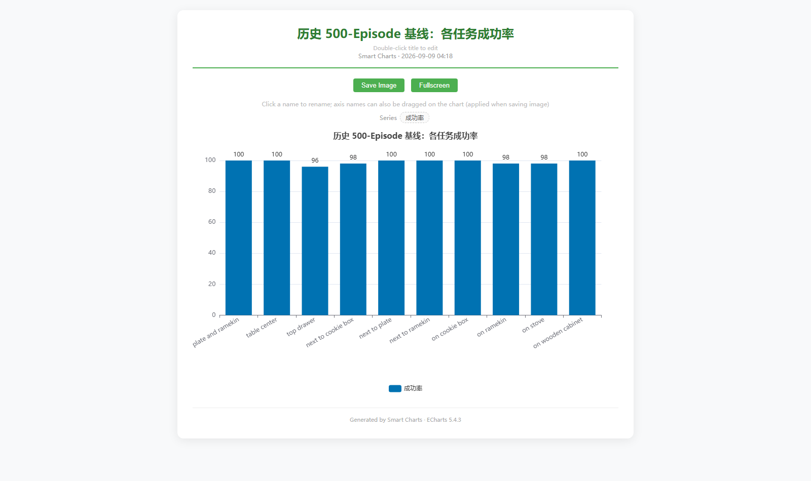
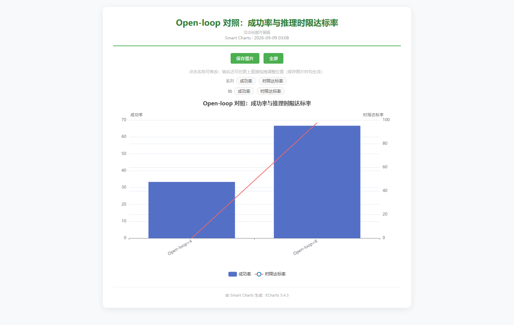
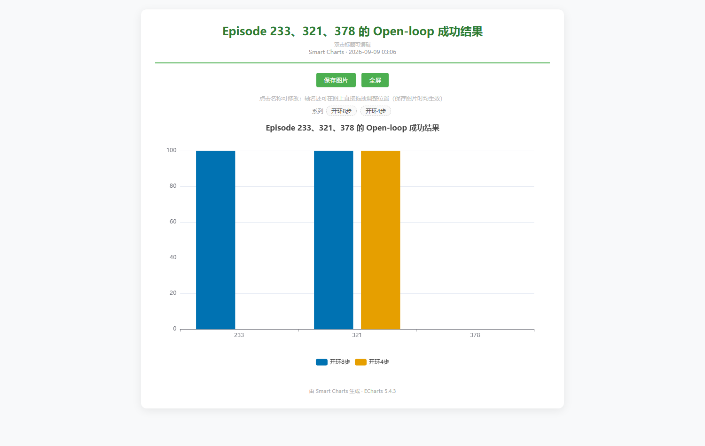
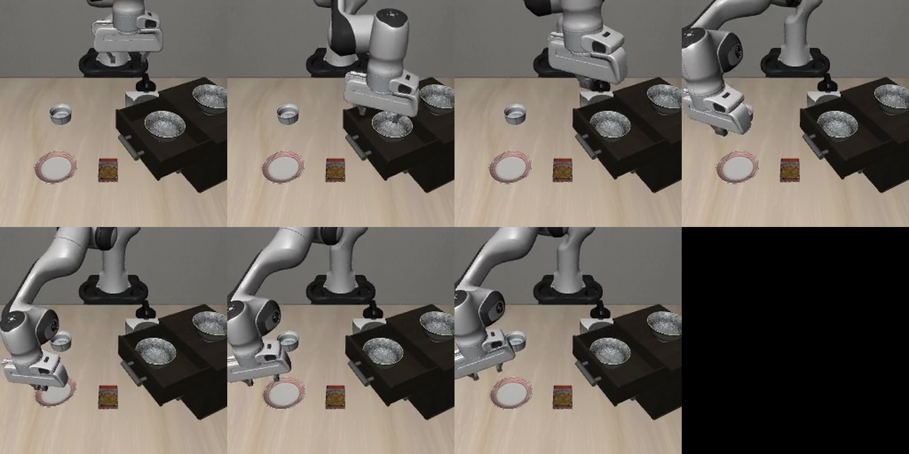
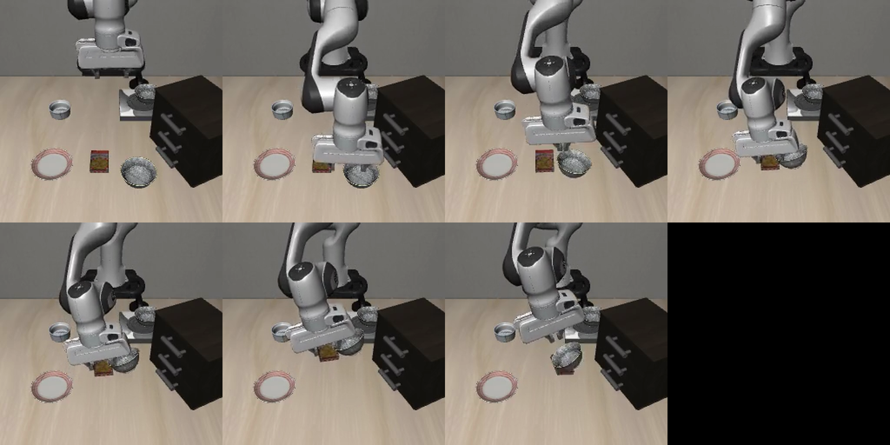
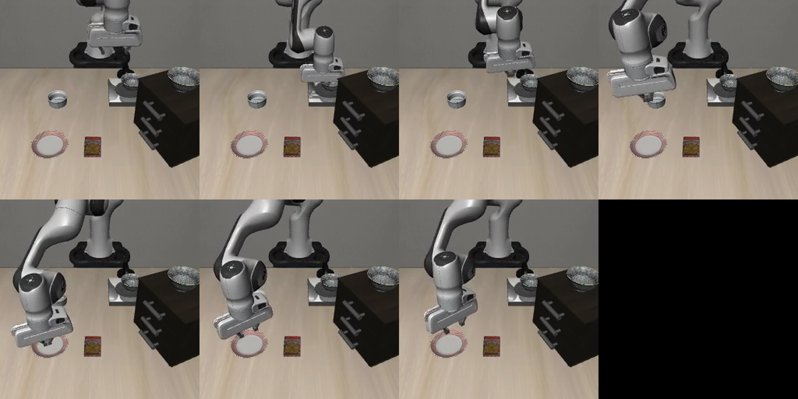
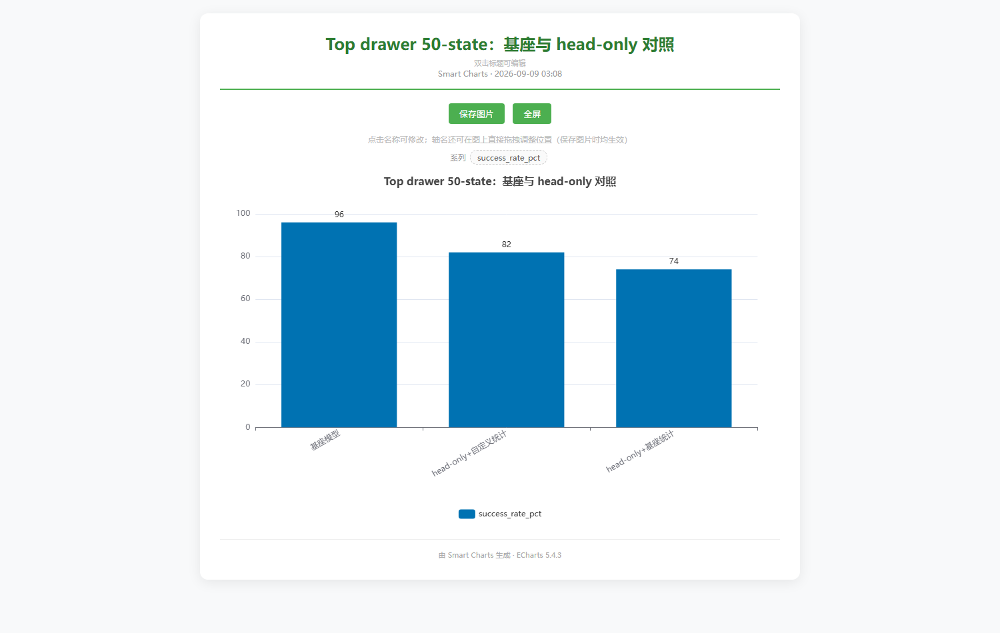
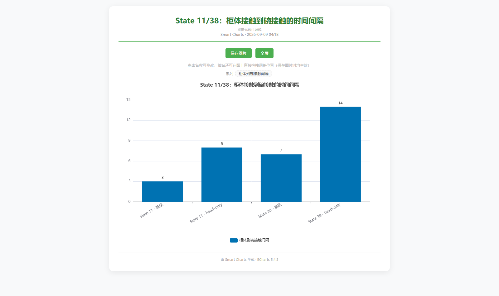
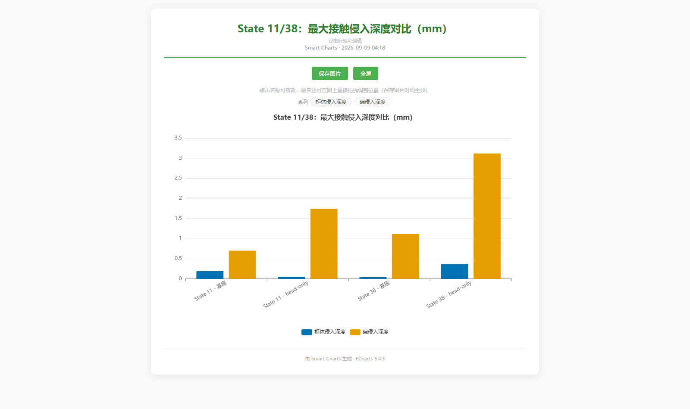

# OpenVLA-OFT 项目全链路技术与实验总结大典

> **权威版本**：2026-09-15 终极定稿版  
> **研究对象**：OpenVLA-OFT LIBERO-Spatial 基座模型、推理时序诊断、微调接触分析、INT8 量化实时性评估与行为教师蒸馏方案  
> **数据口径声明**：全篇以 2026-09-07 物理接触诊断与 2026-09-15 完成的 500-Episode INT8 量化对照实测为最高权威基准；早期历史记录（如 495/500 旧状态、已纠正的 head-only 48/50 误记）已统一勘误并置于对应章节说明。

---

## 目录

- [一、项目执行摘要与全景决策看板](#一项目执行摘要与全景决策看板)
  - [1.1 核心成果与关键量化指标速览](#11-核心成果与关键量化指标速览)
  - [1.2 全局工程决策矩阵](#12-全局工程决策矩阵)
- [二、OpenVLA-OFT 算法原理与系统架构](#二openvla-oft-算法原理与系统架构)
  - [2.1 模型架构与三阶段数据流](#21-模型架构与三阶段数据流)
  - [2.2 OFT 并行动作头与 Action Chunking 时序](#22-oft-并行动作头与-action-chunking-时序)
  - [2.3 动作归一化统计量的生命周期](#23-动作归一化统计量的生命周期)
- [三、云端运行环境与工程基线锁定](#三云端运行环境与工程基线锁定)
  - [3.1 核心依赖与版本清单](#31-核心依赖与版本清单)
  - [3.2 四条核心工程红线](#32-四条核心工程红线)
- [四、专家数据流与 HDF5→TFDS/RLDS 转换体系](#四专家数据流与-hdf5tfdsrlds-转换体系)
  - [4.1 官方专家数据完整性校验](#41-官方专家数据完整性校验)
  - [4.2 RLDS 数据集构建与格式转换](#42-rlds-数据集构建与格式转换)
- [五、基座模型基线评测与失败案例解构](#五基座模型基线评测与失败案例解构)
  - [5.1 历史 500-Episode 基座基线](#51-历史-500-episode-基座基线)
  - [5.2 5 大典型失败样本与可见模式](#52-5-大典型失败样本与可见模式)
  - [5.3 当前实例 Top Drawer 50-State 权威对照](#53-当前实例-top-drawer-50-state-权威对照)
- [六、推理侧机制诊断与时序分析](#六推理侧机制诊断与时序分析)
  - [6.1 Open-loop 8 → 4 消融：实时性断崖](#61-open-loop-8--4-消融实时性断崖)
  - [6.2 Action-Chunk 边界定位与首次闭合出队](#62-action-chunk-边界定位与首次闭合出队)
  - [6.3 腕部相机权重与空抓清空队列重规划](#63-腕部相机权重与空抓清空队列重规划)
  - [6.4 典型失败轨迹关键帧解剖](#64-典型失败轨迹关键帧解剖)
- [七、训练侧微调实验与物理接触层分析](#七训练侧微调实验与物理接触层分析)
  - [7.1 Top Drawer 50-State 微调对照表](#71-top-drawer-50-state-微调对照表)
  - [7.2 上游编码器与 Action Head 漂移证据（Hidden State 逐位比对）](#72-上游编码器与-action-head-漂移证据hidden-state-逐位比对)
  - [7.3 MuJoCo 接触时序与侵入深度分析（State 11 & State 38）](#73-mujoco-接触时序与侵入深度分析state-11--state-38)
- [八、进阶实验一：INT8 量化对照与实时性评测（2026-09-15 实测）](#八进阶实验一int8-量化对照与实时性评测2026-09-15-实测)
  - [8.1 500-Episode 严格配对实验设计](#81-500-episode-严格配对实验设计)
  - [8.2 G0~G5 六门逐项验收结论](#82-g0g5-六门逐项验收结论)
  - [8.3 G1 覆盖审计深度解密：主干+视觉编码器双量化](#83-g1-覆盖审计深度解密主干视觉编码器双量化)
  - [8.4 为什么 Deadline 达标率为 0.0%（实时性失效根因）](#84-为什么-deadline-达标率为-00实时性失效根因)
  - [8.5 4 个回退样本（Regressions）物理归因体系](#85-4-个回退样本regressions物理归因体系)
- [九、进阶实验二：基座教师行为蒸馏方案](#九进阶实验二基座教师行为蒸馏方案)
  - [9.1 保守单任务微调哲学](#91-保守单任务微调哲学)
  - [9.2 架构冻结与参数保护铁律](#92-架构冻结与参数保护铁律)
  - [9.3 跨坐标系损失对齐与双门验收体系](#93-跨坐标系损失对齐与双门验收体系)
- [十、全链路工程排障与避坑全典](#十全链路工程排障与避坑全典)
- [十一、全工作区资产导航与索引矩阵](#十一全工作区资产导航与索引矩阵)

---

## 一、项目执行摘要与全景决策看板

### 1.1 核心成果与关键量化指标速览

本项目围绕具身智能基础模型 **OpenVLA-OFT**（7B 参数量，融合 SigLIP、DinoV2 与 Llama-2，搭载 OFT 并行动作头），在官方标准测试基准 **LIBERO-Spatial** 上完成了从环境构建、评测复现、失败机制定位、数据流对齐、全量/局部微调、物理接触动力学分析，到 500 轮 INT8 量化实测及行为蒸馏方案制定的全生命周期闭环。

```mermaid
flowchart TD
    subgraph 阶段一：基座与环境
        A[环境搭建与版本锁死] --> B[500-Episode 基座评测: 99.0%]
        B --> C[定位 5 个典型失败案例]
    end
    subgraph 阶段二：推理与微调诊断
        C --> D[推理时序消融: Open-loop/权重/重规划]
        C --> E[微调实验: 全量LoRA/Head-only退化]
        D --> F[物理接触诊断: 动作头局部漂移根因]
        E --> F
    end
    subgraph 阶段三：前沿进阶验证
        F --> G[INT8量化500轮实测: 显存-41.2% / 实时性失效]
        F --> H[基座教师蒸馏方案: 冻结前置+仅微调末层位姿]
        F --> I[算法原理与推理架构图解归纳]
    end
```

| 评估维度 | 核心结论与关键指标 | 状态与权威口径 |
|---|---|---|
| **基座全局性能** | 10 个任务 × 50 初始状态 = 500 episodes，成功 **495/500（99.0%）**；6 个任务满分 100%。 | ✅ 权威基线 |
| **Top Drawer 基线** | 基座在最难任务 Top Drawer 上 50-state 成功 **48/50（96.0%）**；失败仅 State 29、32（多 seed 测试中 5/5 成功，非必败死局）。 | ✅ 权威基线 |
| **微调与 LoRA 尝试** | 单任务全量 LoRA（rank 32, 500 steps）定向失败；Head-only 单任务统计为 **41/50（82%）**，基座统计为 **37/50（74%）**，均未超越基座。 | ❌ 未达预期，已回滚 |
| **故障定位与归因** | 上游 hidden states 逐位完全一致（绝对差 0，余弦相似度 0.999988）；退化完全出在 action head 早期微小动作偏移累积，引发接近轨迹与接触几何失控。 | ✅ 物理证实（否定模型理解错误） |
| **推理时序机制** | Open-loop 8→4 无成功增益（2/3→1/3），且推理预算减半至 200 ms 导致 deadline 达标率跌为 **0%**；首次闭合在 chunk 内部；单纯重规划无效。 | ✅ 证实控制闭环缺陷 |
| **INT8 量化收益 (9-15)** | 500 episode 对照：峰值显存从 15839 MiB 降至 9315 MiB，**净降 6524 MiB（−41.2%）**；任务成功率 99.2% → 98.8%（微损 0.4 pp，落入 ≤1.0 pp 噪声门槛）。 | ✅ 显存收益达成 / 任务能力无损 |
| **INT8 实时性代价 (9-15)** | 平均延迟由 217.24 ms 暴增至 555.49 ms（慢 2.56 倍）；400 ms **deadline 达标率 98.4% → 0.0%**；动作产出 14.4 FPS 无法喂饱 20 Hz 控制。 | ❌ **实时性彻底失效，不支持在线控制** |
| **量化路径审计 (G1)** | 436 个 `Linear8bitLt`，1 个普通 `nn.Linear`（末端动作投影），覆盖率 **99.8%**；覆盖视觉塔(209)、LLM(224)、投影器(3)。 | ✅ 实测确证“主干+视觉均被量化” |
| **行为蒸馏方案** | 制定单任务行为蒸馏规范：在线基座教师指导、仅更新学生最后一层前 6 维位姿、夹爪强冻结、反归一化对齐基座统计空间。 | 📋 方案定稿待执行 |

---

### 1.2 全局工程决策矩阵

基于全工作区的一致实验数据，沉淀出以下**不可逾越的决策红线**：

```text
┌──────────────────────────────────────────────────────────────────────────────────┐
│                             OpenVLA-OFT 核心决策矩阵                             │
├──────────────────────────────────────────────────────────────────────────────────┤
│ 1. 基线选择：任何场景必须以未微调的基座模型作为基准，禁止使用已退化的 head-only 或 LoRA。 │
│ 2. 控制参数：必须维持 Open-loop=8 与 20 Hz；绝对不可盲目缩短为 4 步或推升至 50 Hz。      │
│ 3. 量化定位：INT8 仅作“低显存离线评测”方案，严禁用于需要闭环实时响应的物理或仿真控制。   │
│ 4. 归因原则：失败分析严禁默认推卸给“大模型语言理解崩溃”；优先排查抓取几何与接触时序。   │
│ 5. 微调红线：禁止在单任务窄分布上微调全量参数；后续必须结合基座数据 Replay 并锚定夹爪。 │
└──────────────────────────────────────────────────────────────────────────────────┘
```

---

## 二、OpenVLA-OFT 算法原理与系统架构

### 2.1 模型架构与三阶段数据流

OpenVLA-OFT 是专为高频机械臂控制设计的端到端视觉-语言-动作（VLA）模型。其核心数据流由三大部分构成：

```mermaid
graph TD
    subgraph 阶段一：多模态输入与预处理
        A[主视角 RGB: 256x256] --> D[SigLIP 视觉塔: patch=14]
        B[腕部视角 RGB: 256x256] --> E[DinoV2 视觉塔: patch=14]
        C[自然语言指令 Token] --> F[Embedding 查找: 32000词表]
        G[8维 Proprio 本体系本体感] --> H[2层 MLP 投影器: 8D -> 4096D]
    end

    subgraph 阶段二：Prismatic VLA 骨干网络
        D & E --> I[多模态拼接 Projector]
        I & F & H --> J[Llama-2 7B Decoder-only 骨干: 32层 Transformer]
        J --> K[输出序列末端 Hidden States: 1, 56, 4096]
    end

    subgraph 阶段三：OFT 并行动作头与时序控制
        K --> L[OFT MLP Action Head: 4096 -> 1024 -> 512 -> 7]
        L --> M[预测未来 8 步 7D 动作块: 8x7 矩阵]
        M --> N[反归一化: libero_spatial_no_noops q01/q99]
        N --> O[机器人控制器: 20 Hz 下开环执行 8 步]
    end
```

1. **多模态输入编码**：
   - 双路图像（Agentview 与 Wristview）分别通过双视觉编码器（SigLIP 捕获语义特征，DinoV2 捕获高频几何细粒度空间特征）提取密集特征，并映射至 4096 维嵌入空间。
   - 语言指令经 Llama Tokenizer 处理，拼接在视觉 Patch Token 之后。
   - 8 维 Proprio（末端 6 自由度位姿 + 2 维夹爪开度）通过专用 MLP 映射到相同维度。
2. **骨干推理**：
   - 统一由 Llama-2 7B 架构进行全局自注意力融合。
3. **输出映射**：
   - 模型在序列末尾输出 $56$ 个 Action Token 位置的 Hidden States（形状为 `(1, 56, 4096)`）。

---

### 2.2 OFT 并行动作头与 Action Chunking 时序

传统自回归 VLA 模型（如原始 OpenVLA）单次推理只能自回归吐出单个离散化的动作 Token，控制频率受限于 LLM 生成延迟（通常仅 3~5 Hz）。**OFT（Optical Flow / Parallel Action Tokenization）** 通过连续 L1 回归动作头实现了并行动作预测：

- **动作块结构（Action Chunk）**：每次模型推理前向传播一次，直接并行回归输出连续的 $H = 8$ 个动作步，每个动作步为 7 维向量：
  $$\mathbf{a}_t = [\Delta x, \Delta y, \Delta z, \Delta \text{roll}, \Delta \text{pitch}, \Delta \text{yaw}, \text{gripper}]$$
- **时间预算（Timing Budget）**：
  在系统设定的 $20\text{ Hz}$ 控制频率下，每个动作步物理执行耗时为 $50\text{ ms}$。因此执行一个包含 8 个动作的 Chunk 具有的时间窗口为：
  $$T_{\text{budget}} = \frac{8}{20\text{ Hz}} = 0.400\text{ s} = 400\text{ ms}$$
  只要模型推理延迟在 $400\text{ ms}$ 以内完成，系统即可在后台异步计算下一个 Chunk，实现物理机械臂的连续不卡顿控制。

---

### 2.3 动作归一化统计量的生命周期

> [!IMPORTANT]
> **归一化统计量是模型权重的不可分割部分。**  
> 动作向量在网络内部是在 $[-1, 1]$ 归一化空间中学习与回归的；送入物理或仿真环境前，必须通过严格对应的分位数统计量（第 1 百分位数 $q_{01}$ 与第 99 百分位数 $q_{99}$）进行反归一化。

本项目排查出的核心陷阱是：微调模型如果在训练集单任务统计（如仅包含 50 条 top drawer 轨迹的窄数据）上进行归一化，而在评估时错误调用了基座多任务全量统计 `libero_spatial_no_noops`，反归一化公式就会产生严重尺度偏移，导致夹爪动作异常，甚至发生评测彻底崩溃。

---

## 三、云端运行环境与工程基线锁定

### 3.1 核心依赖与版本清单

在云端（阿里云 PAI-DSW / 魔搭 A10 24G 实例）经过严格多轮排查，最终锁定的权威兼容环境清单如下：

| 依赖包 | 锁定版本 | 核心作用与锁死原因 |
|---|---|---|
| **Python** | `3.10.14` | 基础运行时环境，严格匹配 flash-attn 预编译 wheel |
| **PyTorch** | `2.2.0+cu121`（推理兼容 2.3.1） | CUDA 12.1 运行时，严禁随意升级至导致 ABI 破坏的版本 |
| **NumPy** | **`1.26.4`**（严禁 2.x） | **高危红线**：NumPy 2.x 会导致 C-API 不兼容，引起底层 umath 崩溃 |
| **opencv-python-headless** | `4.9.0.80` | 无显示器无头服务端必备；禁止安装 GUI 版本或 5.x（其依赖 numpy>=2） |
| **protobuf** | **`4.25.3`** | 兼容 TF 2.15 与 wandb；5.x 会引起 gencode runtime 不兼容 |
| **tensorflow-cpu** | `2.15.0` | 仅作为 RLDS 数据管道读取器引入，不参与 GPU 训练 |
| **tensorflow-metadata** | **`1.15.0`** | 锁死旧版 gencode，避免 `cannot import name runtime_version` 异常 |
| **transformers** | `moojink fork`（或走 remote code）| 依赖 checkpoint 自带的 `modeling_prismatic.py`（走 trust_remote_code） |
| **robosuite** | `1.4.1` | 机器人仿真基准 |
| **mujoco** | **`3.3.2`** | 3.4+ 版本会与 robosuite 内部断言冲突 |
| **bitsandbytes** | `0.43.3`（或 0.43.2） | INT8 量化核心运行时 |

---

### 3.2 四条核心工程红线

1. **依赖安装必须隔离**：所有拉取 protobuf 间接依赖的包（`tfds`、`tensorflow-metadata`、`dlimp`）一律加 `--no-deps` 安装，严禁触发 pip 级联升级破坏 NumPy 和 Torch。
2. **源码引用通过 PYTHONPATH**：OpenVLA-OFT 与 LIBERO 源码不可采用 `pip install -e .` 安装（存在导入混乱风险），统一使用：
   ```bash
   export PYTHONPATH="/mnt/workspace/openvla-oft:/mnt/workspace/LIBERO:${PYTHONPATH}"
   ```
3. **渲染配置**：无显表服务器使用 OSMesa 进行离线渲染，确保 rollout MP4 视频正确录制与导出。
4. **持久化与清理**：环境与权重均位于 `/mnt/workspace`，单次微调产生的 15 GiB 完整模型应及时转换为仅保留 adapter/head 的轻量权重，避免磁盘利用率超过 94% 触发系统 OOM 封死。

---

## 四、专家数据流与 HDF5→TFDS/RLDS 转换体系

### 4.1 官方专家数据完整性校验

针对最关键的困难任务 `pick up the black bowl in the top drawer of the wooden cabinet and place it on the plate`，下载并对官方专家轨迹 HDF5 进行结构校验：

- **轨迹数量**：50 条高质量专家示教轨迹。
- **转移总数**：7,479 个 transitions（单条长度 127~190 步）。
- **观测空间**：双路 $128 \times 128 \times 3$ RGB（Agentview 与 Wristview），8 维 Proprio。
- **动作空间**：$(T, 7)$ 浮点矩阵，位置移动与旋转平滑，包含明确的夹爪开合信号（HDF5 中约定 $-1$ 为开，$+1$ 为关）。
- **结论**：官方示教数据结构严谨、物理量完整，**排除了“数据本身损坏”这一假设**。

---

### 4.2 RLDS 数据集构建与格式转换

针对 OpenVLA-OFT 训练流程，完成从 HDF5 到 TensorFlow Datasets / RLDS 格式的标准转换：

- **数据集命名**：`libero_spatial_top_drawer`，版本 `1.0.0`。
- **分片与规模**：生成 8 个 TFRecord shards，总磁盘占用约 640 MiB。
- **图像转换**：统一解码为 $256 \times 256$ 无损 RGB。
- **字段映射**：每个 step 严格固化 7D action、8D state、双视角帧、语言指令字符串及 RLDS `is_terminal` / `is_last` 标志。

---

## 五、基座模型基线评测与失败案例解构

### 5.1 历史 500-Episode 基座基线

在 LIBERO-Spatial 基准的 10 个任务套件上（每个任务 50 个初始状态，共 500 次评估），基座模型交出了优异答卷：



| 任务场景 | 成功数 | 成功率 | 失败数 | 典型困难状态 |
|---|---:|---:|---:|---|
| between plate and ramekin | 50/50 | 100% | 0 | — |
| table center | 50/50 | 100% | 0 | — |
| **top drawer** | **48/50** | **96%** | **2** | **State 29, 32** |
| next to cookie box | 49/50 | 98% | 1 | State 20 |
| next to plate | 50/50 | 100% | 0 | — |
| next to ramekin | 50/50 | 100% | 0 | — |
| on cookie box | 50/50 | 100% | 0 | — |
| on ramekin | 49/50 | 98% | 1 | State 35 |
| on stove | 49/50 | 98% | 1 | State 27 |
| on wooden cabinet | 50/50 | 100% | 0 | — |
| **全集总计** | **495/500** | **99.0%** | **5** | 全局 Episode: 230, 233, 286, 321, 378 |

> **关键判读**：10 个任务中有 6 个取得 100% 满分。所有的 5 次失败**全部发生在抓取阶段（Grasp Phase）**，且集中于空间受限（如抽屉内部）、紧邻干涉障碍物或需要精确抬升的场景。这表明基座具备完备的全局宏观任务理解，失败是纯粹的**局部末端几何控制精度不足**。

---

### 5.2 5 大典型失败样本与可见模式

| 全局 Episode | 映射任务与状态 | 任务场景 | 视频可见物理失败模式 |
|---:|---|---|---|
| **230** | Task 4 / State 29 | top drawer | 夹爪探入狭窄抽屉腔体后产生碰撞卡滞，未形成对碗的双指稳定包络 |
| **233** | Task 4 / State 32 | top drawer | 空抓（Grasp Miss），黑碗留于抽屉内，夹爪闭合后仍继续执行空载转移轨迹 |
| **286** | Task 5 / State 35 | on ramekin | 夹爪接近高度过低，抓取目标碗时连带铲起下方的 ramekin 支撑物 |
| **321** | Task 6 / State 20 | next to cookie box | 抓取退化为单侧推挤，黑碗位移后策略未做新观测重新定位，持续将碗推向饼干盒 |
| **378** | Task 7 / State 27 | on stove | 在炉灶表面发生空抓，末端闭合并径直移向盘子上方执行放置动作 |

---

### 5.3 当前实例 Top Drawer 50-State 权威对照

在迁移后的 GPU 实例上对最核心的 Task 4（Top Drawer）进行严密重测，彻底理清了早期历史混淆：

| 评估对象 | 成功数 | 成功率 | 核心判定与说明 |
|---|---:|---:|---|
| **基座模型（权威基线）** | **48/50** | **96.0%** | 50 个状态中仅 State 29、32 失败 |
| **基座模型（State 29 多 seed）** | **5/5** | **100%** | 更换 5 个不同 seed 全过，否定了“State 29 必败死局”的旧假说 |
| **基座模型（State 32 多 seed）** | **5/5** | **100%** | 表现为对轨迹随机波动微小敏感，而非能力不可达 |

---

## 六、推理侧机制诊断与时序分析

### 6.1 Open-loop 8 → 4 消融：实时性断崖

提出猜想：“如果模型把 8 步缩短为 4 步执行，每次只走前 4 步并提前重规划，是否能纠正漂移？”

对 233、321、378 三个定向难例进行消融对比：





| Episode | Open-loop=8 结果 | Open-loop=4 结果 | 首次闭合步数 (8 vs 4) | Deadline 达标率 (8 vs 4) |
|---:|---|---|---|---|
| 233 | 成功 | **失败** | c5/a1 → c10/a3 | 93.3% → **0.0%** |
| 321 | 成功 | 成功 | c6/a1 → c12/a1 | 100% → **0.0%** |
| 378 | 失败 | 失败 | c4/a6 → c10/a1 | 100% → **0.0%** |
| **综合指标** | **2/3 (66.7%)** | **1/3 (33.3%)** | 时机极其接近 | **97.8% → 0.0%** |

> [!CAUTION]
> **消融定论**：
> 1. **成功率零收益**：缩短 chunk 并没有救回任何既有失败。
> 2. **实时性全面瓦解**：在 20 Hz 控制下，`Open-loop=4` 将推理时间预算从 $400\text{ ms}$ 腰斩至 $200\text{ ms}$。当前 A10 上的推理延迟约为 $217\text{ ms}$，因此 **$200\text{ ms}$ 预算达标率直接归零（0.0%）**。物理系统无法满足实时闭环。

---

### 6.2 Action-Chunk 边界定位与首次闭合出队

提取 233 和 378 的具体控制时序，检查动作输出序列：

| Episode | 首次夹爪闭合动作位置 | 闭合后该 Chunk 剩余待执行动作数 | 是否位于 Chunk 边界 |
|---:|---|---:|---|
| **233** | Chunk 5 / Action 1 | 6 个动作步 | **否（位于 Chunk 内部）** |
| **378** | Chunk 4 / Action 6 | 1 个动作步 | **否（位于 Chunk 内部）** |

两次闭合均发生在 Chunk 中部。这解释了为何“在 Chunk 边界处检查抓取”无济于事：当 Chunk 执行完时，机械臂早已带着空夹爪移动了数个动作步，物理构型已被破坏。

**闭环改进方案**：
必须构建状态机：在动作出队并触发闭合指令的瞬间立刻挂起队列，执行双指接触与力矩检查；若检测为空抓，立即强制张开、重新获取视觉观察并允许有限重试（最多 3 次）。

---

### 6.3 腕部相机权重与空抓清空队列重规划

- **腕部相机权重消融（1.0 → 1.25）**：
  在 Episode 230（抽屉）与 286（ramekin）上测试，成功率维持 1/2 不变。Dump 腕部图像显示输入清晰、特征无异常。证明核心瓶颈不在于视场权重分配。
- **清空队列并强制重规划（Flush & Replan）**：
  在 Episode 230 上测试，系统触发了 **19 次空抓检测与强制重规划**，但最终仍然失败。夹爪与黑碗的物理距离从初次的 $0.129\text{ m}$ 持续扩大到 $0.389\text{ m}$。这证明**盲目的重新推理无法跳出局部极小值**，策略在没有物理后退机制下只会重复同一类失败动作。

---

### 6.4 典型失败轨迹关键帧解剖

#### Episode 233：抽屉空抓后径直执行转移

*夹爪伸入抽屉抓取黑碗时略有偏差，黑碗滞留原位；空夹爪随后抬起并移动到盘子上方执行放置轨迹。*

#### Episode 321：抓取退化为侧向推移

*夹爪自侧边接触碗体，未形成对称夹持，碗被持续推向旁侧障碍物，系统未作重定位。*

#### Episode 378：炉灶空抓

*夹爪在炉灶上方闭合，黑碗未被抬起，策略在 transfer 阶段无视空载状态继续前进。*

---

## 七、训练侧微调实验与物理接触层分析

### 7.1 Top Drawer 50-State 微调对照表

对官方 50 条专家轨迹开展全量 LoRA 及两种 Head-only 微调实验，并在当前实例的 Top Drawer 50 个初始状态上进行严格对照：



| 候选模型 | 成功数 | 成功率 | 失败状态集合 | 判定与结论 |
|---|---:|---:|---|---|
| **基座模型（权威基准）** | **48/50** | **96.0%** | State 29, 32 | 保持最稳固性能 |
| **Head-only（单任务自定义统计）**| 41/50 | 82.0% | 5, 6, 11, 15, 17, 30, 35, 38, 45 | 性能发生明显退化 |
| **Head-only（基座多任务全局统计）**| 37/50 | 74.0% | 3, 5, 6, 10, 11, 28, 29, 33, 36, 38, 40, 42, 44 | 退化进一步加剧 |
| **全量 LoRA（500 steps, rank 32）**| 0/5 | 0.0% | 定向测试状态全部失败 | 破坏了全局特征泛化 |

---

### 7.2 上游编码器与 Action Head 漂移证据（Hidden State 逐位比对）

为查明 Head-only 退化的本质，在完全相同的多模态输入下，对基座模型与 Head-only 微调模型的内部张量进行逐层差分提取：

| 校验位置 | 基座模型 | Head-only 微调模型 | 差分结果 |
|---|---|---|---|
| **Token 输出 Hidden State 形状** | `(1, 56, 4096)` | `(1, 56, 4096)` | 完全对齐 |
| **Hidden State 最大绝对差（Max Diff）** | — | — | **0.000000** |
| **Hidden State 平均绝对差（Mean Diff）**| — | — | **0.000000** |
| **余弦相似度（Cosine Similarity）** | — | — | **0.999988** |
| **动作头（Action Head）输出差分** | — | — | **在第 1 步平移维产生 0.047 偏差** |

> **关键物理推论**：
> 这一张量级实验**彻底排除了“微调破坏了视觉编码器或语言理解”的假说**。上游特征分毫不差，所有退化都源于 Action Head 最后一层 MLP 参数在窄数据上的过拟合偏移。

---

### 7.3 MuJoCo 接触时序与侵入深度分析（State 11 & State 38）

通过递归遍历 MuJoCo 物理引擎的 `geom` 与 `body` 碰撞树，对基座（成功）与 Head-only（失败）在 State 11 与 State 38 进行碰撞动力学全解析：





| 接触动力学指标 | State 11 (基座) | State 11 (Head-only) | State 38 (基座) | State 38 (Head-only) |
|---|---:|---:|---:|---:|
| **首次接触柜体时间步** | Step 55 | Step 57 | Step 58 | Step 60 |
| **首次接触黑碗时间步** | Step 58 | Step 65 | Step 65 | Step 74 |
| **柜体碰触至碰碗时延** | **3 步** | **8 步（2.67倍）** | **7 步** | **14 步（2.00倍）** |
| **柜体接触记录点数** | 9 次 | 9 次 | 5 次 | **14 次（2.8倍）** |
| **柜体最大侵入深度** | 0.194 mm | 0.047 mm | 0.035 mm | **0.372 mm（10.6倍）** |
| **黑碗最大侵入深度** | 0.699 mm | **1.737 mm（2.49倍）**| 1.111 mm | **3.118 mm（2.81倍）** |

#### 接触分析核心结论
1. **否定碰柜必败假说**：基座成功轨迹同样会在接近碗体前与抽屉柜体发生轻微弹触，因此“是否接触柜体”不能作为二元失败准则。
2. **时延与轨迹偏移是本质**：微调后模型在抽屉内行动犹豫，碰柜到碰碗时间拉长 2~2.67 倍。
3. **侵入过深引发推击**：Head-only 对碗的最大物理侵入深度增加了近 3 倍（State 38 达到 3.12 mm），表明夹爪不是优雅包络，而是产生猛烈冲撞推挤，导致黑碗移位失效。

---

## 八、进阶实验一：INT8 量化对照与实时性评测（2026-09-15 实测）

### 8.1 500-Episode 严格配对实验设计

为验证模型能否在边缘或消费级显卡上运行，实施了严格配对的 INT8 量化实测。

- **测试规模**：完整 LIBERO-Spatial（10 任务 × 50 状态 = 500 Episodes × 2 组配对）。
- **运行环境**：NVIDIA A10 (24GB)，`run_tag: int8-full-20260915-104513`，同环境、同 seed (7)、同 state 顺序。
- **配置对照**：BF16 Baseline 对照组 vs. `load_in_8bit=True` 处理组（动作头与投影器保留 BF16）。

---

### 8.2 G0~G5 六门逐项验收结论

| 验收门禁 | 门禁内容与要求 | 实测关键数值 | 判定结果 |
|---|---|---|---|
| **G0** | 独立运行环境隔离 | Python 3.10.14 / Torch 2.3.1 / A10 纯净显存 | ✅ **通过** |
| **G1** | 量化路径功能审计 | 436 个 `Linear8bitLt`，线性层覆盖率 **99.8%**，主干与视觉均量化 | ✅ **通过** |
| **G2** | 性能与实时控制达标 | 延迟 Speedup **0.391×**（慢 2.56 倍）；Deadline 达标率 **0.0%** | ❌ **未通过** |
| **G3** | 峰值显存降幅达成 | 显存从 15839 降至 9315 MiB，**净降 6524 MiB（−41.2%）** | ✅ **通过** |
| **G4** | 任务成功率无损 | 成功率损失 **+0.4 pp**（99.2% → 98.8%），落在 ≤1.0 pp 门槛内 | ✅ **通过** |
| **G5** | 实验配对可复现性 | 配置严格配对一致；已排查 transformers remote code 真实执行 | ✅ **通过** |
| **综合** | — | 显存与任务能力达标，但实时闭环彻底不达标 | ❌ **未通过 (G2未过)** |

---

### 8.3 G1 覆盖审计深度解密：主干+视觉编码器双量化

运行专用审计脚本 `audit_int8_coverage.py` 得到确切的层级解剖：

```text
Linear8bitLt（被量化）  : 436 层
普通 nn.Linear（未量化）: 1 层
线性层总计              : 437 层  →  量化覆盖率 99.8%

按顶层模块归组分布:
  language_model  : 224 层 (Llama-2 7B 核心投影与前馈)
  vision_backbone : 209 层 (SigLIP 与 DinoV2 视觉塔内部全部密集线性层)
  projector       : 3 层
  action_head     : 保持 torch.bfloat16 (16 项)
  proprio_proj    : 保持 torch.bfloat16 (4 项)
```

> [!IMPORTANT]
> **覆盖审计带来的认知升级**：
> 1. 证实 bitsandbytes 的 `load_in_8bit` 将 **视觉编码器（209 层）** 与语言主干一并量化。
> 2. 显存下降的 6524 MiB 并非由 LLM 单独贡献，其中视觉塔贡献了约 1.5 GiB 显存缩减。
> 3. 唯一的未量化层是末端动作输出投影，符合确保动作连续回归精度的原始架构意图。

---

### 8.4 为什么 Deadline 达标率为 0.0%（实时性失效根因）

| 延迟与吞吐指标 | BF16 Baseline 组 | INT8-Mixed 处理组 | 变化量与增幅 |
|---|---:|---:|---:|
| **有效样本数（去前3 warmup）**| 6583 chunks | 6612 chunks | — |
| **平均延迟（Mean Latency）** | **217.24 ms** | **555.49 ms** | **+338.25 ms（慢 2.56 倍）** |
| **中位数延迟（P50 Latency）** | 205.76 ms | 545.11 ms | +339.35 ms（+164.9%） |
| **P95 尾部延迟** | 278.57 ms | 616.43 ms | +337.86 ms（+121.3%） |
| **Policy Query FPS** | 4.60 次/秒 | 1.80 次/秒 | −60.9% |
| **动作产出吞吐（8/chunk）** | **36.82 FPS** | **14.40 FPS** | **无法满足 20 Hz 控制需求** |
| **Chunk Deadline 达标率** | **98.4%** | **0.0%** | **结构性无法满足** |

**物理瓶颈剖析**：
BitsAndBytes 的 `LLM.int8()` 是为 batch 推理节省显存设计的“Weight-only 动态反量化 + 离群值混合精度分解”算法。在 VLA 这种 batch=1 的低延迟在线控制场景下，每步推理必须反复进行矩阵反量化和显存搬运，算子开销远大于矩阵乘法本身。因此：
$$\text{Speedup} = \frac{217.24\text{ ms}}{555.49\text{ ms}} = 0.391\times$$
它成功实现了**省显存**，但代价是**失去了实时控制能力**。

---

### 8.5 4 个回退样本（Regressions）物理归因体系

在 500 个 episode 中，INT8 与 BF16 的胜负矩阵如下：
- **共同成功**：492 例
- **共同失败**：2 例（任务客观超高难度）
- **INT8 独赢（BF16 败，INT8 胜）**：2 例（属于统计噪声涨落）
- **INT8 回退（BF16 胜，INT8 败）**：**4 例**

通过开发专用的回退分析器 `analyze_regressions.py`，避开上游字段假设错误（真实字段为 `executed_control_steps`，无 `total_reward`），锁定了六大物理分类依据：

| 回退样本分类 | 观测判据 | 潜在技术指向 |
|---|---|---|
| **极早失败** | `executed_control_steps` 远少于 BF16（≤35%） | 动作数值累积偏差导致机械臂过早碰撞出界 |
| **反复尝试后失败** | 执行步数显著多于 BF16（≥1.5倍） | 动作微调精度不足导致任务执行犹豫 |
| **同长度失败** | 步数与 BF16 基本相同但最终失败 | **最干净的量化截断误差体现** |
| **抓取重试耗尽** | `grasp_retry_exhausted = True` | 夹爪对阈值触发事件极度敏感 |
| **抓取位移不足** | 闭合后目标位移 $<2\text{ cm}$ | 空抓或夹爪打滑 |
| **全程未闭合夹爪** | `steps.jsonl` 中夹爪指令未发生正负跳变 | **优先怀疑视觉编码器特征退化** |

---

## 九、进阶实验二：基座教师行为蒸馏方案

### 9.1 保守单任务微调哲学

鉴于全量 LoRA 和 Head-only 在单任务微调上破坏全局泛化能力的惨痛教训，制定了严谨的**在线教师蒸馏方案**：
- **服务边界明晰**：生成仅供 Task 4（抽屉抓黑碗）定向调用的候选 Action Head，其他 9 个任务一律保持原装基座权重，确保全局零风险。

---

### 9.2 架构冻结与参数保护铁律

1. **绝对冻结区**：VLA 双视角视觉塔、语言 Transformer、Proprio 投影器全部冻结。
2. **基座在线教师**：基座 Action Head 全冻结作为 Teacher 实时提供前向指导。
3. **极窄学生可训区**：学生 Action Head 从基座逐位深拷贝，**仅更新最后一层线性层的 6 个位姿输出**；对第 7 维夹爪输出的权重与偏置应用梯度掩码，强制零梯度更新。

---

### 9.3 跨坐标系损失对齐与双门验收体系

```text
               ┌─────────────────────────────────────────────────────────┐
               │              RLDS Top-Drawer 数据分布                   │
               └───────────────────────────┬─────────────────────────────┘
                                           │ (先反归一化)
                                           ▼
               ┌─────────────────────────────────────────────────────────┐
               │    统一投射至 libero_spatial_no_noops 全局基座坐标空间     │
               └───────────────────────────┬─────────────────────────────┘
                                           ▼
      ┌────────────────────────────────────┴────────────────────────────────────┐
      ▼                                                                         ▼
┌──────────────┐                                                          ┌──────────────┐
│  专家 L1 损失 │                                                          │ 教师蒸馏损失 │
└──────┬───────┘                                                          └──────┬───────┘
       │                                                                         │
       └───────────────────────────────────┬─────────────────────────────────────┘
                                           ▼
                                综合更新学生动作头参数
```

- **损失对齐**：必须在同一全局物理坐标系下计算学生与教师的均方差/L1 损失，严防坐标系错位。
- **Gate 0 产物验收**：训练步数严格限制在 100 steps 内；位姿层相对权重漂移不得超过 2%；夹爪层权重差值绝对为 0。
- **Gate 1 仿真验收**：6 状态定向抽检：State 5、6、11、38（基座成功项）必须全部保持成功；State 29、32（基座失败项）至少攻克其一。

---

## 十、全链路工程排障与避坑全典

| 阶段 | 典型异常现象 | 核心根因分析 | 标准处理命令与解法 |
|---|---|---|---|
| **环境** | `numpy.core.umath failed` | 依赖被更新至 NumPy 2.x | `pip install --force-reinstall "numpy==1.26.4"` |
| **环境** | `cannot import name runtime_version` | protobuf 与 tf-metadata 冲突 | `pip install --no-deps "protobuf==4.25.3" "tensorflow-metadata==1.15.0"` |
| **环境** | `ModuleNotFoundError: libero` | 新终端未正确初始化 PYTHONPATH | 运行 `source /mnt/workspace/activate_oft.sh` |
| **模型** | 运行成功率直接为 0% | 走进了裸 transformers 建模逻辑 | 确保加载参数包含 `trust_remote_code=True`，核对模型类为 `transformers_modules.` |
| **数据** | TFDS 报 `dataset already registered` | 多重导入 builder 脚本 | 规范单入口导入，清理多余命名空间 |
| **评估** | 推理日志 `deadline_met_rate: 0%` | `num_open_loop_steps` 设为 4 或过小 | 改回默认 `num_open_loop_steps=8`，保证 400 ms 延迟余量 |
| **磁盘** | `No space left on device` (94%+) | 频繁保存 15G 完整合并权重 | 运行清理脚本，仅保留权重中的 action-head 和 LoRA 增量 |
| **动力学** | MuJoCo 解析接触结果全为 0 | 接触 JSON 为多层嵌套对象 | 采用递归解析遍历提取所有 `geom1`/`geom2` 碰撞配对 |
| **量化** | 审计报 `json_numpy` 找不到 | 基础环境缺少依赖 | `python -m pip install --no-deps json-numpy` |
| **量化** | 填充器报 `TypeError: unsupported operand` | 未量化层数为 `—` 字符串强转失败 | 增加安全类型校验，区分未量化标记 |

---

## 十一、全工作区资产导航与索引矩阵

```text
c:\Users\27013\Desktop\oft
├── README.md                          --> 全局项目导航、核心结论速览与运行指引
├── 总结文档.md                         --> 【当前文档】全链路技术与实验总结大典
├── 00-项目文档时间线.md                 --> 2026-08 至 2026-09 全时序研发演进记录
├── OpenVLA-OFT环境搭建与训练方案.md     --> 云端 GPU 部署与早期微调方案原始实录
├── 01-上游源码/                        --> OpenVLA-OFT 与 LIBERO 上游权威源码备份
├── 02-实验代码/                        --> 推理评测、数据生成、环境探针核心脚本
├── 03-补丁/                            --> wandb 可选补丁、SDPA 补丁与环境适配文件
├── 04-评测结果/                        --> 500-Episode 基座评测原始统计、失败标注与视频
├── 05-推理侧分析/                      --> Open-loop 消融、边界检查与 CSV 详细数据
├── 06-文档/                            --> 2026-09-07 阶段权威总结与云端部署细节
├── 07-归档/                            --> 早期基线归档压缩文件与临时日志
├── 08-后续实验验证/                    --> 抓取恢复、位移重定位、频率消融与验收标准
├── 09-行为蒸馏实验/                    --> 在线基座教师行为蒸馏代码与双门验收脚本
├── 10-INT8量化与并行解码教材/          --> INT8 完整量化教程、500轮对照报告与审计工具
└── 11-算法原理与架构图解/              --> 系统架构图、推理时序图与算法详细图解教程
```

---
*全篇完 · OpenVLA-OFT 具身智能研究团队 2026-09-15 联合定稿*
